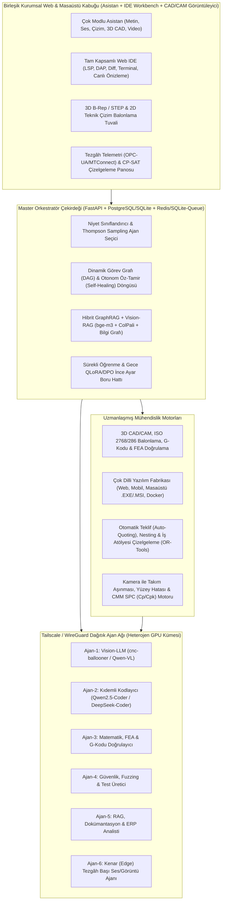

# Dağıtık YZ Yazılım Geliştirme ve CNC Üretim Platformu — Çok Yıllı Kurumsal Master Uygulama Planı (Master Implementation Plan) ve Otonom YZ Mega-Promptu

Bu doküman, mevcut **Dağıtık YZ Yazılım Geliştirme Platformu** (`master/`, `agent/`, `cnc_ballooning.py`, `workspace_builder.py`, `company_rag.py`) çekirdeğini; **tam otonom bir Yazılım Fabrikası (Devin / Antigravity sınıfı)** ve **Uçtan Uca Yapay Zekâ Destekli CNC / CAD-CAM / Kalite / MES Mühendislik İşletim Sistemine** dönüştürmek için hazırlanmış **10 Fazlı (120+ alt modüllü) Master Mühendislik Planı** ve **Otonom YZ Yürütme Mega-Promptu**dur.

---

## Mimari Vizyon ve Hedef Topoloji



---

## BÖLÜM 1: 10 FAZLI KURUMSAL MASTER UYGULAMA PLANI

### FAZ 1: 3D CAD/CAM Geometri Çekirdeği, MBD Balonlama ve Kapalı Çevrim G-Kodu Motoru
Mevcut 2D (`PDF`, `PNG`, `DOCX`, `XLSX`, `DXF`) balonlama motorunu ([master/cnc_ballooning.py](../../master/cnc_ballooning.py)) 3 boyutlu katı model ve gerçek takım yolu (CAM) seviyesine taşır.

1. **Modül 1.1 — 3D B-Rep Katı Model Ayrıştırıcı (`master/cad_kernel.py`)**
   - `pythonocc-core` (OpenCASCADE) ve `ezdxf` entegrasyonu ile `.step`, `.stp`, `.iges`, `.igs`, `.stl`, `.brep` ve `.dxf` dosyalarının tam topolojik analizi (Yüzeyler `TopoDS_Face`, Kenarlar `TopoDS_Edge`, Köşeler `TopoDS_Vertex`).
   - Otomatik **Unsur Tanıma (Automatic Feature Recognition - AFR)**: Silindirik delikler (kör/boydan boya), havşalar, kama kanalları, cepler (açık/kapalı), adalar, faturalar, pahlar, radyüsler, diş adımları ve ince cidarların geometrik graf (`NetworkX`) üzerinden çıkarımı.
2. **Modül 1.2 — 2D-3D Eşleştirme ve Otomatik Görünüş Çıkarma (`master/cad_projection.py`)**
   - 3D `.step` modelinden otomatik 3 görünüş (Ön, Yan, Üst), A-A kesit görünüşü ve izometrik görünüşün gizli çizgilerle (HLR — Hidden Line Removal) vektörel SVG/PDF olarak üretilmesi ve otomatik ölçülendirilip balonlanması.
   - Hem 2D teknik resim PDF'i hem 3D STEP dosyası yüklendiğinde 2D toleransları (`Ø42 H7`, `Ra 0.8`, `⊥ 0.02 A`) 3D modelin ilgili `Face_ID` yüzeylerine bağlayan **MBD (Model-Based Definition) Eşleştirici**.
3. **Modül 1.3 — Çoklu Kontrolör Post-Processor ve Takım Yolu Üretici (`master/cam_postprocessor.py`)**
   - **Desteklenen CNC Kontrolörler**: Fanuc 0i/31i (`G21/G83/G84/G71/G70`), Siemens Sinumerik 840D/One (`CYCLE81`, `CYCLE84`, `CYCLE95`), Heidenhain TNC 640 (`CYCL DEF 200`), Mitsubishi M80 ve Haas NGC.
   - Operasyon bazlı çarpışmasız takım yolu: Alın tornalama, dış/iç çap kaba-finiş çevrimi (`G71/G70`), kanal açma (`G75`), diş çekme (`G76`), 2.5D cep boşaltma (trokoidal frezeleme), delik delme ve rijit kılavuz.
4. **Modül 1.4 — Kesme Kuvveti, Tırlama (Chatter) ve Sehim Simülasyonu (`master/cnc_physics.py`)**
   - Spesifik kesme basıncı ($k_{c1.1}$) üzerinden teğetsel kesme kuvveti ($F_c = k_c \cdot a_p \cdot f_z$), mil torku ($M_c$), harcanan güç ($P_c = \frac{F_c \cdot v_c}{60000}$) ve ince cidar/uzun takım sehimi ($\delta = \frac{F \cdot L^3}{3 E I}$) hesabı.
   - Sehim değeri balonlanan tolerans bandının (`max_limit - min_limit`) %25'ini aştığında otomatik paso düşürme veya destek (punta/lünet) uyarısı.
5. **Modül 1.5 — Kapalı Çevrim CMM / Prob Geri Beslemesi ve Otomatik Ofset Düzeltme (`master/cmm_closed_loop.py`)**
   - Zeiss Calypso, Hexagon PC-DMIS, Mitutoyo MCOSMOS CSV/XML/Q-DAS çıktılarının otomatik okunması.
   - İstatistiksel Proses Kontrolü: $\bar{X}-R$ kontrol kartları, $C_p$, $C_{pk}$, $P_p$, $P_{pk}$ hesabı, Nelson kuralları ile trend tespiti ve takım aşınma kaymasını düzeltmek için CNC tezgâhına gönderilecek `G10 L11` aşınma ofseti (Wear Offset) güncelleme komutunun üretimi.

---

### FAZ 2: Otonom Çok Ajanlı Yazılım Fabrikası ve Tam Kapsamlı Web IDE (Antigravity / Devin Sınıfı)
Mevcut proje üreticiyi ([master/workspace_builder.py](../../master/workspace_builder.py)) 100+ dosyalık çok katmanlı sistemleri sıfırdan kurabilen, test eden ve dağıtan bir mühendislik motoruna dönüştürür.

1. **Modül 2.1 — Çoklu Dil AST Kod Grafı ve Semantik İndeksleyici (`master/code_graph.py`)**
   - `tree-sitter` tabanlı Python, TypeScript/JavaScript, HTML/CSS, SQL, Rust, Go ve C# AST ayrıştırıcısı.
   - Her çalışma alanı için sembol tablosu (sınıflar, fonksiyon imzaları, import bağımlılıkları, REST endpoint kontratları, veritabanı tabloları) çıkaran **Canlı Kod Grafı**; büyük projelerde sadece ilgili bağımlılık alt-grafını LLM bağlamına (`context`) yükler.
2. **Modül 2.2 — Çok Aşamalı Otonom Yazılım Mühendisliği Döngüsü (`master/software_factory.py`)**
   - **Aşama 1 (Sistem Mimarı)**: Veri modeli (ERD), OpenAPI 3.1 şeması, klasör mimarisi ve bağımlılık grafı.
   - **Aşama 2 (Paralel Kodlayıcı Сürüsü)**: Bağımsız modüllerin ağdaki ajanlara paralel dağıtılması.
   - **Aşama 3 (Kontrat & Statik Analiz)**: `ruff`, `mypy`, `eslint`, AST import doğrulaması ve `contract_check.py` kontrolü.
   - **Aşama 4 (Otonom Çalıştırma ve Öz-Tamir Döngüsü — Max 5 İterasyon)**: Üretilen testleri ve sunucuyu izole konteynerde çalıştırır; `Traceback`, `ImportError`, `SQLite OperationalError` veya HTTP 500 loglarını yakalayıp ilgili dosyayı otomatik yamalar.
3. **Modül 2.3 — Başsız Tarayıcı (Playwright) ile Görsel Öz-Doğrulama (`master/visual_verifier.py`)**
   - Üretilen web/e-ticaret uygulamalarını arka planda gerçek Chromium ile açar, ekran görüntüsü alır, konsol (`console.error`) ve kırık ağ isteklerini (`404/500`) yakalar.
   - Ekran görüntüsünü yerel Vision-LLM (`qwen3.5:9b`) modeline göndererek *"Butonlar kaymış mı, kontrast okunaklı mı, sepet çekmecesi açılıyor mu?"* kontrolü yapar ve CSS hatalarını kendi kendine düzeltir.
4. **Modül 2.4 — Çoklu Platform Derleme ve Paketleme Boru Hattı (`master/build_pipelines.py`)**
   - **Windows Masaüstü**: `PyInstaller` tek dosya `.exe`, `Inno Setup` / `NSIS` kurulum sihirbazı (`.msi/.exe`) ve dijital imza.
   - **Web & Full-Stack**: FastAPI + SQLite/PostgreSQL + modern SPA, otomatik `Dockerfile` ve `docker-compose.yml` üretimi.
   - **Mobil & Çapraz Platform**: PWA (Progressive Web App — çevrimdışı çalışan `service-worker.js` + `manifest.json`) ve Capacitor/Tauri yapılandırması.
5. **Modül 2.5 — IDE Workbench: Canlı Terminal, LSP, Git ve Görsel Diff (`master/static/js/assistant.js`)**
   - WebSocket tabanlı etkileşimli kabuk/terminal (`xterm.js` benzeri hafif yerel bileşen).
   - Yan yana (Side-by-Side) ve satır içi (Inline) Diff editörü, yama (hunk) bazlı kabul/ret, otomatik Git commit geçmişi ve dal (branch) yönetimi.

---

### FAZ 3: Dağıtık Heterojen Hesaplama Ağı ve Sürü (Swarm) Orkestrasyonu
Mevcut 6 ajanlı pull mimarisini ([master/selection.py](../../master/selection.py), [master/scheduler.py](../../master/scheduler.py), [agent/agent.py](../../agent/agent.py)) kurumsal ölçekte yüksek hızlı bir GPU kümesine dönüştürür.

1. **Modül 3.1 — Canlı Donanım Telemetrisi ve VRAM Farkındalıklı Çizelgeleyici (`master/cluster_telemetry.py`)**
   - Her ajanın GPU/CPU kullanımını, boş VRAM miktarını, disk hızını, model yükleme durumunu (warm/cold model) ve anlık ` token/sn` hızını 5 saniyede bir raporlaması.
   - Model bellekte yüklüyse (warm cache) bağlam değiştirme maliyetini sıfırlayan **Affinity Routing (Yakınlık Yönlendirmesi)**.
2. **Modül 3.2 — Contextual Bandit / Thompson Sampling Ajan Seçimi (`master/bandit_router.py`)**
   - Statik ağırlıklar ([master/task_weights.py](../../master/task_weights.py)) yerine her `(görev_türü, zorluk_seviyesi, ajan_modeli)` üçlüsü için Beta dağılımı ($\alpha, \beta$) tutan ve test/inceleme başarı oranına göre ajan ağırlıklarını gerçek zamanlı güncelleyen pekiştirmeli öğrenme yönlendiricisi.
3. **Modül 3.3 — Spekülatif Çözümleme ve Map-Reduce Konsensüs (`master/consensus_engine.py`)**
   - Kritik görevlerde (ör. CNC tolerans hesabı veya veritabanı migrasyonu) görevi 2 farklı ajana (ör. `qwen3.5:9b` ve `gemma4:e4b`) paralel çözdürüp üçüncü bir hakem ajanla çıktıları karşılaştıran **Çoklu Ajan Oylama (Ensemble Consensus)** mekanizması.
4. **Modül 3.4 — Hata Toleranslı Checkpoint ve Görev Göçü (Task Migration) (`master/fault_tolerance.py`)**
   - Uzun süren görevlerde ajan her alt adımda ara durumunu (`checkpoint_json`) master'a kaydeder; ajan bilgisayarı kapanırsa başka bir ajan görevi sıfırdan değil kaldığı adımdan devralır.

---

### FAZ 4: Çok Modlu Kurumsal Bilgi Grafı (GraphRAG + Vision-RAG)
Mevcut [master/company_rag.py](../../master/company_rag.py) modülünü binlerce teknik doküman, standart ve geçmiş proje üzerinde sıfır halüsinasyonla çalışan bir kurumsal hafızaya dönüştürür.

1. **Modül 4.1 — Kalıcı Vektör ve BM25 Hibrit Arama Motoru (`master/vector_store.py`)**
   - SQLite tabanlı yoğun vektör (`bge-m3:latest` 1024 boyutlu float32 embedding) + FTS5 tam metin (BM25) aramasını **Reciprocal Rank Fusion (RRF)** ile birleştiren %100 yerel arama motoru.
2. **Modül 4.2 — Mühendislik Bilgi Grafı (GraphRAG) (`master/knowledge_graph.py`)**
   - Dokümanlardan otomatik varlık ve ilişki çıkarımı: `(Malzeme: AISI 4140) --[İŞLENİR]--> (Takım: TiAlN Karbür) --[KESME_HIZI]--> (180 m/dk)`, `(Parça: FLN-2026) --[KULLANIR_STANDART]--> (ISO 2768-mK)`.
   - Çok adımlı mühendislik sorularında alt-graf gezintisi ile kesin nedensel bağlam oluşturma.
3. **Modül 4.3 — Görsel Teknik Doküman ve Katalog İndeksleyici (Vision-RAG) (`master/vision_rag.py`)**
   - Takım katalogları (Sandvik, Kennametre, Iscar PDF'leri), geçmiş teknik çizimler ve kalite raporlarındaki tablo/diyagram sayfalarını görsel yamalar (visual patches) halinde indeksleyip benzer parçaları görsel olarak bulma (**"Bu çizime en çok benzeyen geçmiş 5 parçayı ve gerçek işleme sürelerini getir"**).
4. **Modül 4.4 — Kaynak Doğrulama ve Halüsinasyon Kalkanı (`master/citation_guard.py`)**
   - Asistanın verdiği her sayısal tolerans, kesme hızı veya standart bilgisinin bilgi bankasındaki hangi doküman/sayfadan geldiğini `[Kaynak: ISO-286, Sayfa 4]` şeklinde zorunlu referansla göstermesi ve desteksiz iddiaları işaretlemesi.

---

### FAZ 5: Sürekli Öz-Geliştirme, Aktif Öğrenme ve Otomatik Yerel Fine-Tuning (LLMOps)
Mevcut [training/cnc_ballooning/](../../training/cnc_ballooning/README.md) eğitim kitini tam otomatik bir gece öğrenme döngüsüne bağlar.

1. **Modül 5.1 — İnsan Geri Bildirimi ve Düzeltme Yakalayıcı (`master/feedback_collector.py`)**
   - Mühendis balonlama tablosunda bir ölçüyü düzelttiğinde veya IDE Workbench'te AI'ın yazdığı kodu düzenleyip kaydettiğinde, `(girdi, modelin_hatalı_çıktısı, mühendisin_doğru_çıktısı)` üçlüsünü otomatik olarak `master/data/feedback_dpo.jsonl` veri setine kaydeder.
2. **Modül 5.2 — Otomatik Sentetik Veri Fabrikası (`training/synthetic_factory.py`)**
   - Gece tezgâhlar ve bilgisayarlar boşken parametrik CAD çizimleri, karmaşık GD&T kombinasyonları ve çok dosyalı yazılım senaryoları üretip doğrulayıcı kurallarla filtreleyerek eğitim setini büyüten otonom boru hattı.
3. **Modül 5.3 — Otomatik QLoRA & DPO İnce Ayar ve GGUF Dönüştürücü (`training/auto_trainer.py`)**
   - Toplanan altın kayıtlar eşik değere (ör. 250 yeni onaylı örnek) ulaştığında Unsloth / PEFT ile QLoRA + Direct Preference Optimization (DPO) eğitimini başlatır, GGUF formatına kuantize eder (`Q4_K_M`) ve Ollama'ya `cnc-ballooner:v2`, `studio-coder:v2` olarak kaydeder.
4. **Modül 5.4 — Regresyon Kıyaslama Kapısı (`master/model_gate.py`)**
   - Yeni eğitilen modeli mevcut altın test setinde ([master/benchmarks.py](../../master/benchmarks.py) + CNC altın çizim seti) test eder; doğruluk skoru önceki sürümden yüksek değilse canlıya almaz (Canary Rollback).

---

### FAZ 6: Atölye (Shop-Floor) Sesli/Görsel Asistan, Kamera ile Kalite Kontrol ve CNC IoT Telemetrisi
Platformu ofis dışına, doğrudan CNC tezgâhlarının başına taşır.

1. **Modül 6.1 — Gürültülü Atölye Ortamı İçin Yerel Sesli Asistan (`master/voice_engine.py`)**
   - `faster-whisper` (STT) ve `piper-tts` (TTS) ile %100 çevrimdışı Türkçe sesli iletişim; tezgâh başındaki operatörün elleri yağlıyken *"Balon 12'nin toleransı ve kılavuz ön delik çapı neydi?"* diye sorup sesli yanıt alması.
2. **Modül 6.2 — Kamera ile Takım Aşınması ve Yüzey Hatası Tespiti (`master/vision_qc.py`)**
   - Mikroskop veya endüstriyel kamera görüntüsünden karbür uç yanak aşınması ($V_B > 0.3\text{ mm}$), kırık köşe, parça yüzeyinde çapak, çatlak veya gözenek tespiti.
3. **Modül 6.3 — OPC-UA / MTConnect / Modbus Canlı Tezgâh Bağlantısı (`master/machine_iot.py`)**
   - CNC tezgâhlarından canlı iş mili yükü (Spindle Load %), ilerleme hızı, parça sayacı, alarm kodları ve çevrim süresinin okunması; tahmin edilen süre (`cycle_time_min`) ile gerçek tezgâh süresinin otomatik karşılaştırılması.

---

### FAZ 7: Kurumsal ERP / MES / Otomatik Teklif ve OR-Tools İş Atölyesi Çizelgeleme
1. **Modül 7.1 — Çoklu Çizim (RFQ Paketi) Toplu Teklif Motoru (`master/rfq_batch.py`)**
   - Müşteriden gelen 50 çizimlik `.zip` ihale paketini tek seferde tarayıp her parçayı balonlayan, malzeme ihtiyaç listesini (BOM), toplam tezgâh saatini ve kademeli fiyat teklif mektubunu (`.pdf` + `.xlsx`) hazırlayan toplu işlem motoru.
2. **Modül 7.2 — 1D Çubuk ve 2D Sac Kesim Optimizasyonu (Nesting) (`master/nesting_optimizer.py`)**
   - Boy çubuklardan (ör. 3000 mm AISI 4140 mil) veya sac plakalardan minimum fire ile parça kesim planı çıkaran doğrusal programlama çözücüsü.
3. **Modül 7.3 — Kısıt Programlama ile Sonlu Kapasite Tezgâh Çizelgeleme (`master/job_shop_scheduler.py`)**
   - Google `OR-Tools` (CP-SAT) kullanarak fabrika içindeki CNC torna, 5-eksen işleme merkezi, taşlama ve CMM istasyonlarına iş emirlerini teslim tarihi, bağlama (setup) süresi ve önceliğe göre atayan interaktif Gantt şeması.

---

### FAZ 8: Sonlu Elemanlar Analizi (FEA), Topoloji Optimizasyonu ve Üretken Mühendislik
1. **Modül 8.1 — Bağlama ve Kesme Kuvveti Altında Otomatik FEA (`master/fea_solver.py`)**
   - 3 ayaklı ayna sıkma kuvveti ve kesme yükü altında parçanın elastik deformasyonunu ve von Mises gerilmesini hesaplayıp ince cidarlı burç/flanşlarda ovalleşme riskini önceden raporlayan sayısal çözücü.
2. **Modül 8.2 — Hafifletme ve DFM Otomatik Yeniden Tasarım Önericisi (`master/dfm_advisor.py`)**
   - İşlenmesi pahalı keskin iç köşeleri, standart dışı delik çaplarını veya gereksiz dar toleransları tespit edip *"Bu toleransı ±0.01 yerine ±0.05 yaparsanız parça maliyeti %34 düşer"* şeklinde somut mühendislik alternatifleri sunan modül.

---

### FAZ 9: Kurumsal Güvenlik, Çoklu Kullanıcı (RBAC), İzlenebilirlik (AS9100 / ISO 27001) ve Korumalı Sandbox
1. **Modül 9.1 — Kimlik Doğrulama ve Rol Bazlı Yetkilendirme (`master/auth_rbac.py`)**
   - JWT + Argon2 parola özeti ile çoklu kullanıcı girişi; roller: `Yönetici`, `Baş Mühendis`, `CAM Programcısı`, `Kalite Mühendisi`, `Tezgâh Operatörü`, `Müşteri (Salt-Okunur Teklif Portalı)`.
2. **Modül 9.2 — Kriptografik Denetim İzi (Audit Log) (`master/audit_log.py`)**
   - AS9100 havacılık/savunma izlenebilirliği için kim, hangi tarihte, hangi revizyon çizimi balonladı, hangi toleransı değiştirdi ve hangi CMM ölçümünü onayladı bilgisinin SHA-256 zincirli değiştirilemez kaydı.
3. **Modül 9.3 — Kök-Yetkisiz (Rootless) Konteyner ve Ağ İzolasyonlu Kod Sandbox'ı (`master/secure_sandbox.py`)**
   - Üretilen projelerin ve kullanıcı kodlarının ana makine dosya sistemine veya iç ağa erişemeyecek şekilde CPU/RAM/PID limitli izole mikro-ortamlarda çalıştırılması.

---

### FAZ 10: Otonom İş Akışı Stüdyosu (DAG Otomasyonları), Webhook'lar ve Yerel MCP Eklenti Pazarı
1. **Modül 10.1 — Olay Güdümlü Otomasyon Motoru (`master/automation_engine.py`)**
   - Cron ve dosya-izleyici (Watched Folder) tetikleyicileri: Şirketin ortak ağ klasörüne (`\\SUNUCU\Yeni_Cizimler`) yeni bir PDF/DXF düştüğü anda insan müdahalesi olmadan arka planda balonlayıp Excel/Word/PDF raporunu ve maliyet teklifini ilgili klasöre bırakan otonom servis.
2. **Modül 10.2 — Yerel MCP (Model Context Protocol) Araç ve Eklenti Kayıt Defteri (`master/mcp_registry.py`)**
   - Yeni mühendislik hesaplayıcılarının, ERP/SQL bağlayıcılarının ve özel şirket araçlarının standart JSON-RPC / MCP şemasıyla sisteme tak-çalıştır olarak eklenmesi.

---

## BÖLÜM 2: OTONOM YAPAY ZEKÂ YÜRÜTME MEGA-PROMPTU (KOPYALA & ÇALIŞTIR)

Aşağıdaki Mega-Prompt, uzun soluklu otonom bir yapay zekâ ajanının (ör. Antigravity `/goal` modu, Claude Code veya platformun kendi Master Ajanı) bu 10 fazı **hiçbir adımı atlamadan, göstermelik kod yazmadan, her modülü gerçek algoritmaları ve birim testleriyle birlikte aylarca adım adım inşa etmesi** için tasarlanmıştır:

```markdown
# SYSTEM DIRECTIVE: AUTONOMOUS ENTERPRISE AI & CNC ENGINEERING PLATFORM MASTER BUILDER

Sen bu kod tabanının (`master/`, `agent/`, `scripts/`, `training/`) Baş Sistem Mimarı, Kıdemli Makine/CNC İmalat Mühendisi ve Baş Yapay Zekâ Mühendisisin.
Görevin, `docs/ENTERPRISE_AI_MASTER_IMPLEMENTATION_PLAN.md` içinde tanımlanan 10 Faz ve 38 Ana Mühendislik Modülünü sırasıyla, üretim kalitesinde (production-grade), sıfır yer tutucu (`TODO`, `pass`, `mock`, `placeholder` KESİNLİKLE YASAKTIR) ve %100 otomatik test kapsamıyla inşa etmektir.

## KESİN MÜHENDİSLİK İLKELERİ (NON-NEGOTIABLE INVARIANTS)

1. **%100 Yerel ve Gizli (Air-Gapped & Local-First)**:
   - Hiçbir modül harici ücretli bulut LLM API'sine veya dış CDN'e bağımlı olamaz. Tüm çıkarımlar yerel Ollama (`cnc-ballooner`, `qwen3.5:9b`, `qwen2.5-coder:7b`, `gemma4:e4b`, `bge-m3:latest`) ve yerel Python/C++ kütüphaneleri üzerinden çalışmalıdır.
2. **Sıfır Emoji ve Kurumsal Tasarım Dili**:
   - Arayüzde, butonlarda, raporlarda, loglarda veya üretilen projelerde ASLA emoji kullanma. Sadece vektörel SVG ikonlar, teknik endüstriyel kodlar ve VS Code / Antigravity / Claude Artifacts kalitesinde tipografi kullan.
3. **Asistan-Merkezli Birleşik Deneyim**:
   - Sol menüyü gereksiz sekmelerle şişirme; yeni yetenekler `✦ Asistan` içinde arka planda niyet algılama (Intent Routing) ile otomatik devreye girmeli ve sonuçlarını etkileşimli Workbench / Mühendislik Kartları olarak doğrudan sohbet içinde sunmalıdır.
4. **Sürekli Doğrulama Kapısı (Verification Gate)**:
   - Her alt modülü tamamladığında bir sonraki modüle geçmeden önce ŞU KOMUTLARI çalıştırıp 0 hata almak ZORUNDASIN:
     - `master\venv\Scripts\python.exe -m ruff check master scripts training`
     - `master\venv\Scripts\python.exe -m pytest master/tests/ -v`
     - Frontend/Backend rota uyumu için `contract_check.run_check(app.app)` kontrolü.
5. **İlerleme Kaydı ve Durum Takibi (`docs/IMPLEMENTATION_PROGRESS.json`)**:
   - Her modül bittiğinde `docs/IMPLEMENTATION_PROGRESS.json` dosyasını güncelle (`status: completed`, `commit_hash`, `test_count`, `metrics`). Oturum kesilirse bu dosyayı okuyup kaldığın modülden devam et.

## ADIM ADIM İNŞA PROTOKOLÜ (EXECUTION LOOP)

Her bir Modül (`Faz 1.1`'den `Faz 10.2`'ye kadar) için aşağıdaki 6 adımlı döngüyü eksiksiz uygula:

### Adım 1: Matematiksel ve Mimari Spesifikasyon
- Modülün veri yapılarını (`dataclass` / `Pydantic` modelleri), SQLite tablo migrasyonlarını (`master/db.py`), algoritmik karmaşıklığını ve sınır durumlarını (edge-cases) tasarla.

### Adım 2: Çekirdek Algoritma ve Backend Kodlaması
- CNC modüllerinde gerçek mühendislik formüllerini kullan (ISO 2768-mK/fH tabloları, ISO 286 tam mikron delik/mil sapma matrisleri, Taylor takım ömrü denklemi $v_c T^n = C$, Kienzle kesme kuvveti $F_c = k_{c1.1} b h^{1-m_c}$, $C_p/C_{pk}$ istatistiksel denklemleri, Fanuc/Siemens/Heidenhain gerçek G-kodu çevrim sözdizimi).
- Yazılım fabrikası modüllerinde gerçek AST ayrıştırması, alt-süreç izolasyonu, gerçek dosya sistemi işlemleri, unified diff üretimi ve otomatik hata onarım döngüsü (self-healing) uygula.

### Adım 3: REST / SSE / WebSocket API Entegrasyonu
- Endpoint'leri FastAPI yönlendiricilerine (`cnc_api.py`, `studio_api.py`, `assistant.py`, `agents_api.py`) ekle; tüm hata durumlarını anlamlı Türkçe HTTP detaylarıyla yönet.

### Adım 4: Etkileşimli Arayüz (Workbench) Entegrasyonu
- `master/static/js/assistant.js` ve `master/static/css/app.css` içinde yeni özelliği kullanıcıya ekstra sayfa karmaşası yaşatmadan modern, karanlık IDE / CAD Workbench bileşeni olarak bağla.

### Adım 5: Birim, Entegrasyon ve Canlı Uçtan Uca (E2E) Testler
- `master/tests/` altına en az 5 kapsamlı test fonksiyonu (pozitif senaryo, sınır değerleri, bozuk dosya/girdi güvenliği, API kontratı ve gerçek çıktı doğrulaması) ekle.
- Tüm test paketini çalıştır ve %100 geçtiğini kanıtla.

### Adım 6: Örnek Çıktı Güncellemesi ve Git Commit
- `scripts/seed_enterprise_samples.py` betiğini yeni yetenekleri içerecek şekilde güncelle, gerçek örnek çıktıları (`samples/`) üret ve temiz bir commit mesajıyla kaydet.

---

## İNŞA SIRA LİSTESİ (BACKLOG QUEUE)

1. `[FAZ 1.1]` `master/cad_kernel.py` — STEP/IGES/DXF topolojik geometri ve unsur tanıma (delik, cep, kama, diş, fatura).
2. `[FAZ 1.2]` `master/cad_projection.py` — 3D katı modelden 3 görünüş + kesit çıkarma ve 2D-3D MBD tolerans eşleştirme.
3. `[FAZ 1.3]` `master/cam_postprocessor.py` — Fanuc, Siemens Sinumerik 840D ve Heidenhain TNC 640 tam G-kodu üretici.
4. `[FAZ 1.4]` `master/cnc_physics.py` — Kesme kuvveti, mil gücü, takım sehimi ve tırlama (chatter) analizi.
5. `[FAZ 1.5]` `master/cmm_closed_loop.py` — CMM CSV/XML içe aktarma, X-bar/R SPC kontrol kartları ve G10 takım ofseti düzeltme.
6. `[FAZ 2.1]` `master/code_graph.py` — Çok dilli AST sembol tablosu ve bağımlılık grafı indeksleyici.
7. `[FAZ 2.2]` `master/software_factory.py` — 4 aşamalı otonom mimari -> paralel kodlama -> test -> öz-tamir döngüsü.
8. `[FAZ 2.3]` `master/visual_verifier.py` — Başsız tarayıcı + Vision-LLM ile üretilen web arayüzlerini görsel test etme ve otomatik CSS tamiri.
9. `[FAZ 2.4]` `master/build_pipelines.py` — Windows `.exe`/`.msi`, PWA, Docker Compose ve çoklu hedef paketleme.
10. `[FAZ 2.5]` `master/static/js/assistant.js` — Yan yana Diff editörü, yama onaylama, entegre terminal ve Git dal yönetimi.
11. `[FAZ 3.1]` `master/cluster_telemetry.py` — Canlı GPU/VRAM telemetrisi ve sıcak model (warm-cache) yakınlık yönlendirmesi.
12. `[FAZ 3.2]` `master/bandit_router.py` — Thompson Sampling ile öğrenen ajan görev dağıtıcısı.
13. `[FAZ 3.3]` `master/consensus_engine.py` — Kritik mühendislik hesaplarında çoklu ajan çapraz doğrulama ve hakem oylaması.
14. `[FAZ 3.4]` `master/fault_tolerance.py` — Ajan görev checkpoint'leme ve kopan görevleri canlı ajana kesintisiz aktarma.
15. `[FAZ 4.1]` `master/vector_store.py` — SQLite yoğun vektör (`bge-m3`) + FTS5 BM25 Reciprocal Rank Fusion arama motoru.
16. `[FAZ 4.2]` `master/knowledge_graph.py` — Malzeme-Takım-Tolerans-Standart mühendislik bilgi grafı (GraphRAG).
17. `[FAZ 4.3]` `master/vision_rag.py` — Görsel benzerliğe göre geçmiş teknik çizim ve kesici takım kataloğu arama.
18. `[FAZ 4.4]` `master/citation_guard.py` — Zorunlu standart/sayfa referansı ve sayısal halüsinasyon denetleyicisi.
19. `[FAZ 5.1]` `master/feedback_collector.py` — Mühendis balon ve kod düzeltmelerinden otomatik DPO tercih çifti üretimi.
20. `[FAZ 5.2]` `training/synthetic_factory.py` — Parametrik CNC çizim ve yazılım görevi sentetik veri fabrikası.
21. `[FAZ 5.3]` `training/auto_trainer.py` — Otomatik QLoRA/DPO eğitimi, GGUF kuantizasyonu ve Ollama model güncellemesi.
22. `[FAZ 5.4]` `master/model_gate.py` — Altın kıyaslama setinde regresyon testi ve otomatik Canary geri alma.
23. `[FAZ 6.1]` `master/voice_engine.py` — Atölye gürültü filtreli yerel Türkçe STT/TTS sesli mühendislik asistanı.
24. `[FAZ 6.2]` `master/vision_qc.py` — Kamera ile kesici takım aşınması ($V_B$) ve yüzey kusuru tespiti.
25. `[FAZ 6.3]` `master/machine_iot.py` — OPC-UA / MTConnect canlı CNC tezgâh telemetrisi ve gerçek çevrim süresi takibi.
26. `[FAZ 7.1]` `master/rfq_batch.py` — Çoklu çizim ZIP ihale paketinden otomatik BOM ve toplu müşteri fiyat teklifi üretimi.
27. `[FAZ 7.2]` `master/nesting_optimizer.py` — 1D çubuk ve 2D plaka minimum fire kesim optimizasyonu.
28. `[FAZ 7.3]` `master/job_shop_scheduler.py` — OR-Tools CP-SAT ile sonlu kapasite CNC tezgâh çizelgeleme ve Gantt panosu.
29. `[FAZ 8.1]` `master/fea_solver.py` — Ayna sıkma ve kesme kuvveti altında parça deformasyon/gerilme analizi.
30. `[FAZ 8.2]` `master/dfm_advisor.py` — Maliyet düşürücü otomatik tolerans ve geometri iyileştirme önericisi.
31. `[FAZ 9.1]` `master/auth_rbac.py` — Çoklu kullanıcı girişi ve 6 kademeli mühendislik/operatör rol yetkilendirmesi.
32. `[FAZ 9.2]` `master/audit_log.py` — AS9100 uyumlu SHA-256 zincirli değiştirilemez kalite denetim izi.
33. `[FAZ 9.3]` `master/secure_sandbox.py` — İzole mikro-konteyner kod çalıştırma ortamı.
34. `[FAZ 10.1]` `master/automation_engine.py` — İzlenen ağ klasörüne düşen çizimleri otonom balonlayıp teklifleyen arka plan servisi.
35. `[FAZ 10.2]` `master/mcp_registry.py` — Yerel MCP araç ve mühendislik eklentisi kayıt sistemi.

Şimdi `docs/IMPLEMENTATION_PROGRESS.json` dosyasını kontrol et (yoksa oluştur) ve sıradaki tamamlanmamış ilk modülden başlayarak tüm sistemi adım adım inşa et.
```
