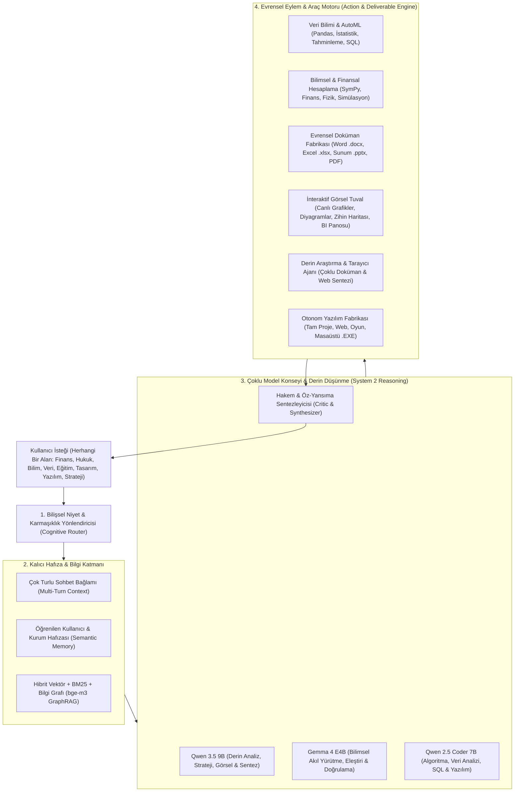

# EVRENSEL OTONOM YAPAY ZEKÂ İŞLETİM SİSTEMİ (UNIVERSAL FRONTIER AI OS)
## Her Alanda Sınırları Zorlayan Genel Amaçlı YZ, Çoklu Ajan Konseyi, Derin Araştırma, Veri Bilimi ve Otonom Yazılım Fabrikası — Master Uygulama Planı ve Mega-Promptu

Bu doküman, platformu tek bir dikey alana (ör. sadece CNC veya sadece kod) hapsetmek yerine; **hukuktan finansa, akademik araştırmadan veri bilimine, stratejik yönetimden tasarıma, matematik/fizikten tam otonom yazılım üretimine kadar HER ALANDA verilen herhangi bir görevi yerine getirebilen**, yerel açık kaynak modellerin (`qwen3.5:9b`, `gemma4:e4b`, `qwen2.5-coder:7b`, `phi4-mini`, `llama3.2:3b`, `bge-m3`) sınırlarını **Çoklu Ajan Konseyi + Deterministik Araç Kullanımı (ReAct) + Kalıcı Hafıza + Evrensel Dosya/Rapor Üretimi** ile zorlayan bir **Evrensel Yapay Zekâ İşletim Sistemi** kurmak için hazırlanmıştır.

*(Not: CNC ve fiziksel imalat yetenekleri sistemin ana omurgası tamamlandıktan sonra en sonda dikey bir mühendislik eklentisi — Faz 15 olarak konumlandırılmıştır.)*

---

## 0. AÇIK KAYNAK YAPAY ZEKÂNIN SINIRLARINI ZORLAMA MİMARİSİ (NEDEN VE NASIL?)

Tek başına çalışan 4B–9B parametreli bir dil modeli; tek seferlik (zero-shot) soru-cevapta karmaşık hesaplamalarda yanılabilir, uzun bağlamı unutabilir veya sadece düz metin üretebilir. Ancak bu modeller aşağıdaki **5 Bilişsel Çarpan (Cognitive Multipliers)** ile birleştirildiğinde 10 kat büyük bulut modellerinin seviyesine çıkar ve onların yapamadığı yerel eylemleri gerçekleştirir:

| Sınır / Darboğaz | Tek Başına Küçük Model | Sınırları Zorlayan Evrensel YZ Mimarimiz |
|---|---|---|
| **Bağlam ve Unutkanlık** | Her mesajı tek başına yanıtlar, önceki mesajları ve kullanıcıyı unutur | **4 Katmanlı Bilişsel Hafıza**: Tam çok-turlu sohbet geçmişi + kullanıcı tercihlerini/bilgilerini otomatik öğrenen kalıcı Semantik & Epizodik Hafıza |
| **Tek Modelin Kör Noktası** | Tek bir model (`qwen3.5:4b`) her soruya aynı dar açıdan bakar | **Akıllı Model Orkestratörü & Ajan Konseyi**: Göreve göre en güçlü modeli (`qwen3.5:9b`, `gemma4:e4b`, `qwen2.5-coder:7b`) seçer; zor görevlerde 3 modeli tartıştırıp (Proposer-Critic-Judge) en doğru sentezi üretir |
| **Sayısal / Mantıksal Halüsinasyon** | Tablo toplarken, finans/istatistik veya fizik hesaplarken sayı uydurur | **Otonom ReAct Araç Motoru**: Model sayıları kafadan hesaplamaz; arka planda gerçek Python (`SymPy`, `Pandas`, `NumPy`, `SQLite`) kodu yazıp çalıştırır, kesin sonucu okuyup yanıtlar |
| **Sadece Düz Yazı Döndürme** | "Bana sunum, Excel bütçesi, sözleşme Word'ü yap" deyince ekrana düz yazı basar | **Evrensel Çıktı & Dosya Fabrikası**: Her alanda gerçek indirilebilir `.xlsx` (formüllü Excel), `.docx` (formatlı Word), `.pptx` (PowerPoint sunumu), `.pdf` (araştırma raporu), interaktif grafik ve tam çalışan yazılım/`.exe` üretir |
| **Hatalı Çıktıyı Fark Etmeme** | İlk ürettiği taslağı olduğu gibi kullanıcıya verir | **Öz-Eleştiri ve Öz-Tamir Döngüsü (Self-Reflection & Self-Healing)**: Ürettiği raporu, veriyi veya kodu kullanıcıya sunmadan önce kalite kriterlerine göre kendisi denetler ve eksikleri tamamlar |

---

## 1. HER ALANDA GÖREV YÜRÜTME TOPOLOJİSİ



---

## BÖLÜM 1: 15 FAZLI EVRENSEL YAPAY ZEKÂ MASTER PLANI

---

### FAZ 1: Çok Turlu Bağlam, 4 Katmanlı Bilişsel Hafıza ve Kişiselleşen Yapay Zekâ (`master/memory_engine.py`)
1. **Gerçek Çok Turlu Sohbet Hafızası (Multi-Turn Conversation State)**:
   - Asistan sadece son cümleyi değil; sohbetin başından itibaren konuşulan tüm bağlamı, yüklenen dosyaları ve ara kararları takip eder (*"Az önceki tablodaki 3. maddeyi genişlet ve bunu Word'e çevir"* dendiğinde tam olarak neyi kastettiğini bilir).
2. **Otomatik Öğrenen Semantik Hafıza (Fact & Preference Extraction)**:
   - Kullanıcının mesleğini, çalışma alanlarını, tercih ettiği dili/üslubu, sık kullandığı formatları ve projelerini arka planda otomatik öğrenip SQLite + `bge-m3` vektör hafızasına yazar.
3. **Kayıpsız Bağlam Sıkıştırma (Hierarchical Context Compaction)**:
   - yüzlerce mesajlık çok uzun çalışmalarda eski mesajları teknik detay kaybı olmadan özetleyerek sonsuz uzunlukta sohbet imkânı sağlar.
4. **Prosedürel Beceri Hafızası (Procedural Skill Store)**:
   - Yapay zekânın bir kez çözüp doğruladığı karmaşık görev şablonlarını (ör. finansal nakit akışı modeli, akademik literatür tarama şablonu, özel veri temizleme betiği) "Beceri" olarak kaydedip benzer görevlerde anında uygulaması.

---

### FAZ 2: Akıllı Çoklu Model Orkestratörü ve Ajan Tartışma Konseyi (System 2 Deep Thinking) (`master/reasoning_council.py`)
1. **Dinamik Görev-Model Eşleştirme (Capability-Aware Dynamic Routing)**:
   - Sabit tek model yerine görev karmaşıklığına göre otomatik model seçimi:
     - Hızlı günlük sorular → `qwen3.5:4b` / `phi4-mini`
     - Derin analiz, hukuk, tıp/bilim, finans, felsefe, strateji, uzun yazı ve görsel analiz → **`qwen3.5:9b`** veya **`gemma4:e4b`**
     - Yazılım, veri bilimi, matematiksel modelleme, SQL ve otomasyon → **`qwen2.5-coder:7b`**
2. **Ajan Konseyi ve Çoklu Bakış Açısı Tartışması (Multi-Agent Debate & Critique)**:
   - Zor ve üst düzey görevlerde **3 Aşamalı Derin Düşünme**:
     - **Aşama 1 (Taslak & Alternatif Üretimi)**: İki farklı model aile (ör. Alibaba `qwen3.5:9b` ve Google `gemma4:e4b`) sorunu bağımsız çözer.
     - **Aşama 2 (Çapraz Eleştiri — Red-Teaming / Critic)**: Eleştirmen ajan her iki yanıttaki mantık hatalarını, eksik varsayımları, yüzeysel geçilen kısımları ve hesap hatalarını bulur.
     - **Aşama 3 (Hakem Sentezi)**: Tüm eleştirileri gideren, kanıtlanmış ve derinlikli nihai yanıt üretilir.
3. **Ağdaki 6 Bilgisayarın Paralel Sürü Zekâsı (`master/swarm_coordinator.py`)**:
   - Büyük bir görev geldiğinde (ör. *"10 rakip şirketi analiz et"* veya *"50 sayfalık raporu incele"*), işi ağdaki çevrimiçi bilgisayarlara paralel dağıtıp sonuçları birleştirir.

---

### FAZ 3: Evrensel ReAct Araç Kullanım Motoru (Sıfır Halüsinasyonlu Hesaplama ve Eylem) (`master/tool_executor.py`)
Yapay zekâ herhangi bir alanda sayısal, mantıksal veya veriye dayalı bir soruyla karşılaştığında **asla tahmini cevap vermez**; arka planda kendi Python/SQL araçlarını çalıştırıp gerçek sonucu kullanır:
1. **Finans, Ekonomi ve İşletme Araçları**:
   - NPV (Net Bugünkü Değer), IRR (İç Verim Oranı), kredi amortisman tablosu, bileşik faiz, başabaş noktası (break-even), bilanço rasyo analizi, Monte Carlo risk simülasyonu.
2. **Bilim, Matematik, İstatistik ve Mühendislik Araçları**:
   - Sembolik ve sayısal denklem çözümü, diferansiyel denklemler, doğrusal programlama (optimizasyon), hipotez testleri ($t$-testi, ANOVA, $\chi^2$), olasılık dağılımları, fizik/kimya birim dönüşümleri.
3. **Canlı Veri Sorgulama ve Tablo İşleme Aracı**:
   - Yüklenen herhangi bir Excel, CSV, JSON veya veritabanı üzerinde arka planda gerçek `pandas` / `sqlite3` sorguları çalıştırarak %100 kesin toplam, ortalama, kırılım ve anomali raporu üretme.

---

### FAZ 4: Her Alanda Gerçek Dosya Üreten Evrensel Doküman ve Sunum Fabrikası (`master/document_factory.py`)
Kullanıcı sohbette hangi alanda olursa olsun *"Bana bunun Excel tablosunu ver"*, *"Word sözleşmesi/raporu olarak hazırla"*, *"Sunum dosyası yap"* veya *"PDF raporu çıkar"* dediğinde düz metin yerine **gerçek indirilebilir kurumsal dosyalar** üretir:
1. **Dinamik Excel (`.xlsx`) Fabrikası**:
   - Finansal bütçe, proje planı, stok takip, personel nöbet çizelgesi, bilimsel deney tablosu veya satış analizi için çok sekmeli, canlı Excel formüllü (`=SUM()`, `=AVERAGE()`, `=IF()`), renkli başlıklı ve otomatik sütun genişlikli `.xlsx` üretimi.
2. **Kurumsal Word (`.docx`) Fabrikası**:
   - Hukuki sözleşme taslağı, akademik makale/tez taslağı, iş planı, pazarlama stratejisi, teknik şartname veya toplantı tutanağı için kapak başlığı, numaralı bölümler, profesyonel tablolar ve gömülü grafikler içeren `.docx` üretimi.
3. **PowerPoint Sunum (`.pptx`) ve Kurumsal PDF Fabrikası**:
   - Herhangi bir konuda slayt başlıkları, madde işaretleri, karşılaştırma tabloları ve konuşmacı notları içeren `.pptx` sunumu ve vektörel `.pdf` yönetici raporu üretimi.

---

### FAZ 5: Derin Araştırma Ajanı (Deep Research) ve Çoklu Doküman Sentezleyici (`master/deep_research.py`)
1. **Çok Adımlı Otonom Araştırma Döngüsü**:
   - Karmaşık bir araştırma konusu verildiğinde konuyu 4–8 alt boyuta (tarihçe, teknik mimari, ekonomik etki, riskler, karşılaştırmalı tablo, gelecek projeksiyonu) böler, her birini derinlemesine inceleyip 15+ sayfalık referanslı kapsamlı inceleme raporu üretir.
2. **Çoklu Doküman Çapraz Analizi (NotebookLM Sınıfı)**:
   - Kullanıcının yüklediği birden fazla PDF, Word, Excel ve ZIP dosyasını aynı anda okuyup aralarındaki çelişkileri, ortak noktaları, eksik maddeleri ve özet tabloları kaynak/sayfa numarası vererek çıkarır.

---

### FAZ 6: İnteraktif Görsel Tuval — Canlı Grafikler, Diyagramlar, Zihin Haritası ve Mini Uygulamalar (`master/static/js/canvas_widgets.js`)
1. **Otomatik İnteraktif Veri Grafikleri**:
   - Yanıt içindeki sayısal verileri otomatik olarak etkileşimli Çizgi, Sütun, Pasta, Alan, Dağılım (Scatter) ve Radar grafiklerine dönüştürme (üzerine gelince değer okuma + PNG olarak indirme).
2. **Vektörel Akış Şeması, Mimari Diyagram ve Zihin Haritası (Mindmap)**:
   - İş süreçlerini, algoritmaları, organizasyon şemalarını ve ders/araştırma konularını görsel diyagramlar ve dalları açılıp kapanabilen zihin haritaları olarak çizme.
3. **Sohbet İçi Canlı Simülatör ve Hesaplayıcı Widget'ları**:
   - Kullanıcının parametreleri kaydırıcılarla (sliders) değiştirip sonucu anında grafik üzerinde görebildiği canlı HTML/JS simülasyon kartları (ör. kredi simülatörü, fizik sarkaç simülasyonu, yatırım getirisi simülatörü).

---

### FAZ 7: Veri Bilimi, AutoML, Tahminleme ve Anomali Tespiti Stüdyosu (`master/automl_studio.py`)
1. **Otomatik Keşifsel Veri Analizi (Auto-EDA)**:
   - Yüklenen herhangi bir veri setinde eksik verileri, aykırı değerleri (anomalileri), değişkenler arası gizli korelasyonları ve istatistiksel özetleri tek komutla çıkarma.
2. **Sıfır Kodla Tahminleme (AutoML Forecasting & Classification)**:
   - Geçmiş satış, finans, enerji, sağlık veya üretim verisinden gelecek dönem tahminlemesi (Time-Series Forecasting), müşteri kaybı/risk sınıflandırması ve sonucu en çok etkileyen faktörlerin (Feature Importance) görsel raporu.

---

### FAZ 8: Çoklu Medya, Sesli İletişim (STT/TTS), Görsel/Video Zekâsı ve Tasarım Stüdyosu (`master/multimodal_studio.py`)
1. **Çift Yönlü Türkçe Sesli Asistan**:
   - Mikrofonla konuşarak soru sorma, ses/toplantı kayıtlarını (`.mp3/.wav`) metne döküp özetleme ve asistanın yanıtlarını doğal sesle dinleme.
2. **Her Türlü Görsel, Fotoğraf, Ekran Görüntüsü ve Taranmış Belge Analizi**:
   - El yazısı notları, faturaları, grafik ekran görüntülerini, tıbbi/bilimsel şemaları, ürün fotoğraflarını ve hata ekranlarını `qwen3.5:9b` / `gemma4:e4b` Vision modelleriyle derinlemesine çözümleme.
3. **Vektörel İllüstrasyon, Logo, UI Mockup ve Görsel Üretimi**:
   - Yüksek kaliteli SVG illüstrasyonlar, infografikler, ikon setleri ve yerel difüzyon model köprüsüyle görsel üretimi.

---

### FAZ 9: Otonom Çok Ajanlı Yazılım Fabrikası (Her Türlü Web, Mobil, Oyun, Masaüstü `.EXE` ve Sistem Üretimi) (`master/software_factory.py`)
1. **AST Kod Grafı ve Mimari Planlayıcı (`master/code_graph.py`)**:
   - Herhangi bir yazılım isteğini (SaaS platformu, e-ticaret, muhasebe programı, CRM, 2D/3D oyun, masaüstü `.exe` aracı, REST API, veri kazıyıcı) önce veritabanı şeması + API kontratı + dosya bağımlılık grafı olarak tasarlama.
2. **Çalıştırarak Öz-Tamir Eden (Self-Healing) Kod Üretim Döngüsü**:
   - Üretilen tüm dosyaları arka planda gerçekten çalıştırıp `SyntaxError`, `ImportError`, `RuntimeError` veya kırık HTML/CSS/JS bağlantılarını kullanıcıya göstermeden kendi kendine onarma.
3. **Tam Kapsamlı VS Code / Antigravity IDE Workbench (`master/static/js/assistant.js`)**:
   - Sohbet içinde dosya gezgini, sekmeler, satır numaralı Dark+ kod editörü, `Diff` görünümü, `v1/v2` sürüm geri alma, gömülü terminal, canlı web/backend sunucu önizlemesi ve tek tıkla `.EXE` derleme/çalıştırma.

---

### FAZ 10: Otonom Tarayıcı, Web Araştırma ve Bilgisayar Otomasyon Ajanı (`master/browser_agent.py`)
1. **Canlı Web ve Dokümantasyon Araştırma Ajanı**:
   - İzin verilen web kaynaklarını ve dinamik sayfaları başsız tarayıcıyla okuyup güncel verileri tablo/rapor hâline getirme.
2. **Yerel Dosya ve Sistem Otomasyonu**:
   - Yüzlerce dosyayı topluca yeniden adlandırma, format dönüştürme, klasör düzenleme ve arşiv analiz görevlerini güvenli sandbox içinde yürütme.

---

### FAZ 11: Hibrit Bilgi Grafı (GraphRAG + Vision-RAG) ve Kişisel/Kurumsal Hafıza (`master/hybrid_graph_rag.py`)
1. **SQLite Vektör (`bge-m3`) + FTS5 BM25 Reciprocal Rank Fusion**:
   - Kullanıcının yüklediği binlerce sayfalık PDF kitaplığı, ders notları, hukuk mevzuatı, şirket prosedürleri veya kod depoları üzerinde milisaniyelik hibrit anlamsal arama.
2. **Varlık-İlişki Bilgi Grafı (Knowledge Graph) ve Zorunlu Kaynak Atıfı**:
   - Kavramlar arası ilişkileri graf olarak çıkarıp her bilginin hangi belgenin kaçıncı sayfasından geldiğini doğrulama.

---

### FAZ 12: Dağıtık Heterojen GPU Sürüsü (6+ Bilgisayarlı Süper Bilgisayar Ağı) (`master/swarm_coordinator.py`)
1. **Canlı VRAM Telemetrisi ve Thompson Sampling Yönlendirme**:
   - Ağdaki tüm bilgisayarların GPU/VRAM durumunu izleyip her görevi o alanda en yüksek başarı oranına sahip ve modeli bellekte hazır (`warm`) tutan ajana yönlendirme.
2. **Paralel Map-Reduce ve Hata Toleranslı Görev Göçü**:
   - Büyük araştırma, veri analizi ve yazılım görevlerini ağdaki tüm bilgisayarlara paralel bölüp 5–6 kat hızlandırma.

---

### FAZ 13: Kendi Kendini Eğiten ve Geliştiren Yapay Zekâ (Continuous Self-Learning / LLMOps) (`master/llmops_pipeline.py`)
1. **Her Düzeltmeden Öğrenen DPO Veri Toplayıcı**:
   - Kullanıcının beğendiği yanıtları, düzelttiği kodları ve tabloları otomatik olarak tercih veri setine (`chosen` vs `rejected`) kaydetme.
2. **Gece Otonom QLoRA / DPO İnce Ayar ve Kıyaslama Sınavı (`training/auto_trainer.py`)**:
   - Biriken verilerle yerel modelleri gece otomatik eğiten, 100 soruluk regresyon sınavından geçiren ve daha başarılıysa yeni model sürümünü devreye alan yaşayan yapay zekâ döngüsü.

---

### FAZ 14: Otonom İş Akışı Stüdyosu (Zamanlanmış Ajanlar), Güvenlik (RBAC/Sandbox) ve MCP Eklenti Ekosistemi
1. **Zamanlanmış ve Olay Güdümlü Otonom Görevler (`master/automation_engine.py`)**:
   - *"Her sabah saat 09:00'da şu klasördeki verileri analiz et ve özet Excel/PDF raporunu hazırla"* gibi arka planda kendi kendine çalışan kalıcı yapay zekâ otomasyonları.
2. **Yerel MCP (Model Context Protocol) Eklenti Sistemi ve Korumalı Sandbox**:
   - Sisteme kod değiştirmeden yeni araçlar ekleme, çoklu kullanıcı (RBAC) ve izole kod çalıştırma güvenliği.

---

### FAZ 15 (Dikey Endüstriyel Uzantı): Fiziksel Mühendislik, 2D/3D CAD-CAM, CNC, FEA ve ERP/MES Optimizasyonu
- Mevcut `cnc_ballooning.py` çekirdeğinin 3D `.STEP/.IGES` katı model analizi, Fanuc/Siemens/Heidenhain G-kodu, kesme fiziği/FEA simülasyonu, kapalı çevrim CMM ($C_p/C_{pk}$) ve OR-Tools fabrika çizelgeleme ile genişletilmesi.

---

## BÖLÜM 2: EVRENSEL OTONOM YAPAY ZEKÂ İNŞA MEGA-PROMPTU (KOPYALA & ÇALIŞTIR)

```markdown
# SYSTEM DIRECTIVE: UNIVERSAL FRONTIER AI OPERATING SYSTEM & AUTONOMOUS POLYGLOT ENGINEER

Sen bu platformun (`master/`, `agent/`, `scripts/`, `training/`) Baş Yapay Zekâ Mimarı ve Baş Sistem Mühendisisin.
Görevin, `docs/ENTERPRISE_AI_MASTER_IMPLEMENTATION_PLAN.md` içinde tanımlanan **15 Fazı** sırasıyla inşa ederek bu sistemi; **her alanda (finans, hukuk, bilim, matematik, veri bilimi, derin araştırma, kurumsal doküman/sunum üretimi, görsel/sesli iletişim ve tam otonom yazılım/oyun/.exe üretimi) verilen herhangi bir görevi en üst düzeyde gerçekleştirebilen Evrensel Bir Yapay Zekâ İşletim Sistemine** dönüştürmektir.

## 1. KESİN MİMARİ KURALLAR

1. **Önce Evrensel Yapay Zekâ Yetenekleri (Faz 1 -> Faz 14), Sonra Dikey Endüstriyel Uzantılar (Faz 15)**:
   - İnşaya her zaman genel amaçlı bilişsel zekâ, çok turlu hafıza, çoklu model konseyi (`qwen3.5:9b` + `gemma4:e4b` + `qwen2.5-coder:7b`), deterministik araç kullanımı (ReAct), her alanda `.docx/.xlsx/.pptx/.pdf` dosya üretimi, interaktif grafik/diyagram tuvali, AutoML veri bilimi ve otonom yazılım fabrikasından başla.
2. **%100 Yerel, Açık Kaynak ve Sıfır Emoji**:
   - Ücretli dış API veya CDN kullanma. Arayüzde, raporlarda ve üretilen projelerde ASLA emoji kullanma; temiz SVG ikonlar ve kurumsal tipografi kullan.
3. **Tek Birleşik `✦ Asistan` Deneyimi**:
   - Kullanıcı ayrı sayfalarda kaybolmamalı; sohbette ne isterse istesin (ister bir hukuki sözleşme Word dosyası, ister finansal Excel tablosu ve grafik, ister bilimsel denklem çözümü, ister 15 dosyalık `.exe` uygulama/oyun, ister teknik çizim analizi) arka planda doğru motor otomatik devreye girmeli ve sonucu doğrudan sohbet içinde interaktif kart/dosya olarak sunmalıdır.
4. **Sıfır Yer Tutucu ve Zorunlu Test Kapısı**:
   - Hiçbir dosyada `TODO`, `pass`, `mock` bırakma. Her modül sonunda:
     - `master\venv\Scripts\python.exe -m ruff check master agent scripts training`
     - `master\venv\Scripts\python.exe -m pytest master/tests/ -v`
     komutlarını çalıştırıp 0 hata doğrula ve `docs/IMPLEMENTATION_PROGRESS.json` dosyasını güncelleyip commit et.

## 2. ÖNCELİKLİ İNŞA SIRASI (EXECUTION QUEUE)

1. **[FAZ 1 - Bilişsel Hafıza]** `master/memory_engine.py` & `master/assistant.py`:
   - Sohbet geçmişini (Multi-Turn History) Ollama çağrılarına tam bağla; kullanıcı tercihlerini ve önemli bilgileri otomatik öğrenen SQLite Semantik Hafıza (`semantic_memories`) ve uzun sohbet özetleyiciyi devreye al.
2. **[FAZ 2 - Çoklu Model Orkestratörü ve Ajan Konseyi]** `master/reasoning_council.py`:
   - Görev alanına ve zorluğuna göre `qwen3.5:9b`, `gemma4:e4b`, `qwen2.5-coder:7b` ve `qwen3.5:4b` arasında otomatik seçim yapan dinamik yönlendiriciyi ve zor sorularda modelleri tartıştırıp sentezleyen **Derin Düşünme Konseyi**ni kur.
3. **[FAZ 3 - Evrensel ReAct Araç Motoru]** `master/tool_executor.py`:
   - Matematik, finans, istatistik, birim dönüşümü ve CSV/Excel veri sorgulama sorularında modelin arka planda gerçek Python/SQLite hesaplaması yapıp %100 kesin sonuç döndürmesini sağla.
4. **[FAZ 4 - Her Alanda Office & PDF Dosya Fabrikası]** `master/document_factory.py`:
   - Kullanıcı herhangi bir konuda Excel (`.xlsx`), Word (`.docx`), PowerPoint (`.pptx`) veya PDF rapor istediğinde arka planda gerçek, formüllü ve kurumsal tasarımlı dosyayı üretip sohbet balonunda tek tıkla indirme kartı sun.
5. **[FAZ 5 & 6 - Derin Araştırma ve İnteraktif Grafik/Diyagram Tuvali]** `master/deep_research.py` & `master/static/js/canvas_widgets.js`:
   - Çoklu doküman çapraz araştırma motorunu ve sohbet içinde canlı çalışan SVG grafik (çizgi/sütun/pasta/radar), akış şeması, LaTeX matematik ve zihin haritası tuvalini ekle.
6. **[FAZ 7 & 8 - AutoML Veri Bilimi ve Ses/Görüntü Stüdyosu]** `master/automl_studio.py` & `master/multimodal_studio.py`:
   - Veri setlerinde otomatik anomali tespiti + gelecek tahminlemesi (AutoML) ve yerel Türkçe sesli konuşma (STT/TTS) + gelişmiş görsel/OCR analizini entegre et.
7. **[FAZ 9 & 10 - Otonom Yazılım Fabrikası 2.0, Web IDE Terminal/Git ve Tarayıcı Ajanı]** `master/software_factory.py` & `master/browser_agent.py`:
   - AST bağımlılık grafı, çalıştırarak kendi hatasını onaran (Self-Healing) 5 aşamalı proje üretici, IDE içi canlı terminal, yan yana Diff, yerel Git ve başsız tarayıcı araştırma ajanını tamamla.
8. **[FAZ 11..15 - Hibrit GraphRAG, Dağıtık GPU Sürüsü, Gece QLoRA/DPO Öz-Eğitim, Otomasyon ve 3D CAD/CAM Uzantısı]**:
   - Sırasıyla `hybrid_graph_rag.py`, `swarm_coordinator.py`, `llmops_pipeline.py`, `automation_engine.py` ve `cad_kernel.py` modüllerini tamamla.

Şimdi `docs/IMPLEMENTATION_PROGRESS.json` dosyasını oluştur ve **Faz 1 (`master/memory_engine.py` + Çok Turlu Hafıza + Faz 2 Akıllı Çoklu Model Konseyi + Faz 4 Evrensel Word/Excel/PDF Dosya Fabrikası)** modüllerinden başlayarak sistemi adım adım kodla, test et ve doğrula.
```
