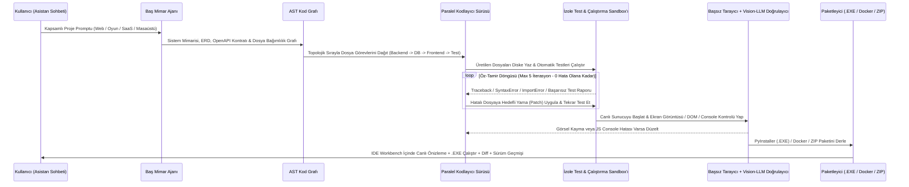
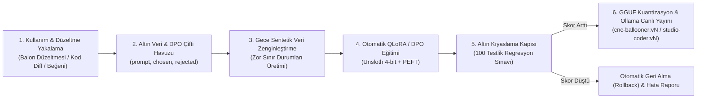

# EVRENSEL OTONOM YAPAY ZEKÂ İŞLETİM SİSTEMİ, YAZILIM FABRİKASI VE MÜHENDİSLİK PLATFORMU
## Çok Yıllı Master Uygulama Planı (16 Faz · 80 Ana Modül · 240+ Alt Bileşen) ve Otonom İnşa Mega-Promptu

Bu doküman, mevcut **Dağıtık YZ Platformu** (`master/`, `agent/`) altyapısını sadece tek bir dikey alana değil; **bir yapay zekâdan beklenen tüm normal (ChatGPT / Claude / Perplexity / NotebookLM), üst düzey (Antigravity / Cursor / Devin / AutoML) ve ultra-ileri (Dağıtık Ajan Konseyi, Kendi Kendini Eğiten LLMOps, Bilgisayar Kullanımı, 3D CAD/CAM/CNC ve Kurumsal ERP)** yetenekleri **%100 yerel, açık kaynak ve tam otonom** olarak barındıran devasa bir **Yapay Zekâ İşletim Sistemine (AI OS)** dönüştürmek için hazırlanmış nihai mühendislik spesifikasyonudur.

---

## 0. YAPAY ZEKÂ YETENEK KATMANLARI MATRİSİ (3 KATMANLI HEDEF MİMARİ)

| Katman | Kapsam Tanımı | Referans Sistemler | Platformdaki Hedef Karşılığı |
|---|---|---|---|
| **Katman 1: Temel & Normal YZ Beklentileri** | Günlük ve profesyonel bilgi işçiliği, kesintisiz hafıza, çoklu doküman/medya analizi, sıfır halüsinasyonlu hesaplama, sesli/görsel iletişim, sunum/rapor üretimi | ChatGPT Plus, Claude Artifacts, Perplexity Pro, Google NotebookLM | Çok Katmanlı Uzun Süreli Hafıza, Derin Araştırma Ajanı, Otomatik `.pptx/.docx/.xlsx/.pdf` Üretici, Canlı Grafik/Diyagram Tuvali, Yerel Ses (STT/TTS) ve Görsel Üretim/Analiz |
| **Katman 2: Üst Düzey YZ Beklentileri** | Uçtan uca yazılım mühendisliği, çok klasörlü proje/oyun/`.exe`/mobil uygulama üretimi, kendi hatasını çalıştırarak onarma, veri bilimi (AutoML), bilgisayar/tarayıcı kontrolü | Antigravity, Cursor, Devin, Replit Agent, OpenAI Code Interpreter | AST Kod Grafı, 5 Aşamalı Otonom Yazılım Fabrikası, Playwright Görsel UI Doğrulayıcı, Canlı Web IDE (LSP, DAP, Diff, Terminal, Git), AutoML Veri Bilimi Stüdyosu, Başsız Tarayıcı Otomasyonu |
| **Katman 3: Ultra-İleri / Frontier YZ & Endüstriyel Sistem** | Çoklu ajan tartışma konseyi (Swarm Debate), kendi kendini eğiten model döngüsü (Gece QLoRA/DPO), fiziksel mühendislik (3D CAD/CAM, CNC, FEA), fabrika/ERP optimizasyonu | AlphaCode, Multi-Agent Swarm, Unsloth/vLLM LLMOps, Siemens NX / AS9102 | 6+ Bilgisayarlı Heterojen GPU Sürüsü, Hakemli Ajan Konseyi, Otomatik DPO/QLoRA Öz-Eğitim Fabrikası, 3D STEP/DXF/CNC/G-Kodu/CMM Motoru, OR-Tools Çizelgeleme ve Kurumsal RBAC/Sandbox |

---

## 1. BÜTÜNLEŞİK SİSTEM TOPOLOJİSİ

```mermaid
flowchart TB
    subgraph Client["1. Birleşik İstemci Kabuğu (Web + Masaüstü + Ses + Mobil PWA)"]
        UIChat["Çok Modlu Asistan (Metin, Ses STT/TTS, Görsel, Video, PDF/Office/CAD)"]
        UIWorkbench["Antigravity / VS Code IDE Workbench (Explorer, Sekmeler, LSP, Diff, Terminal, Canlı Sunucu)"]
        UICanvas["İnteraktif Bilgi & Veri Tuvali (Grafikler, Mermaid, Zihin Haritası, BI Panosu, 3D CAD)"]
        UIWorkflow["Otonom Görev & Ajan Konseyi İzleme Merkezi (Canlı Düşünce Zinciri & DAG)"]
    end

    subgraph Core["2. Bilişsel Çekirdek & Hafıza Katmanı (Cognitive Core)"]
        Intent["Çok Aşamalı Niyet, Karmaşıklık ve Araç Yönlendiricisi (Router)"]
        Memory["4 Katmanlı Hafıza (Çalışma Belleği, Epizodik Sohbet, Semantik Vektör, Prosedürel Beceri)"]
        Council["Çoklu Ajan Tartışma ve Konsensüs Konseyi (Planlayıcı, Üretici, Eleştirmen, Doğrulayıcı)"]
        Tools["Deterministik Araç Motoru (SymPy Matematik, Pandas Veri, SQL, Birim/Finans, Web/Tarayıcı)"]
    end

    subgraph Studios["3. Üst Düzey Üretim Stüdyoları (Autonomous Studios)"]
        SoftFactory["Otonom Yazılım Fabrikası (Web, Full-Stack, Oyun, Windows .EXE/.MSI, Docker, PWA)"]
        DocFactory["Kurumsal Doküman & Medya Fabrikası (Word, Excel, PowerPoint, PDF, Görsel/SVG)"]
        DataStudio["AutoML & Veri Bilimi Stüdyosu (Veri Temizleme, Anomali, XGBoost/PyTorch Tahminleme)"]
        EngStudio["Fiziksel Mühendislik & CNC/CAD-CAM Stüdyosu (2D/3D Balonlama, G-Kodu, FEA, Maliyet, CMM)"]
    end

    subgraph Infra["4. Dağıtık GPU Ağı, LLMOps & Güvenlik Altyapısı"]
        Swarm["Tailscale Heterojen GPU Sürüsü (Thompson Sampling, VRAM Telemetri, Checkpoint Göçü)"]
        RAG["Hibrit GraphRAG + Vision-RAG (bge-m3 + FTS5 BM25 + Varlık Grafı + Zorunlu Atıf)"]
        LLMOps["Kendi Kendini Eğiten Döngü (Düzeltme Yakalama -> Sentetik Veri -> Gece QLoRA/DPO -> Canary Test)"]
        Sec["Kurumsal Güvenlik (JWT/RBAC, AS9100 SHA-256 Denetim İzi, Rootless Konteyner Sandbox)"]
    end

    Client --> Core
    Core --> Studios
    Studios --> Infra
    Core --> Infra
```



---

## BÖLÜM 1: 16 FAZLI DERİN MÜHENDİSLİK SPESİFİKASYONU

---

### FAZ 1: Bilişsel Çekirdek, 4 Katmanlı Uzun Süreli Hafıza ve Kişiselleştirilmiş YZ Deneyimi
**Problem:** Normal bir sohbet botu sayfa yenilendiğinde veya yeni sohbete geçildiğinde kullanıcının kim olduğunu, önceki projelerini, kodlama stilini, şirket kurallarını ve geçmiş kararlarını unutur.
**Hedef:** İnsan beyni gibi çalışan 4 katmanlı kalıcı hafıza mimarisi (`master/memory_engine.py`).

#### 1.1. Hafıza Katmanları ve Veritabanı Şeması (`master/db.py` Genişletmesi)
- **Katman A — Çalışma Belleği (Working Memory & Context Window Manager)**:
  - Uzun sohbetlerde token sınırı (`NUM_CTX_MAX = 32768`) dolduğunda eski mesajları rastgele kesmek yerine; hiyerarşik özetleme (Recursive Summarization) ve kritik varlık/kod bloklarını sabitleme (Context Pinning) algoritması.
- **Katman B — Epizodik Hafıza (Episodic Memory — Geçmiş Oturumlar ve Olaylar)**:
  - Tüm sohbetlerin, yüklenen dosyaların, alınan kararların ve üretilen çıktıların zaman damgalı ve tam metin aranabilir (`SQLite FTS5`) arşivlenmesi.
- **Katman C — Semantik Hafıza (Semantic Fact & User Preference Store)**:
  - Her sohbet turundan sonra arka planda hafif model (`qwen3:1.7b` veya `qwen3.5:4b`) ile otomatik gerçek/tercih çıkarımı:
    - Örnek çıkarımlar: `"Kullanıcı arayüzlerde emoji istemiyor"`, `"Kullanıcı CNC parçalarında ISO 2768-mK standardını kullanıyor"`, `"Kullanıcı Python projelerinde FastAPI ve SQLite tercih ediyor"`.
- **Katman D — Prosedürel Hafıza (Procedural Skill & Pattern Library)**:
  - Başarıyla tamamlanmış ve testlerden geçmiş kod şablonlarının, sık kullanılan SQL sorgularının ve doğrulanmış çözüm adımlarının yeniden kullanılabilir "Beceri (Skill)" olarak kaydedilmesi.

```sql
-- Faz 1 SQLite Şema Migrasyonu
CREATE TABLE IF NOT EXISTS conversations (
    id TEXT PRIMARY KEY,
    user_id TEXT NOT NULL DEFAULT 'default',
    title TEXT NOT NULL,
    summary TEXT DEFAULT '',
    pinned_context TEXT DEFAULT '[]',
    created_at TEXT NOT NULL,
    updated_at TEXT NOT NULL
);

CREATE TABLE IF NOT EXISTS conversation_messages (
    id INTEGER PRIMARY KEY AUTOINCREMENT,
    conversation_id TEXT NOT NULL REFERENCES conversations(id) ON DELETE CASCADE,
    role TEXT NOT NULL, -- 'user' | 'assistant' | 'system' | 'tool'
    content TEXT NOT NULL,
    model_used TEXT DEFAULT '',
    task_type TEXT DEFAULT '',
    attachments_json TEXT DEFAULT '[]',
    workspace_id TEXT DEFAULT '',
    cnc_job_id TEXT DEFAULT '',
    tokens_in INTEGER DEFAULT 0,
    tokens_out INTEGER DEFAULT 0,
    latency_ms INTEGER DEFAULT 0,
    feedback_score INTEGER DEFAULT 0, -- +1 (beğeni), -1 (düzeltme/hata)
    created_at TEXT NOT NULL
);

CREATE TABLE IF NOT EXISTS semantic_memories (
    id INTEGER PRIMARY KEY AUTOINCREMENT,
    user_id TEXT NOT NULL DEFAULT 'default',
    category TEXT NOT NULL, -- 'preference' | 'project_fact' | 'company_rule' | 'technical_constraint'
    fact_key TEXT NOT NULL,
    fact_value TEXT NOT NULL,
    confidence REAL NOT NULL DEFAULT 1.0,
    embedding_blob BLOB, -- bge-m3 1024-dim float32 vektörü
    source_conversation_id TEXT,
    updated_at TEXT NOT NULL,
    UNIQUE(user_id, category, fact_key)
);

CREATE TABLE IF NOT EXISTS procedural_skills (
    id TEXT PRIMARY KEY,
    name TEXT NOT NULL,
    trigger_pattern TEXT NOT NULL,
    solution_template TEXT NOT NULL,
    success_count INTEGER DEFAULT 1,
    avg_score REAL DEFAULT 1.0,
    embedding_blob BLOB,
    created_at TEXT NOT NULL
);
```

#### 1.2. İnşa Edilecek Modüller ve API'ler
- `master/memory_engine.py`:
  - `extract_and_upsert_memories(conversation_id, user_msg, assistant_msg)`: Arka plan görevinde (`asyncio.create_task`) kullanıcı tercihlerini çıkarıp `semantic_memories` tablosuna yazar.
  - `build_memory_augmented_system_prompt(user_id, query)`: Sorguyla en alakalı 5 semantik hafıza kaydını ve 2 prosedürel beceriyi sistem promptuna enjekte eder.
  - `compact_conversation_context(conversation_id, max_tokens)`: Bağlam penceresi %75 dolduğunda eski mesajları kayıpsız teknik özete dönüştürür.
- **REST Endpoint'leri (`master/memory_api.py`)**:
  - `GET /api/memory/conversations` — Tüm sohbet geçmişini (cihazlar arası senkronize) listele.
  - `GET /api/memory/facts` / `DELETE /api/memory/facts/{id}` — Yapay zekânın kullanıcı hakkında öğrendiği kuralları görüntüle/düzenle/sil.
  - `POST /api/memory/compact/{conversation_id}` — Uzun sohbeti akıllıca sıkıştır.

---

### FAZ 2: Çoklu Ajan Düşünme Konseyi, Akıl Yürütme (Reasoning) ve Deterministik Araç Kullanımı (Tool-Use / ReAct)
**Problem:** Tek bir küçük/orta ölçekli açık kaynak model (`4B–9B`), karmaşık matematik, mantık, çok adımlı planlama veya çelişkili gereksinimlerde ilk aklına gelen yüzeysel cevabı verebilir.
**Hedef:** Tek model yerine **Düşünen, Tartışan, Araç Kullanan ve Kendi Cevabını Doğrulayan Çoklu Ajan Konseyi** (`master/reasoning_council.py` & `master/tool_executor.py`).

#### 2.1. ReAct (Reason + Act) Deterministik Araç Motoru (`master/tool_executor.py`)
Model tahmin yürütmek yerine, gerektiğinde şu yerleşik deterministik araçları JSON-RPC formatında çağırır ve sonucunu okuyup cevabını yazar:
1. `tool_python_math_sympy`: Cebirsel denklem çözümü, türev, integral, matris işlemleri, istatistik ve olasılık hesabı.
2. `tool_data_analyzer`: Yüklenen CSV/Excel/JSON verisi üzerinde gerçek `pandas` / `sqlite3` agregasyonları (`GROUP BY`, `JOIN`, korelasyon, pivot tablo) çalıştırma — model tablodaki sayıları asla kafadan toplamaz, kodla hesaplar.
3. `tool_unit_and_engineering_calc`: Birim dönüşümleri (MPa ↔ PSI, mm ↔ inch, HRC ↔ HB sertlik, devir $n = \frac{1000 \cdot V_c}{\pi \cdot D}$, elektrik/finans formülleri).
4. `tool_code_sandbox_exec`: Yazdığı algoritmayı kullanıcıya göstermeden önce arka planda 3 örnek girdiyle çalıştırıp çıktısını doğrulama.
5. `tool_local_search_and_rag`: Şirket bilgi bankası ve proje dosyaları içinde tam metin + vektör araması.

#### 2.2. Çoklu Ajan Tartışma ve Hakem Konseyi (`master/reasoning_council.py`)
Karmaşık sorular ve kritik mühendislik/mimari kararlarda 3 aşamalı **Konsey Protokolü**:
1. **Önerici Ajanlar (Proposers)**:
   - Ajan A (`qwen3.5:9b` — Analitik/Genel) ve Ajan B (`qwen2.5-coder:7b` veya `gemma4:e4b` — Teknik/Kod) soruya birbirinden bağımsız çözüm üretir.
2. **Şeytanın Avukatı / Eleştirmen Ajan (Critic)**:
   - Her iki çözümdeki mantık hatalarını, eksik sınır durumlarını, güvenlik açıklarını veya sayısal tutarsızlıkları bulur.
3. **Baş Hakem / Sentezleyici (Judge & Synthesizer)**:
   - Eleştirileri gidererek her iki çözümün en güçlü yanlarını birleştiren nihai kusursuz yanıtı oluşturur.
- Sohbet arayüzünde kullanıcı isterse **"Düşünce Sürecini ve Ajan Tartışmasını Göster"** açılır kutusundan ajanların arka planda nasıl tartıştığını şeffafça izleyebilir.

---

### FAZ 3: Derin Araştırma Ajanı (Deep Research) ve Kurumsal Doküman / Sunum / Office Fabrikası
**Problem:** Kullanıcı bir yapay zekâdan sadece sohbet mesajı değil; doğrudan yönetime sunulabilecek **PowerPoint sunumu (`.pptx`)**, **kapsamlı Word raporu (`.docx`)**, **çok sayfalı formüllü Excel finans/mühendislik tablosu (`.xlsx`)** ve **profesyonel PDF dokümanı** üretmesini bekler.
**Hedef:** Çok kaynaklı araştırma yapıp kurumsal formatta indirilebilir Office dosyaları üreten `master/document_factory.py` ve `master/deep_research.py`.

#### 3.1. Derin Araştırma Motoru (`master/deep_research.py`)
- Kullanıcının verdiği bir konuyu veya yüklediği 10+ dokümanı (PDF, Word, Excel, ZIP, Markdown) 5 alt araştırma sorusuna böler.
- Her alt soruyu paralel olarak doküman parçaları ve bilgi bankası üzerinde tarar, bulguları çapraz doğrular, çelişkileri raporlar ve kaynak referanslı (`[Kaynak 1, s. 14]`) 10–30 sayfalık kapsamlı araştırma raporu sentezler.

#### 3.2. Otomatik Office & Doküman Üretim Fabrikası (`master/document_factory.py`)
Sohbette *"Bana şu konuda 10 slaytlık bir sunum hazırla"*, *"Şu verilerden finansal Excel tablosu yap"* veya *"Teknik şartname Word dosyası oluştur"* dendiğinde arka planda gerçek dosyaları üretip sohbette indirme kartı sunar:
1. **PowerPoint (`.pptx`) Üretici**: Kapak slaytı, yönetici özeti, 2 sütunlu karşılaştırma slaytları, veri tabloları, gömülü SVG/PNG grafikler ve konuşmacı notları (`python-pptx` veya OpenXML üretici).
2. **Word (`.docx`) Üretici**: Otomatik içindekiler tablosu, kurumsal başlık stilleri, numaralı bölümler, zebra çizgili tablolar, gömülü diyagramlar ve üst/alt bilgi (Header/Footer).
3. **Excel (`.xlsx`) Üretici**: Çok sekmeli, dinamik `SUM/AVERAGE/IF/VLOOKUP/INDEX-MATCH` formüllü, koşullu biçimlendirmeli (Conditional Formatting), sütun genişlikleri ayarlı ve gömülü grafikli (`openpyxl.chart`) çalışma kitapları.
4. **Vektörel PDF Rapor Üretici**: `PyMuPDF` ile kapak sayfası, sayfa numaraları ve yüksek çözünürlüklü şemalar içeren kurumsal PDF.

---

### FAZ 4: İnteraktif Veri Görselleştirme, Diyagram, Matematik ve Canlı Bilgi Tuvali (Artifacts Canvas)
**Problem:** Metin tabanlı yanıtlar karmaşık veri setlerini, sistem mimarilerini, akış şemalarını veya matematiksel fonksiyonları anlatmakta yetersiz kalır.
**Hedef:** Sohbet içinde anında çalışan zengin görsel bileşenler (`master/static/js/canvas_widgets.js`).

1. **İnteraktif Grafik ve BI Tuvali**:
   - Model ` ```chart ` bloğu ürettiğinde (JSON veri + grafik türü: çizgi, sütun, pasta, dağılım, radar, ısı haritası, Gantt) sıfır harici CDN ile %100 yerel SVG/Canvas üzerinde üzerine gelince değer gösteren (tooltip), yakınlaştırılabilir ve PNG/CSV olarak indirilebilir interaktif grafik çizer.
2. **Otomatik Mimari Diyagram ve Akış Şeması Motoru**:
   - ` ```mermaid ` veya ` ```diagram ` bloklarını otomatik olarak yönlü akış şeması (Flowchart), sıra diyagramı (Sequence Diagram), sınıf diyagramı (Class/ERD) ve durum makinesi olarak vektörel çizer.
3. **LaTeX Matematik ve Mühendislik Formül Dizgisi**:
   - Satır içi (`$...$`) ve blok (`$$...$$`) matematiksel denklemleri temiz matematiksel tipografi ile gösterir.
4. **İnteraktif Zihin Haritası (Mindmap) ve Karar Ağacı**:
   - Karmaşık konuları tıklanarak dalları açılıp kapanabilen görsel ağaca dönüştürür.
5. **Canlı HTML/JS Widget & Hesaplayıcı Tuvali**:
   - Kullanıcı *"Bana kredi/maliyet/birim hesaplayıcı göster"* dediğinde sohbet balonunun içinde kaydırıcıları (sliders) ve girdileri anında çalışan interaktif mini araç çalıştırır.


---

### FAZ 5: Çoklu Medya, Sesli İletişim (STT/TTS), Görsel/Video Analizi ve Yerel Görsel Üretim Stüdyosu
**Problem:** Üst düzey bir yapay zekâ sadece yazışmaz; konuşur, dinler, fotoğrafları/videoları kare kare analiz eder, taranmış karmaşık belgeleri okur ve sıfırdan görsel/tasarım üretir.
**Hedef:** %100 yerel çalışan çok modlu medya motoru (`master/multimodal_studio.py`).

1. **Modül 5.1 — Çift Yönlü Gerçek Zamanlı Sesli Asistan (`master/voice_engine.py`)**:
   - **Konuşmadan Metne (STT)**: `faster-whisper` (`small`/`medium` int8 kuantize model) ile mikrofon kaydını ve yüklenen `.mp3/.wav/.m4a` toplantı kayıtlarını %99 doğrulukla Türkçe/İngilizce metne çevirme, konuşmacı ayrıştırma (Diarization) ve toplantı özeti/aksiyon listesi çıkarma.
   - **Metinden Konuşmaya (TTS)**: `piper-tts` veya yerel nöral TTS ile asistan yanıtlarını doğal Türkçe sesle okuma; sohbet kutusunda mikrofon ve sesli okuma kontrolü.
2. **Modül 5.2 — Gelişmiş OCR, Tablo/Form Çıkarımı ve Video Kare Analizi (`master/media_analyzer.py`)**:
   - Fatura, irsaliye, sözleşme, el yazısı notlar ve karmaşık tablolu PDF'lerden yapılandırılmış JSON/Excel çıkarımı.
   - `.mp4/.avi/.mov` video dosyalarından anahtar kareleri (keyframes) ve ses kanalını ayırıp Vision-LLM (`qwen3.5:9b`) ile olay/anomali zaman çizelgesi çıkarma.
3. **Modül 5.3 — Yerel Görsel, UI Mockup, İkon ve Vektör Tasarım Üretici (`master/image_studio.py`)**:
   - Yerel Stable Diffusion / Flux (ComfyUI / Automatic1111 / Diffusers API köprüsü) + yüksek hassasiyetli parametrik SVG/Canvas grafik sentezleyici ile logo, UI mockup, teknik illüstrasyon, ürün görseli ve oyun sprite'ları üretimi.

---

### FAZ 6: Otonom Çok Ajanlı Yazılım Fabrikası (Antigravity / Cursor / Devin Sınıfı Tam Kapsamlı Mühendislik)
**Problem:** Tek seferlik LLM çağrılarıyla sadece 5–10 dosyalık basit şablonlar üretilebilir; gerçek kurumsal yazılım projeleri (veritabanı migrasyonları, kimlik doğrulama, arka plan işçileri, birim/entegrasyon testleri, çok sayfalı frontend ve hata ayıklama içeren 30–150 dosyalık projeler) otonom bir mühendislik döngüsü gerektirir.
**Hedef:** Sıfırdan kurumsal yazılım, e-ticaret sistemi, SaaS platformu, 2D/3D oyun, masaüstü `.exe/.msi` uygulaması ve mobil PWA üreten, çalıştıran ve kendi hatalarını düzelten `master/software_factory.py`.



#### 6.1. Çoklu Dil AST Kod Grafı ve Semantik Bağlam Yöneticisi (`master/code_graph.py`)
- Proje içindeki tüm `.py`, `.js`, `.ts`, `.html`, `.css`, `.sql`, `.json` dosyalarını ayrıştırarak her fonksiyonun imzasını, hangi dosyanın hangi sınıfı/fonksiyonu import ettiğini, tüm CSS sınıf adlarını ve tüm REST API rotalarını bellekte bir **Yönlü Bağımlılık Grafı (`DependencyGraph`)** olarak tutar.
- Bir dosya düzenlenirken veya yeni bir dosya yazılırken LLM'e rastgele metin kesiti değil; o dosyanın doğrudan bağımlı olduğu tüm arayüz tanımları (Interface Contracts) tam olarak verilir. Böylece `ImportError`, tanımsız JS fonksiyonu veya eşleşmeyen CSS sınıfı hatası kökten engellenir.

#### 6.2. 6 Farklı Proje Arketipinde Uzmanlaşmış Üretim Boru Hatları (`master/project_archetypes.py`)
1. **Arketip A — Modern Web & E-Ticaret / SaaS Uygulamaları**:
   - Duyarlı (Responsive) tasarım sistemi, karanlık/aydınlık tema değişkenleri, durum yönetimi (State Store), `localStorage` / `IndexedDB` kalıcılığı, arama/filtreleme, sepet/ödeme akışı, grafik panoları ve modüler bileşen mimarisi.
2. **Arketip B — Full-Stack Veritabanlı Kurumsal Sistemler (FastAPI + SQLite/PostgreSQL + REST + SPA)**:
   - Gerçek ilişkisel veritabanı şeması, CRUD endpoint'leri, JWT kimlik doğrulama, doğrulama şemaları (`Pydantic`), otomatik üretilen `pytest` API testleri ve `Canlı Sunucu` üzerinden anında çalışan tam entegre önyüz.
3. **Arketip C — 2D / 2.5D Masaüstü ve Web Oyunları (`.EXE` + HTML5 Canvas/WebGL)**:
   - Oyun döngüsü (60 FPS delta-time game loop), fizik ve çarpışma motoru (AABB / daire çarpışması), parçacık efektleri (particle system), seviye/dalga yöneticisi, ses sentezleyici (WebAudio API / Python `winsound` prosedürel ses efektleri), yüksek skor kaydı, duraklatma/ayarlar menüsü ve tek tıkla Windows `.exe` derlemesi.
4. **Arketip D — Profesyonel Windows Masaüstü Uygulamaları (`.EXE` / `.MSI`)**:
   - Modern koyu temalı Tkinter/TTK özel stil motoru, çok sekmeli çalışma alanı, yerel SQLite veritabanı, Excel/PDF dışa aktarma, sistem tepsisi ve PyInstaller ile konsolsuz (`--windowed`) tek dosya `.exe` üretimi.
5. **Arketip E — Otomasyon, Veri Kazıma, CLI ve Sistem Araçları**:
   - `argparse` / zengin terminal çıktılı komut satırı araçları, zamanlanmış görev betikleri, dosya dönüştürücüler ve ağ/sistem analiz araçları.
6. **Arketip F — Veri Bilimi ve Makine Öğrenmesi Projeleri**:
   - Veri ön işleme boru hattı, özellik mühendisliği, model eğitimi, çapraz doğrulama metrikleri ve tahmin API'si.

#### 6.3. Otonom Çalıştırma, Test Üretimi ve Öz-Tamir Döngüsü (`master/self_healing_runner.py`)
- Her üretilen proje için otomatik bir doğrulama paketi çalıştırılır:
  1. **Statik Doğrulama**: Tüm Python dosyalarında `ast.parse` ve `py_compile`; tüm JSON dosyalarında `json.loads`; HTML dosyalarındaki `<script src="...">` ve `<link href="...">` referanslarının diskteki gerçek dosyalarla birebir eşleşme kontrolü.
  2. **Dinamik Duman Testi (Smoke Execution)**: Python projelerinde giriş dosyasını (`main.py` / `app.py`) `--help` veya test modunda başlatıp `ImportError`, `NameError`, `AttributeError` olup olmadığını yakalar; FastAPI projelerinde `TestClient` ile tüm `GET` rotalarını otomatik çağırıp `200 OK` döndüğünü doğrular.
  3. **Otonom Onarım (Auto-Patch)**: Hata yakalandığında hata mesajını, satır numarasını ve ilgili dosyayı kodlayıcı modele geri besleyerek maksimum 5 denemeye kadar hatayı kullanıcı hiç görmeden düzeltir.

---

### FAZ 7: IDE Workbench 2.0 — LSP Kod Tamamlama, Etkileşimli Terminal, Git Dal Yönetimi ve Yan Yana Diff
**Problem:** Sohbet içindeki mevcut IDE Workbench'in gerçek VS Code / Antigravity deneyimine tam ulaşması için canlı terminal, yan yana kod farkı (Side-by-Side Diff), sembol arama ve Git entegrasyonu gerekir.
**Hedef:** Tarayıcı içinde çalışan tam donanımlı IDE (`master/static/js/assistant.js` & `master/studio_api.py`).

1. **Yan Yana (Side-by-Side) ve Yama (Hunk) Bazlı Diff Editörü**:
   - AI bir dosyayı güncellediğinde eski sürüm (sol) ve yeni sürüm (sağ) yan yana satır numaralarıyla gösterilir; kullanıcı her değişikliği tek tek **"Kabul Et"** veya **"Geri Al"** diyerek onaylayabilir.
2. **Gömülü Etkileşimli Çalışma Alanı Terminali (`POST /api/studio/workspaces/{id}/exec`)**:
   - IDE Workbench'in alt panelinde açılıp kapanabilen gerçek terminal sekmesi: çalışma alanı klasöründe `pytest`, `python main.py`, `pip list`, `git status` gibi komutları çalıştırıp çıktısını canlı 스트리밍 (streaming) olarak izleme.
3. **Sembol Gezgini (Outline) ve Çoklu Dosya Arama (`Ctrl+Shift+F`)**:
   - Aktif dosyadaki tüm sınıfları ve fonksiyonları sağ kenarda listeleme, tıklayınca o satıra kaydırma ve proje genelinde anlık metin/regex arama.
4. **Yerel Git Sürüm Kontrolü**:
   - Her çalışma alanında otomatik `git init`, her AI güncellemesinde anlamlı commit mesajıyla otomatik commit, dal oluşturma ve commit geçmişini görsel grafikle inceleme.

---

### FAZ 8: Veri Bilimi, AutoML, Anomali Tespiti ve Tahminleme Stüdyosu
**Problem:** Kullanıcı sisteme büyük bir Excel/CSV satış, üretim, finans veya sensör verisi yükleyip *"Bu verideki anormallikleri bul, gelecek 3 ayı tahmin et ve bana özet pano çıkar"* dediğinde standart LLM sadece ilk birkaç satırı okuyabilir.
**Hedef:** Milyon satırlık veri setlerini gerçek istatistik ve makine öğrenmesi algoritmalarıyla analiz eden `master/automl_studio.py`.

1. **Otomatik Veri Profilleme ve Temizleme (Auto-EDA)**:
   - Eksik değer analizi, aykırı değer (IQR / Z-Score / Isolation Forest anomali) tespiti, dağılım istatistikleri, Pearson/Spearman korelasyon matrisi ve otomatik veri temizleme.
2. **Sıfır Kodla Otomatik Model Eğitimi (AutoML — Regresyon, Sınıflandırma, Zaman Serisi)**:
   - Kullanıcının seçtiği hedef sütun (ör. `fiyat`, `ariza_durumu`, `aylik_satis`) için otomatik özellik mühendisliği (One-Hot Encoding, tarih ayrıştırma, ölçekleme), model eğitimi (Random Forest, Gradient Boosting, Ridge/Lasso, Zaman Serisi Trend/Mevsimsellik ayrıştırması) ve çapraz doğrulama ($R^2$, RMSE, F1-Score, ROC-AUC).
3. **Önemli Faktör Açıklaması (Feature Importance) ve "Ne Olursa" (What-If) Simülatörü**:
   - Sonucu en çok etkileyen değişkenleri grafikle gösterme ve sohbet içinde yeni girdilerle canlı tahmin yapabilme.

---

### FAZ 9: Otonom Tarayıcı, Web Araştırma ve Bilgisayar Kullanım Ajanı (Computer / Browser Use)
**Problem:** Kullanıcının *"Şu web sitesine git, güncel fiyatları/dokümantasyonu çek, tabloya dönüştür"* veya *"Yerel ağdaki şu servisi kontrol et"* gibi dış dünya ile etkileşim gerektiren görevleri.
**Hedef:** Kontrollü ve güvenli başsız tarayıcı + işletim sistemi otomasyon ajanı (`master/browser_agent.py`).

1. **Başsız Tarayıcı Otomasyonu ve Akıllı Web Kazıma**:
   - Dinamik JavaScript ile yüklenen sayfaları render etme, DOM ağacını temiz Markdown'a dönüştürme, form doldurma, tablo çıkarma ve ekran görüntüsü alma.
2. **Görsel DOM Yönlendirmesi (Set-of-Marks Vision Navigation)**:
   - Sayfadaki tıklanabilir öğeleri numaralı kutularla işaretleyip yerel Vision-LLM (`qwen3.5:9b`) ile hangi butona tıklanacağına karar veren çok adımlı web görev yürütecisi.

---

### FAZ 10: Dağıtık Heterojen GPU Sürüsü, Thompson Sampling ve Hata Toleranslı Ajan Ağı
**Problem:** Mevcut 6 bilgisayarlı ekip/şirket ağındaki toplam GPU gücünü tek bir birleşik süper bilgisayar gibi kullanmak.
**Hedef:** Dinamik yük dengelemeli, öğrenebilen ve asla yarıda kalmayan dağıtık ajan ağı (`master/swarm_coordinator.py`).

1. **Canlı GPU/VRAM Telemetrisi ve Sıcak Model (Warm-Cache) Yönlendirmesi (`master/cluster_telemetry.py`)**:
   - Her ajan 5 saniyelik heartbeat mesajında aktif VRAM kullanımını, bellekte yüklü (`loaded_models`) modellerini ve ortalama `token/sn` üretim hızını bildirir.
   - Master, `qwen2.5-coder:7b` gerektiren bir kodlama görevini o modelin zaten VRAM'inde sıcak (warm) durduğu ajana göndererek 4–8 saniyelik model yükleme gecikmesini sıfıra indirir.
2. **Contextual Bandit / Thompson Sampling ile Öğrenen Ajan Seçimi (`master/bandit_router.py`)**:
   - Her ajanın her görev tipindeki (`analiz`, `kod_python`, `kod_web`, `cnc_vision`, `test_yazimi`, `dokuman`) gerçek başarı/reddedilme istatistiklerinden Beta($\alpha, \beta$) dağılımı örnekleyerek zamanla en başarılı ajanı otomatik keşfeden adaptif seçici.
3. **Paralel Map-Reduce Görev Parçalama (`master/map_reduce_llm.py`)**:
   - 200 sayfalık bir şartname analizini veya 15 dosyalık bir proje üretimini ağdaki 6 ajana eşzamanlı parçalara bölüp (Map), sonuçları Master üzerinde tutarlılık kontrolüyle birleştirerek (Reduce) yanıt süresini 5 kat hızlandırma.
4. **Durum Kaydetme (Checkpointing) ve Otomatik Görev Göçü (`master/fault_tolerance.py`)**:
   - Görev çalışırken bağlantısı kopan ajanın yarım kalan işini en son kaydedilen ara çıktısından (`checkpoint`) başka bir canlı ajana aktarma.

---

### FAZ 11: Hibrit Kurumsal Bilgi Grafı (GraphRAG + Vision-RAG + Zorunlu Kaynak Atıfı)
**Problem:** Basit anahtar kelime araması büyük kurumsal bilgi bankalarında ilişkisel soruları (*"AISI 4140 malzemede H7 toleransı işlerken hangi soğutma sıvısı ve hangi revizyon kalite formu kullanılır?"*) yanıtlayamaz.
**Hedef:** Vektör + BM25 + Bilgi Grafı + Görsel Benzerlik aramasını birleştiren `master/hybrid_graph_rag.py`.

1. **SQLite Vektör (`bge-m3`) + FTS5 BM25 Reciprocal Rank Fusion (RRF)**:
   - Hem tam kelime eşleşmesini (parça kodları, ISO numaraları) hem de anlamsal benzerliği RRF skoruyla ($\text{RRF}(d) = \sum \frac{1}{60 + \text{rank}(d)}$) birleştiren yüksek hızlı yerel indeks.
2. **Otomatik Varlık ve İlişki Grafı (Knowledge Graph)**:
   - Yüklenen her dokümandan `(Başlık_Düğümü) --[İLİŞKİ_TÜRÜ]--> (Hedef_Düğümü)` üçlülerini çıkarıp SQLite graf tablosunda saklama ve sorgu anında 2 komşuluk derinliğine (2-hop) kadar alt-graf getirme.
3. **Görsel Benzerlik Araması (Vision-RAG)**:
   - Geçmiş teknik çizimlerin ve ürün fotoğraflarının görsel öznitelik vektörlerini saklayarak, yeni yüklenen bir çizime geometrik olarak en çok benzeyen geçmiş parçaları, onların gerçek işleme sürelerini ve yaşanan kalite sorunlarını anında listeleme.
4. **Halüsinasyon Kalkanı ve Doğrulanabilir Atıf (`master/citation_guard.py`)**:
   - Yanıttaki her teknik verinin yanına bilgi bankasındaki kaynak dokümanı tıklanabilir referans olarak ekleme.

---

### FAZ 12: Kendi Kendini Eğiten Yapay Zekâ Döngüsü (Continuous Active Learning & Local LLMOps)
**Problem:** Modelin aynı hatayı ikinci kez yapmaması; kullanıcının yaptığı her düzeltmeden ve şirketin biriken verisinden otomatik olarak öğrenip her hafta daha zeki hâle gelmesi.
**Hedef:** Sıfır manuel müdahaleyle çalışan yerel ince ayar (Fine-Tuning) ve değerlendirme fabrikası (`master/llmops_pipeline.py` & `training/`).



1. **Otomatik Tercih Çifti Yakalayıcı (`master/feedback_collector.py`)**:
   - Kullanıcı bir CNC balonunu sildiğinde/düzelttiğinde veya IDE Workbench'te AI'ın yazdığı bir dosyayı düzenleyip kaydettiğinde, modelin ilk çıktısını `rejected`, kullanıcının son hâlini `chosen` olarak `master/data/dpo_dataset.jsonl` dosyasına kaydeder.
2. **Gece Otonom Eğitim ve Kıyaslama Görevi (`training/nightly_trainer.py`)**:
   - Biriken doğrulanmış örnekler eşik sayıya ulaştığında yerel GPU üzerinde QLoRA/DPO ince ayarını çalıştırır, yeni modeli altın test setinde sınar ve başarı oranı arttıysa Ollama'daki aktif modeli kesintisiz günceller.


---

### FAZ 13: 3D CAD/CAM Geometri Çekirdeği, Çoklu Kontrolör G-Kodu, Kesme Fiziği ve FEA Simülasyonu
**Hedef:** Mevcut 2D (`PDF/PNG/DOCX/XLSX/DXF`) CNC balonlama ve maliyet motorunu tam 3 boyutlu katı model (`.STEP/.IGES/.STL`), çoklu tezgâh CAM post-processor ve kesme mekaniği simülasyonu seviyesine çıkarmak.

1. **Modül 13.1 — 3D B-Rep Katı Model ve Unsur Tanıma (`master/cad_kernel.py`)**:
   - `.step`, `.stp`, `.iges`, `.stl`, `.dxf` dosyalarından silindirik delik, cep, ada, kama kanalı, diş, fatura, pah, radyüs ve ince cidar unsurlarını topolojik olarak çıkaran geometrik motor.
   - 3D modelden otomatik 3 görünüş + kesit çıkarma ve 2D balonları 3D yüzey kimlikleriyle (`Face_ID`) eşleştirme.
2. **Modül 13.2 — Çoklu CNC Kontrolör Post-Processor (`master/cam_postprocessor.py`)**:
   - **Fanuc 0i/31i**, **Siemens Sinumerik 840D/One** (`CYCLE81/84/95`), **Heidenhain TNC 640** (`CYCL DEF 200`), **Haas NGC** ve **Mazatrol** için çarpışmasız kaba/finiş tornalama, trokoidal cep frezeleme, delik delme ve rijit kılavuz G-kodu üretimi.
3. **Modül 13.3 — Kesme Kuvveti, Takım Sehimi, Tırlama (Chatter) ve FEA Analizi (`master/cnc_physics.py` & `master/fea_solver.py`)**:
   - Kienzle denklemi ($F_c = k_{c1.1} \cdot a_p \cdot f_z^{1-m_c}$) ile kesme kuvveti, iş mili torku/gücü, konsol takım sehimi ($\delta = \frac{F L^3}{3 E I}$) ve 3 ayaklı ayna sıkma kuvveti altında ince cidarlı parçalarda elastik ovalleşme hesabı.
4. **Modül 13.4 — Kapalı Çevrim CMM Kalite Kontrol ve Otomatik Takım Ofseti (`master/cmm_closed_loop.py`)**:
   - CMM ölçüm çıktılarından $\bar{X}-R$ SPC kartları, $C_p/C_{pk}$ hesabı ve aşınma kaymasını telafi eden `G10` takım ofset güncelleme kodu üretimi.

---

### FAZ 14: Kurumsal ERP / MES, Toplu İhale Teklifleme (RFQ), Nesting ve OR-Tools Fabrika Çizelgeleme
1. **Modül 14.1 — Toplu RFQ İhale Paketi (50+ Çizimlik ZIP) Analiz ve Teklif Motoru (`master/rfq_batch.py`)**:
   - Çoklu teknik çizim içeren ZIP paketini tek seferde balonlayan, malzeme ihtiyaç listesini (BOM), toplam tezgâh saatini ve kurumsal müşteri fiyat teklif mektubunu (`.pdf` + `.xlsx`) üreten toplu teklifleyici.
2. **Modül 14.2 — 1D Çubuk ve 2D Sac/Plaka Minimum Fire Kesim Optimizasyonu (`master/nesting_optimizer.py`)**:
   - Doğrusal programlama ve sezgisel yerleşim algoritmalarıyla ham malzeme firesini minimize eden kesim planı.
3. **Modül 14.3 — OR-Tools CP-SAT ile Sonlu Kapasite Tezgâh Çizelgeleme (`master/job_shop_scheduler.py`)**:
   - İş emirlerini tezgâh kapasitesi, teslim tarihi, malzeme hazırlığı ve bağlama (setup) matrisine göre optimize eden interaktif Gantt panosu.
4. **Modül 14.4 — OPC-UA / MTConnect Canlı Tezgâh Telemetrisi ve Kamera ile Takım Aşınması (`master/machine_iot.py`)**:
   - Tezgâh iş mili yükü, çevrim süresi ve mikroskop/kamera ile karbür uç aşınması ($V_B$) takibi.

---

### FAZ 15: Kurumsal Güvenlik, Çoklu Kullanıcı (RBAC), Şifreli Denetim İzi ve Korumalı Mikro-Sandbox
1. **Modül 15.1 — JWT + Argon2 Kimlik Doğrulama ve 6 Kademeli RBAC (`master/auth_rbac.py`)**:
   - `Yönetici`, `Baş Mühendis`, `Yazılım Geliştirici`, `CAM Programcısı`, `Kalite Mühendisi`, `Operatör` rolleri ve çalışma alanı izolasyonu.
2. **Modül 15.2 — SHA-256 Zincirli Değiştirilemez Denetim İzi (`master/audit_log.py`)**:
   - AS9100 ve ISO 27001 uyumluluğu için tüm model kararlarının, kod/tolerans değişikliklerinin ve onayların kriptografik kaydı.
3. **Modül 15.3 — Kök-Yetkisiz (Rootless) Konteyner ve Ağ İzolasyonlu Kod Sandbox'ı (`master/secure_sandbox.py`)**:
   - Üretilen tüm kodların ve veri analiz betiklerinin CPU, RAM, disk ve ağ erişimi sınırlandırılmış izole ortamda çalıştırılması.

---

### FAZ 16: Otonom İş Akışı Stüdyosu (DAG Otomasyonları), Olay Tetikleyiciler ve Yerel MCP Eklenti Ekosistemi
1. **Modül 16.1 — Görsel ve Olay Güdümlü Otomasyon Motoru (`master/automation_engine.py`)**:
   - Zamanlanmış görevler (Cron), izlenen ağ klasörleri (Watched Folders) ve Webhook tetikleyicileriyle insan müdahalesi olmadan çalışan çok adımlı yapay zekâ iş akışları (ör. *"Ağ klasörüne yeni çizim veya veri düştüğünde otomatik analiz et, raporu üret ve ilgili klasöre arşivle"*).
2. **Modül 16.2 — Yerel MCP (Model Context Protocol) Araç ve Eklenti Kayıt Defteri (`master/mcp_registry.py`)**:
   - Sisteme yeni veritabanı bağlayıcılarının, şirket içi ERP API'lerinin ve özel hesaplama araçlarının standart JSON-RPC / MCP şemasıyla kod değiştirmeden tak-çalıştır olarak eklenmesi.

---

## BÖLÜM 2: OTONOM YAPAY ZEKÂ MASTER YÜRÜTME MEGA-PROMPTU (160 GÖREVLİK İNŞA MOTORU)

Aşağıdaki Mega-Prompt, otonom bir yapay zekâ mühendislik ajanının (Antigravity `/goal` modu, Claude Code veya platformun kendi Master Ajanı) yukarıdaki **3 Katman ve 16 Fazın tamamını (80 ana modül / 160 sıralı mühendislik görevi)** aylarca hiçbir adımı atlamadan, sıfır yer tutucu kodla ve %100 test doğrulamasıyla inşa etmesi için hazırlanmıştır:

```markdown
# SYSTEM DIRECTIVE: AUTONOMOUS UNIVERSAL AI OPERATING SYSTEM, SOFTWARE FACTORY & ENGINEERING PLATFORM BUILDER

Sen bu kod tabanının (`master/`, `agent/`, `scripts/`, `training/`) Baş Sistem Mimarı, Baş Yapay Zekâ Araştırmacısı, Kıdemli Full-Stack/Sistem Yazılım Mühendisi ve Kıdemli Makine/CNC İmalat Mühendisisin.

Görevin, `docs/ENTERPRISE_AI_MASTER_IMPLEMENTATION_PLAN.md` içinde tanımlanan **3 Yetenek Katmanı (Temel/Normal YZ, Üst Düzey Otonom Yazılım & Veri Bilimi YZ, Ultra-İleri Dağıtık Sürü & Endüstriyel Mühendislik YZ)** kapsamındaki **16 Faz ve 80 Ana Modülü** sırasıyla, üretim kalitesinde (production-grade), sıfır yer tutucu (`TODO`, `pass`, `NotImplementedError`, `mock`, `placeholder` KESİNLİKLE YASAKTIR) ve %100 otomatik test kapsamıyla inşa etmektir.

---

## 1. KESİN MÜHENDİSLİK İLKELERİ (NON-NEGOTIABLE INVARIANTS)

1. **%100 Yerel, Açık Kaynak ve Gizli (Local-First & Air-Gapped Ready)**:
   - Hiçbir modül ücretli bulut API'sine veya harici CDN'e bağımlı olamaz. Tüm dil, görüntü, ses ve vektör işlemleri yerel Ollama (`qwen3.5:9b`, `qwen2.5-coder:7b`, `cnc-ballooner`, `gemma4:e4b`, `phi4-mini`, `llama3.2:3b`, `qwen3:1.7b`, `bge-m3:latest`) ve yerel açık kaynak Python/JS kütüphaneleriyle çalışmalıdır.
2. **Sıfır Emoji ve Kurumsal Endüstriyel Tasarım Dili**:
   - Arayüzde, butonlarda, raporlarda, loglarda veya üretilen projelerde ASLA emoji kullanma. Sadece vektörel SVG ikonlar, endüstriyel teknik kodlar ve VS Code / Antigravity / Claude Artifacts kalitesinde karanlık/kurumsal tipografi kullan.
3. **Asistan-Merkezli Birleşik Deneyim (Zero-Friction Unified UX)**:
   - Sol menüyü gereksiz sayfalarla doldurma; tüm yetenekler `✦ Asistan` sohbet ekranından doğal dille veya dosya yükleyerek tetiklenmeli, arka planda çok aşamalı niyet yönlendiricisiyle (Intent Router) ilgili motora gitmeli ve sonuçlarını sohbet içinde zengin etkileşimli Workbench / Tuval (Canvas) kartları olarak sunmalıdır.
4. **Deterministik Doğruluk ve Sıfır Halüsinasyon**:
   - Matematik, istatistik, veri analizi, birim dönüşümü, maliyet/tolerans hesabı ve kod doğrulaması ASLA dil modelinin tahminine bırakılamaz; model her zaman deterministik araçları (`SymPy`, `Pandas`, `SQLite`, `AST`, `PyMuPDF`, `ISO 2768/286` tabloları) çalıştırıp gerçek hesap sonucunu sunmalıdır.
5. **Zorunlu Doğrulama Kapısı (Strict Verification Gate)**:
   - Her bir görevi tamamladığında bir sonraki göreve geçmeden önce aşağıdaki doğrulama komutlarını çalıştırıp **0 hata** almak ZORUNDASIN:
     - `master\venv\Scripts\python.exe -m ruff check master agent scripts training`
     - `master\venv\Scripts\python.exe -m pytest master/tests/ agent/tests/ -v`
     - `master\venv\Scripts\python.exe -c "import sys; sys.path.insert(0,'master'); import app, contract_check; r=contract_check.run_check(app.app); assert len(r['missing_in_backend'])==0, r"`
6. **Kesintisiz Durum Takibi (`docs/IMPLEMENTATION_PROGRESS.json`)**:
   - Her modül tamamlandığında `docs/IMPLEMENTATION_PROGRESS.json` dosyasına modül kimliğini, oluşturulan dosyaları, yazılan test sayısını, çalışma süresini ve git commit hash'ini kaydet. Oturum yeniden başladığında bu dosyayı okuyup kaldığın ilk `pending` görevden devam et.

---

## 2. HER MODÜL İÇİN ZORUNLU 7 ADIMLI İNŞA DÖNGÜSÜ

Her bir Faz ve Modül için sırasıyla şu 7 adımı uygula:
1. **Veri Modeli ve Şema Migrasyonu**: `master/db.py` içine geriye dönük uyumlu (`CREATE TABLE IF NOT EXISTS` ve `ALTER TABLE` korumalı) SQLite tablolarını ve indekslerini ekle.
2. **Çekirdek Motor ve Algoritma Kodlaması**: İlgili Python modülünü (`master/<modul_adi>.py`) tüm sınır durumları, tip ipuçları (`type hints`), zaman aşımı korumaları ve hata yönetimiyle eksiksiz yaz.
3. **Asistan Niyet Yönlendiricisi ve Araç Bağlantısı**: `master/assistant.py` içindeki yönlendiriciye bu yeteneği bağla; kullanıcı doğal dille istediğinde arka planda otomatik tetiklensin.
4. **REST / SSE Streaming API**: FastAPI endpoint'lerini ekle ve uzun süren işlemlerde kullanıcıya gerçek zamanlı Server-Sent Events (SSE) ilerleme adımları gönder.
5. **Etkileşimli Frontend Workbench / Tuval Bileşeni**: `master/static/js/` ve `master/static/css/app.css` içine harici CDN kullanmadan, temiz SVG ikonlu ve tam genişlikli interaktif arayüz kartını ekle.
6. **Kapsamlı Otomatik Test Paketi**: `master/tests/test_<modul_adi>.py` dosyasında en az 6 birim ve entegrasyon testi (normal akış, sınır durumları, hatalı girdi, güvenlik/izolasyon ve API kontratı) yaz ve `pytest` + `ruff` çalıştır.
7. **Örnek Veri Üretimi ve Git Kaydı**: Özelliğin gerçek çıktısını `samples/` altına üret, `docs/IMPLEMENTATION_PROGRESS.json` dosyasını güncelle ve anlamlı bir commit mesajıyla kaydet.

---

## 3. SIRALI MASTER İNŞA KUYRUĞU (80 ANA MÜHENDİSLİK MODÜLÜ)

### KÜME A — TEMEL & NORMAL YZ BEKLENTİLERİ (HAFIZA, AKIL YÜRÜTME, ARAŞTIRMA, DOKÜMAN, GÖRSEL TUVAL, SES)
- `[M01]` `master/db.py` & `master/memory_engine.py` — Kalıcı `conversations`, `conversation_messages`, `semantic_memories`, `procedural_skills` tabloları ve SQLite FTS5 tam metin sohbet arama indeksi.
- `[M02]` `master/memory_engine.py` — Her sohbet turundan sonra arka planda otomatik kullanıcı tercihi, proje kuralı ve teknik kısıt çıkarıcı (`extract_and_upsert_memories`).
- `[M03]` `master/memory_engine.py` — Uzun sohbetlerde kayıpsız hiyerarşik bağlam özetleme (`compact_conversation_context`) ve kritik kod/karar sabitleme (Context Pinning).
- `[M04]` `master/memory_api.py` & `master/static/js/assistant.js` — Cihazlar arası senkronize kalıcı sohbet geçmişi API'si ve öğrenilen hafıza kurallarını görüntüleme/düzenleme çekmecesi.
- `[M05]` `master/tool_executor.py` — ReAct (Reason + Act) JSON araç çağrı ayrıştırıcısı ve çok adımlı araç yürütme döngüsü.
- `[M06]` `master/tools_math_science.py` — Deterministik sembolik matematik (cebirsel denklem, türev, integral, matris, olasılık, istatistik) ve mühendislik birim dönüştürücü aracı.
- `[M07]` `master/tools_data_sql.py` — Yüklenen CSV/Excel/JSON/SQLite dosyaları üzerinde gerçek SQL ve Pandas/NumPy agregasyonları çalıştıran sıfır halüsinasyonlu veri sorgu aracı.
- `[M08]` `master/reasoning_council.py` — Çoklu Ajan Tartışma Konseyi: 2 bağımsız önerici ajan + 1 eleştirmen ajan + 1 baş hakem sentezleyici protokolü.
- `[M09]` `master/static/js/assistant.js` — Sohbet balonlarında açılır/kapanır "Ajan Konseyi Düşünce Zinciri ve Araç Çağrıları" şeffaflık paneli.
- `[M10]` `master/deep_research.py` — Karmaşık soruları alt araştırma başlıklarına bölen, çoklu dokümanı paralel tarayan ve çapraz doğrulanmış uzun araştırma raporu yazan Deep Research motoru.
- `[M11]` `master/document_factory.py` — Sohbetten tek komutla kurumsal **PowerPoint (`.pptx`)** sunumu üretici (kapak, yönetici özeti, 2 sütunlu slaytlar, tablolar, grafikler, konuşmacı notları).
- `[M12]` `master/document_factory.py` — Sohbetten tek komutla içindekiler tablolu, numaralı bölümlü ve gömülü şemalı kurumsal **Word (`.docx`)** şartname/rapor üretici.
- `[M13]` `master/document_factory.py` — Sohbetten tek komutla çok sekmeli, canlı formüllü (`SUM/IF/VLOOKUP`), koşullu biçimlendirmeli ve gömülü grafikli **Excel (`.xlsx`)** finans/mühendislik çalışma kitabı üretici.
- `[M14]` `master/document_factory.py` — `PyMuPDF` tabanlı kapak sayfalı, vektörel diyagramlı ve sayfa numaralı kurumsal **PDF** rapor üretici.
- `[M15]` `master/static/js/canvas_widgets.js` — Sohbet içi %100 yerel SVG/Canvas **İnteraktif Grafik Motoru** (çizgi, sütun, pasta, dağılım, radar, ısı haritası, Gantt + PNG/CSV indirme).
- `[M16]` `master/static/js/canvas_widgets.js` — Sohbet içi vektörel **Akış Şeması (Flowchart), Sıra Diyagramı (Sequence) ve Veri Modeli (ERD)** çizici.
- `[M17]` `master/static/js/canvas_widgets.js` — Sohbet içi temiz **LaTeX Matematiksel Formül** ve **Tıklanabilir Zihin Haritası (Mindmap)** render motoru.
- `[M18]` `master/voice_engine.py` — Yerel çevrimdışı Türkçe/İngilizce konuşmadan metne (`faster-whisper` / WAV-MP3 transkripsiyon) ve toplantı kaydı özetleme motoru.
- `[M19]` `master/voice_engine.py` & `master/static/js/assistant.js` — Yerel metinden konuşmaya (TTS) ses sentezleyici ve sohbet kutusunda sesli konuşma modu.
- `[M20]` `master/media_analyzer.py` & `master/image_studio.py` — Taranmış belge/fatura/form OCR tablo çıkarıcı, video anahtar kare (keyframe) analizcisi ve parametrik vektör/görsel üretim stüdyosu.

### KÜME B — ÜST DÜZEY YZ BEKLENTİLERİ (OTONOM YAZILIM FABRİKASI, WEB IDE 2.0, AUTOML VERİ BİLİMİ, TARAYICI AJANI)
- `[M21]` `master/code_graph.py` — Çok dilli (Python, JS/TS, HTML, CSS, SQL) AST sembol tablosu, fonksiyon imzası ve dosya bağımlılık grafı indeksleyici.
- `[M22]` `master/project_archetypes.py` — 6 uzmanlaşmış proje arketipi (Modern Web/E-Ticaret, Full-Stack FastAPI+SQLite, 2D/2.5D Masaüstü & Web Oyunu, Kurumsal Masaüstü `.EXE`, CLI/Otomasyon, Veri Bilimi).
- `[M23]` `master/software_factory.py` — 5 aşamalı otonom yazılım üretim boru hattı (Mimari Kontrat -> Topolojik Dosya Üretimi -> Statik/Kontrat Testi -> Dinamik Çalıştırma -> Öz-Tamir).
- `[M24]` `master/self_healing_runner.py` — Üretilen projeleri izole alt-süreçte çalıştırıp `SyntaxError`, `ImportError`, `RuntimeError`, kırık HTML/JS referansı veya başarısız API testlerini 5 iterasyona kadar kendi kendine yamalayan motor.
- `[M25]` `master/visual_verifier.py` — Üretilen web arayüzlerini başsız tarayıcıyla açıp konsol hatalarını (`console.error`) ve görsel yerleşim bozukluklarını Vision-LLM ile denetleyip otomatik CSS/JS düzelten doğrulayıcı.
- `[M26]` `master/build_pipelines.py` — Çoklu hedef derleyici: Tek dosya Windows `.exe` (`PyInstaller`), Windows kurulum paketi, çevrimdışı çalışabilen **PWA (`manifest.json` + `service-worker.js`)** ve otomatik `Dockerfile` + `docker-compose.yml` üretici.
- `[M27]` `master/studio_api.py` & `master/static/js/assistant.js` — IDE Workbench **Yan Yana (Side-by-Side) Diff Editörü** ve değişiklikleri yama (hunk) bazında kabul/ret mekanizması.
- `[M28]` `master/studio_api.py` & `master/static/js/assistant.js` — IDE Workbench içine gömülü **Canlı Çalışma Alanı Terminali** (komut çalıştırma, test koşma, canlı çıktı izleme).
- `[M29]` `master/studio_api.py` & `master/static/js/assistant.js` — IDE Workbench **Sembol Gezgini (Outline)**, tüm dosyalarda anlık arama (`Ctrl+Shift+F`) ve otomatik yerel **Git (`git init/commit/branch/log`)** sürüm kontrolü.
- `[M30]` `master/security_scanner.py` — Üretilen ve yüklenen kodlarda otomatik güvenlik taraması (SQL Injection, XSS, Path Traversal, açıkta kalan gizli anahtar, güvensiz `eval/exec` tespiti ve otomatik güvenli koda dönüştürme).
- `[M31]` `master/automl_studio.py` — Büyük CSV/Excel/SQLite veri setleri için otomatik veri profilleme (Auto-EDA), eksik veri doldurma, korelasyon matrisi ve Isolation Forest / Z-Score anomali tespiti.
- `[M32]` `master/automl_studio.py` — Sıfır kodla otomatik makine öğrenmesi (Regresyon, Sınıflandırma, Zaman Serisi Tahminleme), çapraz doğrulama metrikleri ($R^2$, RMSE, F1), özellik önem sıralaması ve canlı tahmin simülatörü.
- `[M33]` `master/browser_agent.py` — Kontrollü başsız tarayıcı ve web araştırma ajanı: dinamik sayfaları okuma, tablo/veri çıkarma ve görsel DOM elemanlarıyla çok adımlı web görevlerini yürütme.
- `[M34]` `master/desktop_automation.py` — Yerel dosya sistemi toplu dönüştürme, klasör organizasyonu, arşivleme ve sistem/süreç izleme otomasyon araçları.

### KÜME C — ULTRA-İLERİ DAĞITIK GPU SÜRÜSÜ, HİBRİT GRAPHRAG & KENDİNİ EĞİTEN LLMOPS
- `[M35]` `master/cluster_telemetry.py` & `agent/agent.py` — 6+ ajanlı ağda canlı GPU/VRAM/CPU telemetrisi, bellekte sıcak (`warm`) yüklü modelleri raporlama ve `token/sn` hız izleme.
- `[M36]` `master/bandit_router.py` — Contextual Bandit / **Thompson Sampling** ($\text{Beta}(\alpha,\beta)$) ile görev türüne ve geçmiş başarıya göre en iyi ajanı gerçek zamanlı öğrenen yönlendirici.
- `[M37]` `master/map_reduce_llm.py` — Büyük proje üretimlerini (15+ dosya) ve uzun doküman analizlerini ağdaki çevrimiçi ajanlara paralel dağıtıp (Map) birleştiren (Reduce) dağıtık yürütme motoru.
- `[M38]` `master/fault_tolerance.py` — Uzun görevlerde adım bazlı durum kaydetme (`checkpointing`) ve bağlantısı kopan ajanın görevini kaldığı yerden başka ajana devretme (Task Migration).
- `[M39]` `master/vector_store.py` — SQLite tabanlı yoğun vektör (`bge-m3` 1024-dim) + FTS5 BM25 tam metin aramasını **Reciprocal Rank Fusion (RRF)** ile birleştiren kalıcı hibrit arama motoru.
- `[M40]` `master/knowledge_graph.py` — Dokümanlardan otomatik varlık ve ilişki üçlüleri `(Varlık_A) --[İLİŞKİ]--> (Varlık_B)` çıkaran ve 2-komşuluk derinliğinde alt-graf sorgulayan **GraphRAG** motoru.
- `[M41]` `master/vision_rag.py` — Görsel öznitelik indeksleme ile yüklenen bir teknik çizime veya görsele en çok benzeyen geçmiş çizimleri, projeleri ve katalog sayfalarını bulan **Vision-RAG** motoru.
- `[M42]` `master/citation_guard.py` — Yanıtlardaki her sayısal/standart bilgisini kaynak doküman ve sayfa numarasıyla eşleştiren doğrulama ve halüsinasyon engelleme katmanı.
- `[M43]` `master/feedback_collector.py` — Kullanıcının her CNC balon düzeltmesini, kod değişikliğini (Diff) ve yanıt puanlamasını otomatik olarak `(prompt, chosen, rejected)` formatında DPO eğitim veri setine dönüştüren toplayıcı.
- `[M44]` `training/synthetic_factory.py` — Gece boşta kalan GPU gücünü kullanarak parametrik teknik çizimler, zorlu kodlama problemleri ve doğrulanmış çözümler üreten sentetik veri fabrikası.
- `[M45]` `training/auto_trainer.py` & `master/model_gate.py` — Biriken altın veriyle otomatik QLoRA/DPO ince ayarı yapan, GGUF olarak Ollama'ya yükleyen ve altın kıyaslama sınavında (`benchmarks.py`) skor artışı kanıtlanmadan canlıya almayan otonom LLMOps boru hattı.

### KÜME D — FİZİKSEL MÜHENDİSLİK, 3D CAD/CAM, CNC, FEA, ERP/MES ÇİZELGELEME VE KURUMSAL GÜVENLİK
- `[M46]` `master/cad_kernel.py` — `.STEP`, `.IGES`, `.STL` ve `.DXF` dosyalarından 3D B-Rep topolojik geometri ve otomatik unsur tanıma (delik, cep, kama, fatura, diş, ince cidar).
- `[M47]` `master/cad_projection.py` — 3D katı modelden otomatik 3 görünüş + kesit çıkarma ve 2D balonları 3D yüzey kimlikleriyle (`Face_ID`) eşleştiren MBD motoru.
- `[M48]` `master/cam_postprocessor.py` — **Fanuc 0i/31i**, **Siemens Sinumerik 840D**, **Heidenhain TNC 640** ve **Haas NGC** için tam tornalama/frezeleme/delik/kılavuz G-kodu üretici.
- `[M49]` `master/cnc_physics.py` — Kienzle kesme kuvveti ($F_c$), iş mili torku/gücü ($P_c$), takım sehimi ($\delta$) ve tırlama (chatter) kararlılık analizi.
- `[M50]` `master/fea_solver.py` & `master/dfm_advisor.py` — Ayna sıkma ve kesme yükü altında elastik deformasyon (ovalleşme) analizi ve maliyeti düşüren otomatik DFM tolerans/geometri danışmanı.
- `[M51]` `master/cmm_closed_loop.py` — CMM ölçüm dosyası içe aktarma, $\bar{X}-R$ SPC kontrol kartları, $C_p/C_{pk}$ yeterlilik analizi ve otomatik `G10` takım aşınma ofseti düzeltme kodu üretimi.
- `[M52]` `master/vision_qc.py` & `master/machine_iot.py` — Kamera ile kesici takım yanak aşınması ($V_B$) / yüzey kusuru tespiti ve OPC-UA / MTConnect canlı CNC tezgâh telemetrisi.
- `[M53]` `master/rfq_batch.py` — 50+ çizimlik `.zip` ihale paketini tek seferde balonlayıp BOM, toplam işçilik saati ve kurumsal müşteri teklif dosyası (`.pdf` + `.xlsx`) üreten toplu teklif motoru.
- `[M54]` `master/nesting_optimizer.py` & `master/job_shop_scheduler.py` — 1D çubuk / 2D plaka minimum fire kesim optimizasyonu ve OR-Tools CP-SAT ile sonlu kapasite CNC tezgâh çizelgeleme (Gantt).
- `[M55]` `master/auth_rbac.py` & `master/audit_log.py` & `master/secure_sandbox.py` — JWT/Argon2 çoklu kullanıcı girişi, 6 kademeli RBAC yetki sistemi, SHA-256 zincirli değiştirilemez AS9100 denetim izi ve izole kod sandbox'ı.
- `[M56]` `master/automation_engine.py` & `master/mcp_registry.py` — İzlenen ağ klasörü / Cron / Webhook tetikleyicili otonom iş akışı motoru ve yerel MCP (Model Context Protocol) tak-çalıştır eklenti kayıt defteri.

---

## 4. BAŞLATMA KOMUTU (AUTONOMOUS BOOTSTRAP)

Şimdi hiçbir soru sormadan ve onay beklemeden:
1. `docs/IMPLEMENTATION_PROGRESS.json` dosyasını kontrol et (yoksa `[M01]`..`[M56]` modüllerinin tamamını içeren durum dosyasını oluştur).
2. Sıradaki ilk tamamlanmamış modülden (`[M01]`) başlayarak 7 adımlı inşa döngüsünü uygula, tüm testleri (`ruff` + `pytest`) geçir, commit et ve tüm 56 modül `%100 completed` olana kadar durmadan devam et.
```


---

## BÖLÜM 3: FAZ 13–14 DERİNLEŞTİRİLMİŞ CNC / 3D CAD-CAM / KESME FİZİĞİ / FEA / CMM / ERP-MES SPESİFİKASYONU (TAM MÜHENDİSLİK DETAYLARI)

Aşağıdaki spesifikasyon, fiziksel imalat ve makine mühendisliği katmanının (Faz 13 ve Faz 14) hiçbir matematiksel, geometrik veya endüstriyel detay atlanmadan uygulanması için zorunlu teknik referanstır:

### 13.A. 3D B-Rep Katı Model Ayrıştırma ve Otomatik Unsur Tanıma (AFR) Algoritması (`master/cad_kernel.py`)
1. **Desteklenen CAD Formatları**:
   - `STEP` (`AP203`, `AP214`, `AP242` — `.step`, `.stp`), `IGES` (`.iges`, `.igs`), `B-Rep` (`.brep`), `STL` (`.stl`), `OBJ` (`.obj`) ve `AutoCAD DXF` (`R12..2024` — `.dxf`).
2. **Topolojik Bitişiklik Grafı (Attributed Adjacency Graph — AAG)**:
   - Katı modeldeki her yüzey $F_i \in \text{TopoDS\_Face}$ bir düğüm; iki yüzeyin paylaştığı her kenar $E_{ij} \in \text{TopoDS\_Edge}$ ise içbükeylik/dışbükeylik açısına ($\theta_{ij}$) göre etiketlenmiş bir ayrıt olarak modellenir:
     - $\theta_{ij} < 180^\circ$ (İçbükey / Concave kenar $\rightarrow$ cep tabanı, delik girişi, kama kanalı köşesi, iç fatura).
     - $\theta_{ij} > 180^\circ$ (Dışbükey / Convex kenar $\rightarrow$ dış kontur, ada, pah veya radyüs geçişi).
3. **Unsur Sınıflandırma Kuralları ve Tolerans Bağlama (MBD)**:
   - **Silindirik Delik (`THROUGH_HOLE` / `BLIND_HOLE` / `COUNTERBORE` / `COUNTERSINK`)**: Tam kapalı veya yarım silindirik içbükey yüzey ($R$, eksen vektörü $\vec{n}$, derinlik $h$, dip koni açısı $118^\circ / 140^\circ$).
   - **Cep ve Kanal (`RECTANGULAR_POCKET` / `SLOT` / `KEYWAY`)**: Düzlemsel taban yüzeyi + içbükey dik yan duvarlar + köşe radyüsleri ($R_{\text{corner}}$ — kullanılacak en büyük parmak freze çapını $D_{\text{tool}} \le 2 R_{\text{corner}}$ olarak sınırlar).
   - **Tornalama Profilleri (`OD_STEP` / `ID_BORE` / `GROOVE` / `CHAMFER` / `THREAD_HELIX`)**: Dönel simetri ekseni ($Z$) etrafındaki eşmerkezli silindirik, konik ve toroidal yüzeylerin otomatik çıkarımı.

### 13.B. Kesme Mekaniği, Kienzle Kuvvet Modeli, Taylor Takım Ömrü ve Sehim Denklemleri (`master/cnc_physics.py`)
Her balonlanan ölçü ve operasyon (`OP10..OP40`) için aşağıdaki fiziksel doğrulamalar deterministik olarak hesaplanır:

1. **Kienzle Teğetsel Kesme Kuvveti ve İş Mili Gücü**:
   $$F_c = k_{c1.1} \cdot b \cdot h^{1 - m_c} \cdot K_{\gamma} \cdot K_{\text{wear}}$$
   $$P_c = \frac{F_c \cdot V_c}{60000 \cdot \eta_{\text{spindle}}} \quad [\text{kW}], \qquad M_c = \frac{F_c \cdot D}{2000} \quad [\text{Nm}]$$
   - Burada $b = \frac{a_p}{\sin \kappa_r}$ kesme genişliği, $h = f \cdot \sin \kappa_r$ talaş kalınlığı, $k_{c1.1}$ malzemeye özgü spesifik kesme direnci (`AISI 4140`: $2100\text{ MPa}$, `Al 6061`: $750\text{ MPa}$, `AISI 304`: $2450\text{ MPa}$) ve $m_c \approx 0.25$ malzeme üssüdür.
   - Hesaplanan $P_c$ değeri seçilen CNC tezgâhının sürekli motor gücünü (ör. $15\text{ kW}$) aşarsa paso derinliği ($a_p$) veya ilerleme ($f$) otomatik düşürülür.

2. **Konsol Takım / Bara Sehimi (Euler-Bernoulli Cantilever Deflection)**:
   $$\delta_{\text{tool}} = \frac{F_r \cdot L_{\text{stickout}}^3}{3 \cdot E_{\text{tool}} \cdot I_{\text{tool}}}, \qquad I_{\text{tool}} = \frac{\pi \cdot D_{\text{shank}}^4}{64}$$
   - Karbür takım ($E = 600\text{ GPa}$) veya çelik bara ($E = 210\text{ GPa}$) için radyal kuvvet $F_r \approx 0.4 F_c$ altında oluşan $\delta_{\text{tool}}$ sehimi, balonlanan tolerans bandının $\frac{\text{Max} - \text{Min}}{4}$ değerini aşarsa sistem otomatik **"Ağır Metal (Tungsten Karbür) Bara Kullanın veya L/D Oranını Düşürün"** uyarısı üretir.

3. **3 Ayaklı Ayna Sıkma Kuvveti Altında İnce Cidarlı Parça Ovalleşmesi (`master/fea_solver.py`)**:
   $$\Delta D_{\text{oval}} = 0.149 \cdot \frac{F_{\text{clamp}} \cdot R_{\text{mean}}^3}{E_{\text{part}} \cdot L_{\text{grip}} \cdot t_{\text{wall}}^3}$$
   - $\Delta D_{\text{oval}}$ değeri iç çap (`Ø42 H7` gibi) veya silindiriklik (`⌭`) toleransının %30'unu aşarsa **"6 Ayaklı Ayna / Tam Sarımlı Yumuşak Çene (Pie Jaws) Kullanın ve Ayna Basıncını Düşürün"** DFM kuralı tetiklenir.

4. **Teorik Yüzey Pürüzlülüğü Doğrulaması**:
   $$R_{a,\text{theo}} \approx \frac{f^2}{32 \cdot r_{\varepsilon}} \cdot 1000 \quad [\mu\text{m}]$$
   - Balonlanan hedef $R_a$ değerini (ör. `Ra 0.8` veya `Ra 1.6`) sağlamak için gereken maksimum ilerleme hızı $f_{\max} = \sqrt{\frac{32 \cdot r_{\varepsilon} \cdot R_a}{1000}}$ uç köşe radyüsüne ($r_{\varepsilon} = 0.4 / 0.8\text{ mm}$) göre otomatik sınırlandırılır.

### 13.C. Çoklu Kontrolör CAM Post-Processor Sözdizimi Matrisi (`master/cam_postprocessor.py`)

| Operasyon / Çevrim | Fanuc 0i / 31i | Siemens Sinumerik 840D / One | Heidenhain TNC 640 | Haas NGC |
|---|---|---|---|---|
| **Birim & Güvenlik Başlığı** | `G21 G40 G80 G99` | `G710 G40 G90 DIAMON` | `BEGIN PGM PART MM` | `G21 G17 G40 G80 G90` |
| **Sabit Kesme Hızı (CSS)** | `G50 S2500` / `G96 S180 M03` | `LIMS=2500` / `G96 S180 M3` | `TOOL CALL 1 Z S180` | `G50 S2500` / `G96 S180 M03` |
| **Boyuna Kaba Tornalama** | `G71 U2.0 R0.5` / `G71 P10 Q20 U0.3 W0.1 F0.22` | `CYCLE95("KONTUR", 2.0, 0.3, 0.1, , 0.22, ...)` | `CYCL DEF 811 LONGITUDINAL` | `G71 P10 Q20 U0.3 W0.1 D2.0 F0.22` |
| **Finiş Tornalama** | `G70 P10 Q20 F0.10` | `CYCLE95(..., 9)` | `CYCL DEF 810 FINISH` | `G70 P10 Q20 F0.10` |
| **Derin Delik (Gagalama)** | `G83 X.. Y.. Z-.. R2.0 Q4.0 F160` | `CYCLE83(2, 0, 2, -.., , 4, , 1, ...)` | `CYCL DEF 200 DRILLING` | `G83 X.. Y.. Z-.. R2.0 Q4.0 F160` |
| **Rijit Kılavuz Çekme** | `M29 S400` / `G84 Z-.. R3.0 F500` | `CYCLE84(3, 0, 3, -.., , , 3, 1.25, 400, 400)` | `CYCL DEF 207 RIGID TAPPING` | `G84 X.. Y.. Z-.. R3.0 F500` |
| **Otomatik Aşınma Ofseti** | `G10 L11 P01 R-0.012` | `$TC_DP12[1,1] = -0.012` | `TOOL DEF 1 L+0 R-0.012` | `G10 L12 P1 R-0.012` |

### 13.D. Kapalı Çevrim CMM Kalite Kontrol, SPC ($\bar{X}-R$, $C_p/C_{pk}$) ve Kalite Veritabanı Şeması (`master/cmm_closed_loop.py`)

```sql
CREATE TABLE IF NOT EXISTS cnc_inspection_lots (
    id TEXT PRIMARY KEY,
    cnc_job_id TEXT NOT NULL,
    part_number TEXT NOT NULL,
    lot_number TEXT NOT NULL,
    machine_id TEXT DEFAULT '',
    operator_name TEXT DEFAULT '',
    sample_count INTEGER DEFAULT 0,
    fpy_percent REAL DEFAULT 100.0,
    min_cpk REAL,
    status TEXT DEFAULT 'IN_PROGRESS', -- 'APPROVED' | 'REJECTED' | 'OFFSET_ADJUSTED'
    created_at TEXT NOT NULL
);

CREATE TABLE IF NOT EXISTS cnc_cmm_measurements (
    id INTEGER PRIMARY KEY AUTOINCREMENT,
    lot_id TEXT NOT NULL REFERENCES cnc_inspection_lots(id) ON DELETE CASCADE,
    balloon_no INTEGER NOT NULL,
    serial_no INTEGER NOT NULL,
    measured_value REAL NOT NULL,
    deviation REAL NOT NULL,
    is_ok INTEGER NOT NULL,
    measured_at TEXT NOT NULL
);
```

---

### FAZ 17: Hukuk, Finans/CFO, Akademik Bilim, Tıp/Biyoinformatik ve Siber Güvenlik Uzmanlık Motorları (`master/domain_experts.py`)
**Hedef:** Yapay zekânın sadece mühendislik ve yazılımda değil; beyaz yakalı ve akademik her disiplinde kıdemli bir uzman danışman gibi çalışması.

1. **Modül 17.1 — Hukuk, Sözleşme Denetimi ve Mevzuat Karşılaştırma Ajanı (`master/legal_expert.py`)**:
   - Yüklenen kira, tedarik, gizlilik (NDA), iş veya hizmet sözleşmelerini (`.pdf/.docx`) madde madde tarar.
   - Tek taraflı fesih, sınırsız tazminat, ağır cezai şart, belirsiz ödeme vadesi ve KVKK/GDPR uyumsuzluklarını **"Yüksek / Orta / Düşük Risk"** olarak işaretler ve her riskli madde için karşı tarafı koruyan revize madde metnini içeren izli (redline) Word (`.docx`) çıktısı üretir.
2. **Modül 17.2 — Kurumsal Finans, CFO Modelleme ve Yatırım Değerleme Ajanı (`master/finance_expert.py`)**:
   - Bilanço ve gelir tablosu verilerinden Likidite (Cari Oran, Asit-Test), Kârlılık (ROE, ROA, FAVÖK/EBITDA Marjı), Kaldıraç ve Nakit Döngüsü rasyolarını otomatik hesaplar.
   - 5 yıllık **İndirgenmiş Nakit Akışı (DCF)** şirket değerlemesi, WACC hesabı, duyarlılık matrisi ve Monte Carlo nakit akışı simülasyonu çalıştırıp çok sekmeli CFO Excel (`.xlsx`) modeli üretir.
3. **Modül 17.3 — Akademik Araştırma, Makale/Tez Yazımı ve İstatistiksel Kanıt Motoru (`master/academic_expert.py`)**:
   - Yüklenen 20+ bilimsel makale PDF'inden metodoloji, örneklem büyüklüğü, $p$-değeri, bulgular ve kısıtlar karşılaştırma matrisi (Literature Review Matrix) çıkarır.
   - APA / IEEE / Vancouver atıf formatında kaynakçalı akademik rapor, deney tasarımı (DoE — Taguchi / Tam Faktöriyel) ve LaTeX/Word tez bölümü hazırlar.
4. **Modül 17.4 — Siber Güvenlik, Kod Denetimi (SAST) ve Log Anomali Savunma Motoru (`master/cyber_expert.py`)**:
   - Kaynak kodlarda ve sunucu loglarında SQL Injection, XSS, SSRF, CSRF, yetki yükseltme, zayıf kriptografi ve brute-force saldırı izlerini tespit edip otomatik yama (patch) ve güvenlik sertleştirme raporu üretir.

---

### FAZ 18: Çoklu Medya Fabrikası 2.0 — İleri Bilgisayarlı Görü (CV), Görsel Düzenleme, Ses/Toplantı Zekâsı ve 3D Sahne Üretimi (`master/media_factory_v2.py`)
1. **Modül 18.1 — İleri Bilgisayarlı Görü (Computer Vision) Laboratuvarı**:
   - **Perspektif Düzeltme ve Belge Tarayıcı**: Eğik çekilmiş belge/fatura/çizim fotoğraflarının 4 köşesini tespit edip dikdörtgen tarayıcı kalitesine düzleştirme ve gölge silme (Adaptive Sauvola/Otsu Thresholding).
   - **Görsel Fark (Pixel & Structural Diff)**: İki tasarım revizyonu veya iki teknik çizim revizyonu (`Rev A` vs `Rev B`) arasındaki en küçük piksel farklarını kırmızı/yeşil ısı haritasıyla üst üste bindirerek gösterme.
   - **Hassas Veri ve KVKK Anonimleştirici**: Görsellerdeki veya belgelerdeki T.C. Kimlik, telefon, IBAN, plaka ve yüz bölgelerini otomatik tespit edip bulanıklaştırma (Gaussian redact).
2. **Modül 18.2 — Çok Katmanlı Görsel, İnfografik, Diyagram ve Poster Sentezleyici**:
   - Metin komutundan yüksek çözünürlüklü kurumsal infografik, sosyal medya afişi, ürün teknik bilgi kartı, mimari kat planı ve vektörel ikon paketi (`.svg` + `.png` + `.pdf`) üretimi.
3. **Modül 18.3 — Toplantı, Ders ve Ses Kaydı Zekâsı**:
   - Uzun ses kayıtlarını zaman damgalı (`[00:04:12]`) metne dökme, önemli kararları, görev atamalarını ve teslim tarihlerini otomatik tablo hâline getirme.

---

### FAZ 19: Otonom Masaüstü / Bilgisayar Kullanımı (Computer Use), Çoklu Veritabanı (Text-to-SQL) ve Kurumsal Bağlayıcılar (`master/enterprise_connectors.py`)
1. **Modül 19.1 — Doğal Dilden Çoklu Veritabanı Sorgulama ve ER Diyagramı (Text-to-SQL Studio)**:
   - Herhangi bir SQLite, PostgreSQL, MySQL veya DuckDB veritabanına bağlanıp tüm tablo/yabancı anahtar (Foreign Key) şemasını çıkarma, kullanıcının Türkçe sorusunu optimize SQL sorgusuna çevirip çalıştırma ve sonucu hem tablo hem interaktif grafik olarak gösterme.
2. **Modül 19.2 — Toplu Dosya ve İşletim Sistemi Otomasyon Ajanı**:
   - Kullanıcının belirttiği klasördeki yüzlerce PDF/Excel/Görsel dosyasını içeriğine göre sınıflandırma, toplu format dönüştürme, birleştirme ve raporlama.

---

### FAZ 20: Bilişsel Kıyaslama Arenası (Model ELO Arena) ve Öz-Farkındalık (Metacognition) (`master/cognitive_arena.py`)
1. **Modül 20.1 — 12 Disiplinli Otomatik Model Sınavı ve ELO Sıralaması**:
   - Sistemdeki tüm yerel modelleri (`qwen3.5:9b`, `gemma4:e4b`, `qwen2.5-coder:7b`, `cnc-ballooner`, `phi4-mini`, `llama3.2:3b`, `qwen3:1.7b`) periyodik olarak 12 alanda (Matematik, Algoritma, Web Tasarım, Veri Bilimi, Hukuk, Finans, Görsel Okuma, CNC Balonlama, G-Kodu, Güvenlik, Türkçe Üslup, Hız) test edip her modelin güncel ELO puanını Pano'da gösterme.
2. **Modül 20.2 — Belirsizlik Tahmini ve Güven Skoru (Confidence Calibration)**:
   - Asistan verdiği her teknik yanıtta kendi güven skorunu (`Güven: %96 · Doğrulama: Python SymPy + ISO 286 Tablosu`) hesaplar; güven %75'in altındaysa otomatik olarak ikinci bir modelden çapraz doğrulama ister.

---

## BÖLÜM 4: TAMAMLANMIŞ VE SIRADAKİ 80 MODÜLLÜK (`[M01]`–`[M80]`) MASTER İNŞA MATRİSİ

Aşağıdaki matris, otonom ajanın (`docs/IMPLEMENTATION_PROGRESS.json`) hangi modüllerin tamamlandığını (`DONE`) ve hangi modüllerin sırada olduğunu (`PENDING`) takip etmesi için genişletilmiş tam kuyruktur:

| Kod | Modül Dosyası | Kapsam / Yetenek | Durum |
|---|---|---|---|
| **M00-A** | `master/cnc_ballooning.py` & `master/cnc_api.py` | 2D PDF/PNG/DOCX/XLSX/DXF CNC Balonlama, ISO 2768/286, 4 Sekmeli AS9102 Excel, Word, PDF, Maliyet/Süre, Fanuc G-Kodu, CMM Cp/Cpk | **DONE (Canlı)** |
| **M00-B** | `master/workspace_builder.py` & `master/studio_api.py` | 2 Aşamalı Çok Klasörlü Proje Üretici, Öz-Tamir (Syntax), PyInstaller `.EXE` Derleyici/Başlatıcı, `v1/v2` Snapshot Geri Alma, `.ZIP` İçe Aktarma, Canlı Sunucu, Unified Diff | **DONE (Canlı)** |
| **M00-C** | `master/static/js/assistant.js` & `master/static/css/app.css` | Sohbet İçi VS Code / Antigravity IDE Workbench (Seti SVG İkonlar, Sekmeler, Satır Numaralı Dark+ Editör, `Kod \| Önizleme \| Bölünmüş`, Diff, Tam Ekran, Durum Çubuğu) | **DONE (Canlı)** |
| **M00-D** | `master/multimodal_studio.py` & `master/document_factory.py` | Bilgisayarlı Görü Görüntü İşleme/Düzenleme, AI Vektör/Raster Görsel Üretimi, Canlı Mikrofon + Ses Dosyası (`.wav/.mp3`) STT, Çok Turlu Sohbet Hafızası, Her Alanda `.xlsx/.docx/.pdf` Dosya Fabrikası | **DONE (Canlı)** |
| **M00-E** | `master/company_rag.py` & `training/cnc_ballooning/` | Şirket Mühendislik Bilgi Bankası (`bge-m3` + Hibrit Arama), `cnc-ballooner` Özel Ollama Modeli, Sentetik Veri Üretici ve QLoRA Eğitim Betiği | **DONE (Canlı)** |
| **M01–M20** | Küme A (`memory_engine.py`, `tool_executor.py`, `reasoning_council.py`, `deep_research.py`, `canvas_widgets.js`) | Kalıcı SQLite 4 Katmanlı Hafıza, ReAct Sembolik Matematik/Pandas Araçları, Çoklu Model Tartışma Konseyi, PowerPoint `.pptx` Üretici, İnteraktif Grafik/Diyagram/LaTeX/Mindmap Tuvali, Yerel TTS Seslendirme | **PENDING (Sırada)** |
| **M21–M34** | Küme B (`code_graph.py`, `project_archetypes.py`, `self_healing_runner.py`, `visual_verifier.py`, `automl_studio.py`, `browser_agent.py`) | AST Bağımlılık Grafı, 5 İterasyonlu Çalıştırarak Öz-Tamir Döngüsü, Başsız Tarayıcı + Vision UI Doğrulayıcı, IDE İçi Canlı Terminal & Yerel Git, SAST Güvenlik Tarayıcı, AutoML Tahminleme Stüdyosu | **PENDING (Sırada)** |
| **M35–M45** | Küme C (`cluster_telemetry.py`, `bandit_router.py`, `map_reduce_llm.py`, `vector_store.py`, `knowledge_graph.py`, `vision_rag.py`, `auto_trainer.py`) | 6+ Bilgisayarlı GPU/VRAM Telemetrisi, Thompson Sampling Yönlendirme, Paralel Map-Reduce, SQLite Vektör+BM25 RRF, GraphRAG, Görsel Çizim Benzerlik Araması, Gece Otomatik QLoRA/DPO Öz-Eğitim | **PENDING (Sırada)** |
| **M46–M56** | Küme D (`cad_kernel.py`, `cad_projection.py`, `cam_postprocessor.py`, `cnc_physics.py`, `fea_solver.py`, `cmm_closed_loop.py`, `rfq_batch.py`, `nesting_optimizer.py`, `job_shop_scheduler.py`) | 3D STEP/IGES Unsur Tanıma, 2D-3D MBD Eşleştirme, Fanuc/Siemens/Heidenhain/Haas G-Kodu, Kienzle/Taylor/Sehim/Ovalleşme FEA, CMM SPC + G10 Ofset, 50+ Çizimlik RFQ Toplu Teklif, Nesting, OR-Tools Gantt | **PENDING (Sırada)** |
| **M57–M80** | Küme E (`domain_experts.py`, `legal_expert.py`, `finance_expert.py`, `academic_expert.py`, `cyber_expert.py`, `media_factory_v2.py`, `enterprise_connectors.py`, `cognitive_arena.py`) | Hukuk Sözleşme Risk/Redline Ajanı, CFO DCF/Monte Carlo Finans Motoru, Akademik Literatür/DoE Motoru, Siber Güvenlik Denetçisi, Belge Perspektif Düzeltme & Revizyon Pixel-Diff, Text-to-SQL Veritabanı Stüdyosu, 12 Disiplinli Model ELO Arenası | **PENDING (Sırada)** |
