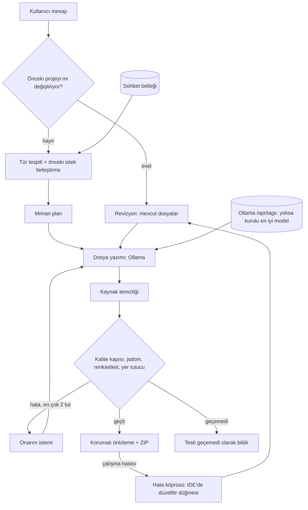

# Çok ajanlı platform şartnamesi: mimari ve durum

Yığın kararı: mevcut FastAPI + SQLite + düz JavaScript + Ollama korunur. Sıfırdan React/Playwright'a geçmek çalışan
859 testi ve özellikleri riske atar; tarayıcı testi için Docker içinde jsdom zaten var.

## Beş temel hata türü ve alınan önlem

| Hata türü | Önlem | Dosya |
|---|---|---|
| Şablon kaçırma (istenen yerine başka uygulama) | Önceki istek takip mesajına eklenir; tek dosya isteği tek dosya planına zorlanır; renk kodu ve etiketler denetlenir | `followup.py`, `workspace_batches.py`, `spec_contract.py` |
| Editör renklendirme sızıntısı | Yazmadan önce temizlenir, tarayıcı kapısı da reddeder | `workspace_batches.pure_source`, `prompts/jsdom_probe.js.txt` |
| Bağlam taşması / unutma | Eski kullanıcı mesajları sıkıştırmada korunur; ayrıntılı tarife "tipik özellik" eklenmez | `memory_engine.py`, `project_flow.py` |
| Sahte veri | Yazım kuralı yasaklar; tarayıcı kapısı yer tutucuları reddeder | `prompts/b4_single_file_writer.txt`, `jsdom_probe.js.txt` |
| Bozuk arayüz durumu | Ekleme ve "Tümü" filtresi gerçekten denenir; hata modele geri gider; geçemezse "hazır" denmez | `workspace_smoke.py`, `revise_chat.py` |

## Akış

## Durum

| Şartname maddesi | Durum |
|---|---|
| Yasa 1 sahte veri | Kısmi: yer tutucu taraması var; modelin uydurduğu gerçekçi örnek kayıtlar yakalanmaz |
| Yasa 2 halüsinasyon | Kısmi: çıktılar test edilir; ajanlar arası her aktarımda JSON şeması yok |
| Yasa 3 eleştirel yaklaşım | Kısmi: sohbet talimatında kural var; proje üretiminde ayrı denetim adımı yok |
| Yasa 4 tarife uyum | Kısmi: renk kodu ve tırnaklı etiketler; ölçü ve yerleşim denetlenmez |
| Yasa 5 saf kaynak | Var |
| Ajan durum makinesi (Bölüm 2) | Kısmi: plan, yazım, onarım hattı var; ayrı Intake/Architect şemaları yok |
| Rol bazlı model (Bölüm 3) | Kısmi: yapılandırma ve yedek model var; rol başına sıcaklık profili tam değil |
| Üç katmanlı bellek (Bölüm 4) | Kısmi: sohbet ve kalıcı bilgiler var; proje başına `spec.json` yalnızca renk/etiket tutar |
| Nokta atışı yama (diff) | Yok: revizyon dosyayı baştan yazar |
| IDE hata köprüsü (Bölüm 5) | Var (mantığı Node ile sınandı; gerçek tarayıcıda denenmedi) |
| API sözleşme testi, API deneme konsolu | Yok / sınırlı |
| Ajan başına istem dosyaları (Faz 4) | Yok |
| Uçtan uca çok türlü stres testi (Faz 5) | Yok |

## Sınır

Yerel 7-9B modeller her maddeyi her üretimde tutturamaz. Kapı hatayı yakalayıp bildirir, başarıyı garanti etmez.
Kapı yalnızca ekleme formu olan sayfaların temel davranışını sınar; oyun, hesap makinesi gibi türlerde senaryo testi devrededir.

## Sıradaki adımlar (sırayla)

1. Nokta atışı yama ile revizyon.
2. Proje başına tam `spec.json` (yerleşim ölçüleri, buton davranışları) ve senaryo testinin bundan üretilmesi.
3. Üretimden önce çelişki/güvenlik denetimi adımı.
4. Üretilen API'ler için gerçek istek testi.
