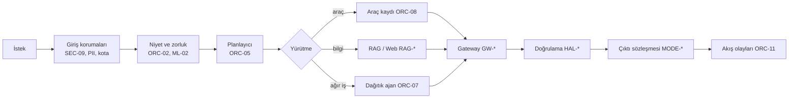

# Parça 2 — LLM Gateway (GW), Orkestratör (ORC) ve Yanıt Modları (MODE)

**Amaç:** "Ne istenirse yapsın" hedefi tek bir büyük sohbet fonksiyonuyla değil, açık aşamalı bir hatla (giriş korumaları → niyet → plan → araç/RAG/ajan → üretim → doğrulama → çıktı sözleşmesi) gerçekleşir. Bugün bu hat tek bir 575 satırlık `_chat_stream_impl` ve 208 satırlık `_prepare_chat_request` içinde anahtar kelime zincirleriyle gömülü [DOĞRULANDI: F9].

**Gateway notu:** Hocanın isteğiyle LiteLLM kaldırıldı. Buradaki "gateway" ayrı bir sunucu değil, **süreç içi bir Python paketidir** (`master/gateway/`); sağlayıcı olarak yerel Ollama ve *dağıtık ajanlar* birincil, harici bulut sağlayıcılar yalnızca isteğe bağlı ve varsayılan kapalıdır (karar D1, README).

---

## A. GW — LLM Gateway ve Model Yönetimi

#### GW-01 · Tek LLM istemci arayüzü
- **Sorun:** [DOĞRULANDI: F18] 13 yerde (`assistant`, `llm`, `deep_research`, `document_factory`, `multimodal_studio`, `workspace_builder`, `tool_executor`, `company_rag`, `hybrid_graph_rag`, `cnc_ballooning`...) Ollama'ya doğrudan `httpx` çağrısı var; zaman aşımı, yeniden deneme, günlük, iptal her birinde farklı veya yok.
- **Değişiklik:** `master/gateway/client.py`: `LLMClient.chat()`, `.stream()`, `.embed()`, `.structured()`; tüm çağıranlar bunu kullanır; doğrudan `httpx` ile `/api/chat|generate|embed` çağrısı lint kuralıyla yasaklanır.
- **Kabul:** `grep` testi: gateway dışında Ollama URL'sine çağrı yok; tüm mevcut testler sahte sağlayıcıyla geçer.
- **Meta:** P0 · L · Bağ: DEF-04 · Durum: açık

#### GW-02 · Sağlayıcı soyutlaması (Ollama, Ajan, OpenAI-uyumlu, opsiyonel bulut)
- **Sorun:** [DOĞRULANDI: F12] Sohbet yolu yalnız master'ın yerel Ollama'sını kullanıyor; hocanın "ajanlar farklı modellerle çalışır" mimarisi sohbette yok.
- **Değişiklik:** `Provider` protokolü: `OllamaProvider`, `AgentProvider` (isteği görev olarak ajan kuyruğuna yazar, sonucu bekler/akıtır), `OpenAICompatProvider` (LM Studio, vLLM, llama.cpp), opsiyonel `AnthropicProvider/GeminiProvider/OpenAIProvider` (anahtar yoksa yüklenmez, günlükte "kapalı").
- **Kabul:** Aynı istek sağlayıcı değiştirilerek (ayar) çalışır; `AgentProvider` ile sahte ajanda uçtan uca test; bulut sağlayıcılar kapalıyken hiçbir dış ağ çağrısı yapılmaz (ağ yakalayıcı testi).
- **Meta:** P0 · L · Bağ: GW-01, SEC-18 · Durum: açık

#### GW-03 · Model kayıt defteri
- **Sorun:** [DOĞRULANDI: F10] Model adları koda gömülü; modellerin bağlamı, yetenekleri, VRAM ihtiyacı, kalitesi tek yerde değil.
- **Değişiklik:** `model_registry` tablosu: ad, sağlayıcı, ajan/düğüm, parametre boyutu, kuantizasyon, bağlam uzunluğu, yetenekler (vision/tools/thinking/embedding/json), tahmini VRAM, benchmark skorları (agents puanlarından), durum; Ollama `/api/tags` + `/api/show` ile otomatik senkron ve elle geçersiz kılma.
- **Kabul:** Ollama'ya yeni model çekilince 60 sn içinde kayıt defterinde görünür ve yetenekleri doğru çıkarılır (test: sahte Ollama).
- **Meta:** P0 · M · Bağ: GW-01 · Durum: açık

#### GW-04 · Yetenek tabanlı model seçimi (açıklanabilir)
- **Sorun:** [DOĞRULANDI: F10] `selection.py`/`task_weights.py` ajanlar için puanla seçim yapıyor ama sohbet/stüdyo bunu kullanmıyor.
- **Değişiklik:** Aynı skor formülü her LLM çağrısında: görev türü ağırlıkları × model puanları × (sıcak model, yük, bağlam yeterliliği, halüsinasyon profili HAL-28); sonuç `{model, skor, gerekçe}` olarak yanıt meta verisine ve arayüze.
- **Kabul:** "kod" görevinde kodlama puanı yüksek model, "uzun belge" görevinde bağlamı yeterli model seçilir (parametrik test); gerekçe metni boş değil.
- **Meta:** P0 · M · Bağ: GW-03, DIST-03 · Durum: açık

#### GW-05 · Bağlam penceresi yönetimi
- **Sorun:** [DOĞRULANDI: F9] Token sayısı hesaplanmıyor; uzun girdi sessizce kesiliyor veya modelin penceresini aşıp kalitesi düşüyor.
- **Değişiklik:** Tokenizer tabanlı sayaç (model ailesine göre; yoksa muhafazakâr tahmin), `num_ctx` dinamik, kapasite aşımında sırasıyla: RAG ile seçici getirme → özetleme → parçalama/map-reduce; kullanıcıya şeffaf bildirim.
- **Kabul:** Pencereyi aşan girdi asla gönderilmez; her yanıt meta verisinde `ctx_used/ctx_max`; aşım senaryosu testinde seçilen strateji kaydedilir.
- **Meta:** P0 · M · Bağ: GW-03, RAG-14 · Durum: açık

#### GW-06 · Dinamik `num_ctx` ve model ısınma
- **Sorun:** [ÖNERİ] Her istekte büyük `num_ctx` istemek yükleme süresini ve bellek kullanımını gereksiz artırır; küçük istekte büyük pencere ısınmış modeli yeniden yüklemeye zorlar.
- **Değişiklik:** İstek boyutuna göre ağ yuvarlanmış `num_ctx` (4k/8k/16k/32k); Ollama `keep_alive` politikası ve önyükleme; sık kullanılan modeller açılışta ısıtılır.
- **Kabul:** Peş peşe 10 kısa sohbet isteğinde model yeniden yükleme sayısı 0 (Ollama `/api/ps` ile doğrulanır).
- **Meta:** P2 · S · Bağ: GW-03 · Durum: açık

#### GW-07 · Decoding profilleri
- **Sorun:** [DOĞRULANDI: F10] Tüm görevlerde `temperature: 0.7`.
- **Değişiklik:** Adlandırılmış profiller: `factual` (T=0.1, top_p=0.8), `code` (T=0.2), `extract` (T=0 + JSON şema), `creative` (T=0.8), `analytic` (T=0.3); görev türüne eşleme tablosu; yeniden üretilebilirlik için isteğe bağlı sabit tohum.
- **Kabul:** Her görev türü bir profile eşlenmiş (test); `extract` profili 20 örnekte şemaya %100 uyar; eval'de olgusal doğruluk 0.7 ayarına göre eşit veya yüksek.
- **Meta:** P0 · S · Bağ: GW-01 · Durum: açık

#### GW-08 · Zaman aşımı, yeniden deneme, devre kesici, yedek zinciri
- **Sorun:** [DOĞRULANDI: F18] Ollama kapalıyken veya model yüklenemezken kullanıcı belirsiz 502 alıyor; geçici hata için yeniden deneme yok.
- **Değişiklik:** Sınıflandırılmış hatalar (bağlantı, zaman aşımı, model yok, OOM, bağlam aşımı); üstel geri çekilmeyle yeniden deneme; devre kesici; yedek zinciri (bir sonraki uygun model/ajan); kullanıcıya nedenli ve şeffaf rozet ("9B yüklenemedi, 4B kullanıldı").
- **Kabul:** Hata enjeksiyon testleri her hata türü için doğru davranışı gösterir; Ollama kapalıyken yanıt "Ollama'ya ulaşılamıyor, şu adımları dene" metni içerir.
- **Meta:** P0 · M · Bağ: GW-01 · Durum: açık

#### GW-09 · İstek kuyruğu, öncelik ve iptal yayılımı
- **Sorun:** [ÖNERİ] Tek GPU'da eşzamanlı istekler birbirini yavaşlatır; arka plan işleri etkileşimli sohbeti bloklayabilir; "Durdur" yalnız tarayıcı akışını keser.
- **Değişiklik:** Model/düğüm başına öncelikli kuyruk (etkileşimli > arka plan > toplu); iptal belirteci akış → araçlar → sağlayıcı → Ollama isteğine yayılır.
- **Kabul:** Arka planda 3 ağır iş varken etkileşimli isteğin ilk token süresi 2 sn'yi aşmaz (yük testi); Durdur sonrası Ollama isteği 1 sn içinde sonlanır.
- **Meta:** P1 · M · Bağ: GW-01 · Durum: açık

#### GW-10 · VRAM bütçe yönetimi ve sıcak model yönlendirme
- **Sorun:** [DOĞRULANDI: F1] `vram_manager.py` ve `cluster_telemetry.py` (sıcak model bilgisi) bağlı değil; model yükleme/boşaltma körlemesine.
- **Değişiklik:** Gateway, ajan telemetrisinden (`/api/ps`) hangi modelin hangi düğümde sıcak olduğunu bilir; aynı kalitede iki seçenek varsa sıcak olanı seçer; tek düğümde sıralı konsey çağrıları için yükleme planı.
- **Kabul:** İki eşdeğer ajandan model-sıcak olan seçilir (test); 8 GB VRAM profilinde konsey akışı OOM vermeden sıralı çalışır (simüle).
- **Meta:** P1 · M · Bağ: GW-03, DIST-04 · Durum: açık

#### GW-11 · Yapılandırılmış çıktı ve onarım döngüsü
- **Sorun:** [DOĞRULANDI: F9] Sınıflandırıcı çıktısı serbest metin + regex ile çözülüyor; yalnız `llm.chat_structured` şema kullanıyor.
- **Değişiklik:** `structured(schema)`: Ollama `format` JSON şeması + pydantic doğrulama; hata varsa hatayı modele geri verip en fazla 2 onarım denemesi; sonuçta tip güvenli nesne veya açık hata.
- **Kabul:** 50 bozuk-çıktı örneğinde (kesik JSON, ekstra metin) ≥ %95 kurtarma; yeni kod serbest metin regex'i ile yapılandırılmış veri çıkarmaz.
- **Meta:** P0 · M · Bağ: GW-01 · Durum: açık

#### GW-12 · Araç çağırma standardı
- **Sorun:** [ÖNERİ] Araç çağrısı destekli modeller (`tools` yeteneği) ile desteksizler aynı yolla kullanılamıyor.
- **Değişiklik:** Tek `tools` arayüzü: yetenek varsa Ollama yerel `tools`, yoksa şema kısıtlı ReAct JSON; ortak sonuç biçimi; güvenli ayrıştırma (kod değerlendirme yok).
- **Kabul:** İki model sınıfında da aynı 20 araç görevi çalışır; hatalı JSON döngüye girmeden 2 onarım denemesiyle toparlanır veya açıkça başarısız olur.
- **Meta:** P1 · M · Bağ: GW-11, ORC-08 · Durum: açık

#### GW-13 · İçerik adresli önbellek
- **Sorun:** [ÖNERİ] Sınıflandırma, gömme, özetleme gibi deterministik çağrılar tekrar tekrar hesaplanıyor.
- **Değişiklik:** `(model, profil, prompt özeti)` anahtarlı SQLite önbelleği; TTL, geçersiz kılma (model değişince), kullanıcıya özel veride kapalı; isabet oranı metriği.
- **Kabul:** Aynı gömme isteği ikinci seferde modele gitmez; önbellek kapalı kullanıcı verisi için hiç yazılmaz (test).
- **Meta:** P2 · S · Bağ: GW-01 · Durum: açık

#### GW-14 · Token/süre/maliyet muhasebesi ve bütçeler
- **Sorun:** [ÖNERİ] Hangi özelliğin ne kadar token/zaman harcadığı bilinmiyor; bulut sağlayıcı açılırsa harcama denetimsiz olur.
- **Değişiklik:** Her çağrıda `tokens_in/out`, TTFT, süre, model, kullanıcı, özellik; kullanıcı/özellik başına günlük bütçe; bulut için para tavanı ve uyarı.
- **Kabul:** Bütçe aşımında çağrı reddedilir ve nedeni yazılır (test); pano toplamları günlüklerle tutarlı.
- **Meta:** P2 · M · Bağ: GW-15 · Durum: açık

#### GW-15 · LLM çağrı izleri
- **Sorun:** [ÖNERİ] Bir yanıt kötü olduğunda hangi prompt/model/ayarla üretildiği geriye dönük bulunamıyor.
- **Değişiklik:** `llm_calls` tablosu: `trace_id`, `run_id`, şablon sürümü, model, profil, süre, durum, hata, prompt/yanıt özeti (PII maskeli, içerik kısaltılmış, saklama süreli).
- **Kabul:** Her sohbet yanıtı için tüm alt çağrılar `run_id` ile listelenebilir (arayüz: "Bu yanıt nasıl üretildi", ORC-23).
- **Meta:** P1 · M · Bağ: GW-01, SEC-23 · Durum: açık

#### GW-16 · Prompt şablonlarının yönetimi
- **Sorun:** [DOĞRULANDI: F9] Çok sayıda Türkçe prompt dizesi `assistant.py` ve diğer modüllere gömülü; sürümlenmiyor, ölçülmeden değiştiriliyor.
- **Değişiklik:** `prompts/*.md` + sürüm kimliği; yükleyici değişken doğrular; her şablon değişikliği eval çalıştırır (HAL-05); eski sürüme dönüş.
- **Kabul:** Kodda 10 satırdan uzun gömülü prompt dizesi kalmaz (lint); şablon değişiklik PR'ında eval raporu otomatik eklenir.
- **Meta:** P1 · M · Bağ: HAL-03 · Durum: açık

#### GW-17 · Sistem promptu katmanları
- **Sorun:** [ÖNERİ] Kimlik/üslup, görev kuralları, kullanıcı tercihleri (hafıza), güvenlik kuralları farklı yerlerde ve sırasız birleşiyor; selamlamada gereksiz hafıza enjeksiyonu gibi sorunlar yaşandı.
- **Değişiklik:** Katmanlı oluşturucu: temel kimlik → güvenlik/talimat hiyerarşisi → mod sözleşmesi (MODE) → ilgili hafıza (alaka eşikli) → araç/RAG bağlamı; her katman bütçeli ve test edilir.
- **Kabul:** Selamlama isteğinde hafıza katmanı boş; kullanıcı tercihi ("emoji yok") ilgili modda uygulanır; katman sırası snapshot testiyle sabit.
- **Meta:** P1 · M · Bağ: GW-16, ORC-21 · Durum: açık

#### GW-18 · Gerçek çok modelli konsey
- **Sorun:** [DOĞRULANDI: F1] `reasoning_council.py` yalnız `tool_executor.run_reasoning_council`'a yönlendiren sarmalayıcı; konseyin bağımsız önerici/eleştirmen/hakem mantığı doğrulanmamış ve sohbetten ne zaman çağrıldığı belirsiz.
- **Değişiklik:** Yüksek riskli/zor görevlerde (ORC-18 kapısı) farklı model ailelerinden ≥ 2 önerici, 1 eleştirmen, 1 hakem; farklı ajanlarda paralel; uyuşmazlık alanları kullanıcıya gösterilir; maliyet bütçeli.
- **Kabul:** Eval'de konsey yolu, zor soru alt kümesinde tek model yoluna göre doğruluğu ≥ 5 puan artırır (yoksa varsayılan kapalı kalır, kanıtlanmadan açılmaz).
- **Meta:** P2 · L · Bağ: GW-02, HAL-03, DIST-09 · Durum: açık

#### GW-19 · Basamaklı (cascade) kalite yönlendirme
- **Sorun:** [ÖNERİ] Her soruya en büyük modeli kullanmak yavaş; hepsine küçük modeli kullanmak kalitesiz.
- **Değişiklik:** Küçük model dener → güven/doğrulama sinyali eşik altındaysa büyük modele veya konseye yükseltir (FrugalGPT tarzı); eşik eval ile öğrenilir.
- **Kabul:** Karma eval setinde ortalama gecikme tek-büyük-model yoluna göre ≥ %30 düşük, doğruluk farkı ≤ 1 puan.
- **Meta:** P2 · M · Bağ: HAL-14, ML-02 · Durum: açık

#### GW-20 · Gateway durum ve kapasite uç noktası
- **Sorun:** [ÖNERİ] Kullanıcı "neden yavaş/hangi model" sorusuna arayüzden cevap bulamıyor.
- **Değişiklik:** `GET /api/gateway/status`: modeller, düğümler, kuyruk uzunluğu, son 5 dk hata oranı, devre kesici durumu, sıcak modeller; arayüz rozeti ve tanı sayfası.
- **Kabul:** Ollama kapalıyken durum "degraded" ve nedeni içerir; kuyruk uzunluğu gerçek yükle uyumlu (test).
- **Meta:** P2 · S · Bağ: GW-09, OPS-03 · Durum: açık

---

## B. ORC — Orkestratör, Niyet, Planlama, Araçlar ve Dağıtık Yürütme

#### ORC-01 · Sohbet hattının aşamalara bölünmesi
- **Sorun:** [DOĞRULANDI: F9] `_chat_stream_impl` 575 satır, `_prepare_chat_request` 208 satır; ek işleme, niyet, RAG, uzman motorlar, model çağrısı, kayıt tek fonksiyonda; her yeni özellik başka bir `if any(k in lower_prompt ...)` ekliyor ve istemeden diğerlerini etkiliyor.
- **Değişiklik:** `master/orchestrator/` paketi: `preprocess → guard_in → route → plan → execute → verify → render → persist` aşamaları, her biri ≤ 150 satır, tip güvenli `Context` nesnesi; `assistant.py` yalnız HTTP ince katmanı.
- **Kabul:** Hiçbir işlev 150 satırı geçmez (lint kapısı OPS-20); mevcut sohbet testleri değişmeden geçer; aşamalar bağımsız birim testiyle sınanır.
- **Meta:** P0 · XL · Bağ: GW-01 · Durum: açık

#### ORC-02 · Gömme tabanlı niyet sınıflandırıcı
- **Sorun:** [DOĞRULANDI: F9] Anahtar kelime zinciri + yalnız `kod|genel` ayıran LLM çağrısı; "bir oyun yap", "sunum hazırla", "araştır" gibi niyetler regex'lerle yakalanıyor ve sık yanlış tetikleniyor.
- **Değişiklik:** Etiketli örneklerle (ORC-03 taksonomisi) bge-m3 gömmesi üstünde lojistik regresyon/kNN; güven eşiği altında netleştirme sorusu (ORC-15) veya genel sohbet; LLM çağrısı yok; sınıflandırıcı sürümlü (ML-01).
- **Kabul:** 600 örneklik dışlanmış sette makro-F1 ≥ 0.90; ortalama sınıflandırma süresi < 30 ms; anahtar kelime tabanlı yönlendirme kodu silinir.
- **Meta:** P0 · L · Bağ: GW-01, RAG-05, ML-01 · Durum: açık

#### ORC-03 · Niyet taksonomisi ve çıktı eşlemesi
- **Sorun:** [ÖNERİ] "Her ne istenirse" hedefi için niyetler tanımlı ve test edilebilir olmalı; şimdi dağınık.
- **Değişiklik:** `orchestrator/intents.yaml`: ~30 niyet (sohbet, olgusal soru, açıklama/ders, kod yaz, kod düzelt, proje üret, oyun üret, sunum üret, belge üret, araştırma, veri analizi, görsel üret, görsel anlat, ses çöz, çeviri, özet, hesap, hukuk/finans/sağlık bilgisi, CNC/mühendislik, dosya dönüştür, otomasyon...) her biri için: yönlendirme, gerekli araçlar, çıktı sözleşmesi (MODE), risk seviyesi, doğrulama profili.
- **Kabul:** Her niyet için ≥ 20 etiketli örnek ve ≥ 1 uçtan uca senaryo testi; taksonomi dışı istek "genel sohbet" yoluna düşer ve kaydedilir (keşif için).
- **Meta:** P0 · M · Bağ: - · Durum: açık

#### ORC-04 · Çok niyetli isteklerin ayrıştırılması
- **Sorun:** [ÖNERİ] "Şu konuyu araştır, 10 slaytlık sunum yap ve özet tablosu çıkar" tek niyete sıkıştırılıyor.
- **Değişiklik:** Birleşik istek algılama; alt niyetlere ve bağımlılık sırasına ayırma (araştırma → tablo → sunum), kullanıcıya plan özeti.
- **Kabul:** 30 birleşik isteğin %90'ında doğru alt görev listesi ve sırası (eval); alt görev sonuçları tek yanıtta bağlantılı artefaktlar olarak gelir.
- **Meta:** P1 · M · Bağ: ORC-03, ORC-05 · Durum: açık

#### ORC-05 · Planlayıcı
- **Sorun:** [DOĞRULANDI: F12] Proje analizi (`decompose.py`) şema kısıtlı planlama yapıyor ama sohbet/stüdyo istekleri için genel planlayıcı yok.
- **Değişiklik:** `plan(request) → Plan{steps[], depends_on, tool, est_cost, risk}` şema kısıtlı üretim (GW-11); doğrulama (döngü yok, araçlar kayıtlı), maliyet/süre tahmini ve pahalı planlarda kullanıcı onayı.
- **Kabul:** Plan şeması her çıktıda geçerli; döngülü/bilinmeyen araçlı plan reddedilip yeniden üretilir; 40 senaryoda plan-kalite kontrol listesi ≥ %85.
- **Meta:** P0 · L · Bağ: GW-11, ORC-08 · Durum: açık

#### ORC-06 · DAG yürütücü
- **Sorun:** [DOĞRULANDI: F12] DAG zamanlayıcı yalnız Scrum proje görevlerinde (`scheduler.py`); sohbet planları için yeniden kullanılmıyor.
- **Değişiklik:** `scheduler` genelleştirilir: bağımlılık çözümü, paralel yürütme, ara çıktı deposu, adım başarısızlığında yeniden deneme → alternatif araç → yeniden planlama → insana sor.
- **Kabul:** 3 paralel + 2 sıralı adımlı plan beklenen sırada ve paralel çalışır; bir adım başarısız olunca yalnız bağımlıları etkilenir (test).
- **Meta:** P0 · L · Bağ: ORC-05 · Durum: açık

#### ORC-07 · Sohbet/stüdyo adımlarının dağıtık ajanlara dağıtımı
- **Sorun:** [DOĞRULANDI: F12] Hocanın çekirdek mimarisi (master ayrıştırır, yetenek profiline göre ajanlara dağıtır, sonuçları entegre eder) yalnız Scrum görev hattında çalışıyor; sohbet, stüdyo, araştırma ve sunum master'da tek düğümle yürüyor.
- **Değişiklik:** Planın adımları `tasks` tablosuna yazılır, `selection` ile uygun ajan seçilir, sonuç toplanır (aynı kiralama/yeniden atama mekanizması); master yalnız orkestre eder ve entegrasyon yapar; ajan yoksa yerel yedek.
- **Kabul:** 6 ajanlı ortamda 15 dosyalı proje üretimi ve 8 alt soruluk araştırma ajanlara dağılır; her çıktıda "Üreten: ajan·model" atfı; bir ajan düşerse görevi yeniden atanıp tamamlanır (chaos testi DIST-22).
- **Meta:** P0 · XL · Bağ: ORC-06, GW-02, DIST-06 · Durum: açık

#### ORC-08 · Araç kayıt defteri
- **Sorun:** [DOĞRULANDI: F1] `tool_executor`, `tools_math_science`, `tools_data_sql` ve sandbox ayrı ayrı; araçların şeması, yan etkisi, onay gereksinimi tanımsız.
- **Değişiklik:** `tools/registry.py`: araç adı, JSON Schema girdi/çıktı, yan etki sınıfı (salt-okunur/yazma/ağ/pahalı), onay gereksinimi, zaman aşımı, kota, örnekler, sürüm; mevcut araçlar (hesap, SQL, matematik, sandbox, arama, dosya, dönüştürme) taşınır; MCP araçları buraya kaydolur.
- **Kabul:** Her araç şemasıyla doğrulanır; şemaya uymayan çağrı çalıştırılmadan hata döner; kayıt defteri araç listesi OpenAPI benzeri belge üretir.
- **Meta:** P0 · L · Bağ: GW-11 · Durum: açık

#### ORC-09 · Araç döngüsü (ReAct)
- **Sorun:** [ÖNERİ] Çok adımlı araç kullanımı için sınırlı, izlenebilir bir döngü yok.
- **Değişiklik:** `düşün → araç çağır → gözle` döngüsü: en fazla N adım, bütçe, tekrar eden çağrı (döngü) tespiti, araç hatasını modele geri verme, her adımın akışta görünmesi.
- **Kabul:** Döngüye sokan sahte araçla N adımda durur ve nedeni raporlar; her adım SSE'de `step_start/step_end` olarak görünür.
- **Meta:** P1 · M · Bağ: ORC-08, ORC-11 · Durum: açık

#### ORC-10 · İnsan onay kapısı
- **Sorun:** [ÖNERİ] Yazma/ağ/pahalı eylemler (dosya silme, web'e istek, harici MCP çağrısı, uzun üretim) kullanıcıya sorulmadan yapılabilir.
- **Değişiklik:** Yan etki sınıfına göre `approval_required` olayı; arayüz onay kartı (neyi, hangi parametrelerle); zaman aşımında reddedilmiş sayılır; "bu oturumda hep izin ver" kapsamı sınırlı.
- **Kabul:** Onay verilmeden yazan araç çalışmaz (test); reddedilince plan yeniden düzenlenir; onay kayıtları denetim izine gider.
- **Meta:** P0 · M · Bağ: ORC-08, SEC-15 · Durum: açık

#### ORC-11 · SSE olay protokolü
- **Sorun:** [ÖNERİ] Akış bugün metin parçaları ve birkaç özel işaretçi; arayüz plan, araç, kaynak, doğrulama bilgisini gösteremiyor.
- **Değişiklik:** Sürümlü olay şeması: `meta`, `route`, `plan`, `step_start`, `step_end`, `token`, `citation`, `artifact`, `verification`, `warning`, `approval_required`, `done`, `error`; JSON şeması ve TypeScript tipleri otomatik üretilir.
- **Kabul:** İstemci bilinmeyen olay türünü yok sayar (ileri uyumluluk); sözleşme testi tüm olayların şemaya uyduğunu doğrular.
- **Meta:** P0 · M · Bağ: ORC-01 · Durum: açık

#### ORC-12 · İptal yayılımı
- **Sorun:** [ÖNERİ] "Durdur" bugün istemci akışını kesiyor; araçlar ve model çalışmaya devam edebilir.
- **Değişiklik:** İstek başına iptal belirteci: orkestratör aşamaları, araç yürütme, sandbox süreçleri, ajan görevleri (iptal komutu) ve Ollama isteği durdurulur.
- **Kabul:** Durdur sonrası 2 sn içinde sandbox süreci ve model üretimi biter (test); kısmi sonuçlar "yarım bırakıldı" etiketiyle saklanır.
- **Meta:** P1 · M · Bağ: GW-09 · Durum: açık

#### ORC-13 · Uzun işler için iş kuyruğu ve yeniden bağlanma
- **Sorun:** [DOĞRULANDI: F9] Uzun üretim istemci akışına bağlı; sayfa yenilenince/ağ kopunca iş izlenemiyor.
- **Değişiklik:** `jobs` tablosu: durum, ilerleme olayları, sonuç referansı; istemci iş kimliğiyle yeniden bağlanır ve kaçırdığı olayları alır; bitince bildirim (UX-25).
- **Kabul:** Üretim sırasında sayfa yenilenince ilerleme kaldığı yerden görünür; sunucu yeniden başlarsa devam eden iş "kesildi" olarak işaretlenir ve devam ettirilebilir.
- **Meta:** P0 · L · Bağ: ORC-11, DAT-04 · Durum: açık

#### ORC-14 · Konuşma durumu ve bağlam sabitleme
- **Sorun:** [DOĞRULANDI: F1] `memory_engine.compact_conversation_context` özetleme/sabitleme mantığı var ama sohbet hattına bağlı mı doğrulanmadı; uzun sohbette erken içerik kaybolabilir.
- **Değişiklik:** Konuşma durumu nesnesi: açık görevler, kullanıcı kısıtları, kararlar, sabitlenmiş kod/belge; bağlam dolunca hiyerarşik özet, sabitlenenler korunur.
- **Kabul:** 100 turluk sohbet testinde ilk 5 turda verilen kısıt (ör. "emoji yok", dosya adı) son turda hâlâ uygulanır.
- **Meta:** P1 · M · Bağ: GW-05 · Durum: açık

#### ORC-15 · Netleştirme politikası
- **Sorun:** [ÖNERİ] Eksik girdide model tahmin ediyor (örneğin bilinmeyen finansal değerler); gereksiz soru da sıkıcı.
- **Değişiklik:** Niyet başına zorunlu girdi listesi; eksikse en fazla 1–2 hedefli soru; geri kalan varsayımlar açıkça listelenip yanıtın başında belirtilir; sayısal/hukuki/finansal girdiler asla tahmin edilmez.
- **Kabul:** "DCF yap" eksik girdilerle sorulduğunda hesaplamaz, gerekli girdi listesini sorar (test); "basit bir hesap makinesi yap" sormadan üretir ve varsayımları listeler.
- **Meta:** P0 · M · Bağ: ORC-03 · Durum: açık

#### ORC-16 · Hedefli düzenleme ve artefakt farkındalığı
- **Sorun:** [ÖNERİ] "3. slaytı kısalt", "login fonksiyonunu düzelt" gibi isteklerde tüm artefaktı yeniden üretmek hem yavaş hem hata riskli.
- **Değişiklik:** Artefakt kimlik/sürümü bağlama alınır; düzenleme istekleri yalnız hedef parçayı (slayt/dosya/fonksiyon) üretir, yama olarak uygular, sürüm oluşturur.
- **Kabul:** Hedef dışı içerik bayt bayt aynı kalır (test); geri alma sürüm geçmişinden çalışır.
- **Meta:** P1 · L · Bağ: ORC-17 · Durum: açık

#### ORC-17 · Artefakt modeli
- **Sorun:** [DOĞRULANDI: F9] Üretilen kod, sunum, belge, görsel sohbet mesajına gömülü veya dağınık dizinlerde; yeniden açma, sürüm, kaynak izleme yok.
- **Değişiklik:** `artifacts` tablosu: tür, sürümler, içerik/dosya referansı, kaynaklar/atıflar, doğrulama raporu, üreten ajan/model, bağlı sohbet; sohbetten bağımsız açılır (UX-11).
- **Kabul:** Sohbet silinse bile artefakt (kullanıcı isterse) kalır; her artefakt sürümünün doğrulama raporu ve üreticisi görünür.
- **Meta:** P0 · L · Bağ: DAT-04 · Durum: açık

#### ORC-18 · Maliyet-kalite kademesi ve doğrulama bütçesi
- **Sorun:** [ÖNERİ] Her soruya konsey/öz-tutarlılık/CoVe uygulamak sistemi çok yavaşlatır; hiç uygulamamak halüsinasyon bırakır.
- **Değişiklik:** Niyet riski + ML-02 zorluk tahmini + güven sinyaliyle yol seçimi: hızlı (önbellek/araç) → standart → doğrulamalı → konsey; kararlar kayıt altına alınır.
- **Kabul:** Basit selamlama/hesap sorusu doğrulama aşamalarını atlar; yüksek riskli niyet (sağlık/hukuk/finans) en az atıf doğrulamasından geçer (test).
- **Meta:** P1 · M · Bağ: ML-02, HAL-14 · Durum: açık

#### ORC-19 · Korumaların hatta entegrasyonu
- **Sorun:** [DOĞRULANDI: F11] Giriş ve çıkış korumaları (enjeksiyon, PII, atıf, talimat uyumu) hatta bağlı değil veya dağınık.
- **Değişiklik:** `guard_in` (enjeksiyon, PII, kota) ve `verify/guard_out` (atıf, sayısal, çıktı sözleşmesi, güvenlik) aşamaları; her koruma açık `Decision{allow/modify/block, reason}` döndürür ve olay olarak yayınlanır.
- **Kabul:** Her koruma için ihlal ve geçiş testi; engelleme nedeni kullanıcıya anlaşılır metinle gösterilir.
- **Meta:** P0 · M · Bağ: ORC-01, SEC-09, HAL-08 · Durum: açık

#### ORC-20 · Dil algılama ve yanıt dili politikası
- **Sorun:** [ÖNERİ] Türkçe/İngilizce karışık girdide yanıt dili tutarsız olabiliyor; teknik terimlerde çeviri hataları.
- **Değişiklik:** Dil algılama (hafif); kullanıcının ayarı ve mesaj dili önceliği; kod/komut/API adları çevrilmez; kullanıcı terim sözlüğü.
- **Kabul:** 100 karışık dilli örnekte doğru dil seçimi ≥ %95; kod blokları ve teknik terimler değişmez.
- **Meta:** P2 · S · Bağ: GW-17 · Durum: açık

#### ORC-21 · Hafıza enjeksiyonu için alaka eşiği
- **Sorun:** [DOĞRULANDI: F9] Bilgi bankası/hafıza bağlamı eşik ve alaka denetimi olmadan prompta ekleniyor; alakasız bağlam halüsinasyonu artırır (selamlamada atlama kısmen var).
- **Değişiklik:** Hafıza/RAG enjeksiyonu yalnız alaka skoru eşiğini geçerse; her enjekte parçanın kaynak etiketi; kullanıcıya "şu hafıza kullanıldı" görünür.
- **Kabul:** 50 alakasız soruda enjekte edilen bağlam oranı < %5; alakalı sorularda isabet ≥ %90.
- **Meta:** P1 · S · Bağ: RAG-08 · Durum: açık

#### ORC-22 · Geri bildirim yakalama
- **Sorun:** [ÖNERİ] Kullanıcı düzeltmeleri ve beğeni/beğenmeme sistemden öğrenilmiyor.
- **Değişiklik:** Yanıt başına beğen/beğenme + neden etiketi (yanlış bilgi, eksik, biçim, yavaş) + isteğe bağlı doğru cevap; `feedback` tablosu; eval havuzu/DPO verisine aday (kullanıcı onayıyla).
- **Kabul:** Her geri bildirim `run_id` ile ilişkilenir; "yanlış bilgi" etiketi HAL-25 kuyruğuna düşer.
- **Meta:** P1 · M · Bağ: DAT-04 · Durum: açık

#### ORC-23 · Yeniden üretilebilirlik ve "nasıl üretildi" paneli
- **Sorun:** [ÖNERİ] Yanıtın hangi modelle, hangi kaynaklarla, hangi doğrulamalarla üretildiği görünmüyor.
- **Değişiklik:** Her yanıta `run_id`; plan, araç çağrıları, kullanılan kaynaklar, modeller, doğrulama sonuçları, süreler panelde; "aynı ayarlarla yeniden çalıştır".
- **Kabul:** Panelde listelenen alt çağrı sayısı `llm_calls` kayıtlarıyla eşleşir; yeniden çalıştırma aynı yapılandırmayla yeni run üretir.
- **Meta:** P2 · M · Bağ: GW-15, UX-09 · Durum: açık

#### ORC-24 · Orkestratör senaryo test paketi
- **Sorun:** [DOĞRULANDI: F18] 280 test var ama uçtan uca "niyet → plan → araç → çıktı türü" davranışını güvenceye alan senaryo seti yok.
- **Değişiklik:** Deterministik sahte LLM ve kayıt/tekrar ile 60 senaryo (niyet başına ≥ 2); beklenen plan, araç çağrıları, çıktı türü ve korumaların kararı.
- **Kabul:** 60 senaryo CI'da < 60 sn; yeni niyet eklemek en az 2 senaryo gerektirir (kapsam kapısı).
- **Meta:** P0 · L · Bağ: ORC-01, OPS-10 · Durum: açık

---

## C. MODE — Çıktı Sözleşmeleri ("istenen neyse o")

> Kullanıcının istediği: *kod isterse yalnız kod, konu anlatımı isterse anlatım, araştırma isterse araştırma.* Bu, prompt'a eklenen bir cümleyle değil, **doğrulanan bir sözleşmeyle** sağlanır.

#### MODE-01 · Çıktı sözleşmesi şeması
- **Sorun:** [ÖNERİ] "Yalnız kod ver" gibi talimatlar ayrı ayrı `CODE_ONLY_RE` regex'iyle yakalanıyor; genel bir mekanizma yok.
- **Değişiklik:** `ResponseContract{mode, allowed_blocks, required_sections, forbidden, max_words, language, citation_policy}` ve niyet → sözleşme eşlemesi (ORC-03); sözleşme hem prompt'a hem doğrulayıcıya girer.
- **Kabul:** Her niyetin bir sözleşmesi var (test); sözleşme ihlali `verification` olayı üretir.
- **Meta:** P0 · M · Bağ: ORC-03 · Durum: açık

#### MODE-02 · "Yalnız kod" modu
- **Sorun:** [DOĞRULANDI: F9] Mevcut tespit yalnız birkaç Türkçe kalıp; kural ihlali (açıklama eklemek) doğrulanmıyor.
- **Değişiklik:** Yalnız tek (veya istenen sayıda) kod bloğu + isteğe bağlı çalıştırma komutu; blok dışı metin yok; doğrulayıcı AST ile bloğu çözümler ve ihlalde bir kez yeniden üretir.
- **Kabul:** 50 "sadece kod" isteğinde blok dışı metin içeren yanıt oranı < %2; kod sözdizimi geçerli (≥ %98).
- **Meta:** P1 · S · Bağ: MODE-01, HAL-12 · Durum: açık

#### MODE-03 · "Konu anlatımı" modu
- **Sorun:** [ÖNERİ] Anlatım kalitesi tutarsız; öğrenci düzeyine uyum yok.
- **Değişiklik:** Öğretim yapısı: hedef, sezgi/analoji, adım adım anlatım, çalışılmış örnek, sık hata, kısa alıştırma + çözüm; seviye (başlangıç/orta/ileri) kullanıcı hafızasından; olgusal içerik kaynaklı (HAL-08).
- **Kabul:** Kontrol listesi (6 bölümün varlığı) ≥ %95; matematik/kod örnekleri araçla doğrulanmış (HAL-12, DOM-10).
- **Meta:** P2 · M · Bağ: MODE-01 · Durum: açık

#### MODE-04 · "Araştırma" modu
- **Sorun:** [DOĞRULANDI: F7] Bugün "araştırma" yalnız modelin hafızası; kaynak yok.
- **Değişiklik:** Özet, bulgular (atıflı), çelişkiler/belirsizlikler, sınırlılıklar, kaynakça; her olgusal cümle atıflı; kaynaksız cümle yazılmaz (RES-04).
- **Kabul:** Atıfsız olgusal cümle oranı < %3; atıfların %95'i gerçekten iddiayı destekler (HAL-07 ölçümü).
- **Meta:** P0 · M · Bağ: MODE-01, RES-04 · Durum: açık

#### MODE-05 · "Sunum" modu
- **Sorun:** [ÖNERİ] Kullanıcı sonucu yönetmeden tek seferde sunum üretiliyor.
- **Değişiklik:** Önce anahat önizlemesi (isteğe bağlı atlanır), sonra PPTX; sohbette slayt küçük resimleri; indirme kartı (PPT-08).
- **Kabul:** Anahat onayı olmadan "hızlı üret" seçeneği çalışır; onay akışında değişiklik istekleri yeni anahatta yansır.
- **Meta:** P1 · S · Bağ: PPT-01, PPT-08 · Durum: açık

#### MODE-06 · "Proje" modu
- **Sorun:** [ÖNERİ] Proje üretiminde sohbet metni uzun kalıyor; asıl çıktı IDE panosu.
- **Değişiklik:** Sohbette yalnız kısa özet (ne üretildi, nasıl çalıştırılır, test sonucu); dosya ağacı ve kod IDE panelinde; çalıştırma komutu doğrulanmış.
- **Kabul:** Yanıt metni ≤ 120 kelime; "çalıştır" komutu sandbox'ta gerçekten başarılı (IDE-05).
- **Meta:** P1 · S · Bağ: IDE-05 · Durum: açık

#### MODE-07 · "Kısa cevap" modu
- **Sorun:** [ÖNERİ] Basit sorularda uzun, dolgu cümleli yanıtlar.
- **Değişiklik:** ≤ 3 cümle; "ayrıntı ver" ile genişletme; olgusal ise kaynak/hesap izi tek satırda.
- **Kabul:** Basit soru setinde ortalama yanıt ≤ 45 kelime; doğruluk uzun moda göre düşmez (eval).
- **Meta:** P2 · S · Bağ: MODE-01 · Durum: açık

#### MODE-08 · Kullanıcı biçim talimatlarının sözleşmeye çevrilmesi
- **Sorun:** [ÖNERİ] "madde madde yaz", "tablo ver", "kısa tut", "İngilizce yaz" gibi talimatlar prompt'ta kalıyor, uygulandığı doğrulanmıyor.
- **Değişiklik:** Talimat ayrıştırıcı biçim kısıtlarını sözleşmeye ekler; doğrulayıcı uyumu denetler; ihlalde bir kez yeniden üretir ve kalıcı tercihleri hafızaya yazmayı önerir.
- **Kabul:** 100 biçim talimatlı istekte uyum ≥ %95 (kural tabanlı doğrulama).
- **Meta:** P1 · M · Bağ: MODE-01, HAL-20 · Durum: açık
