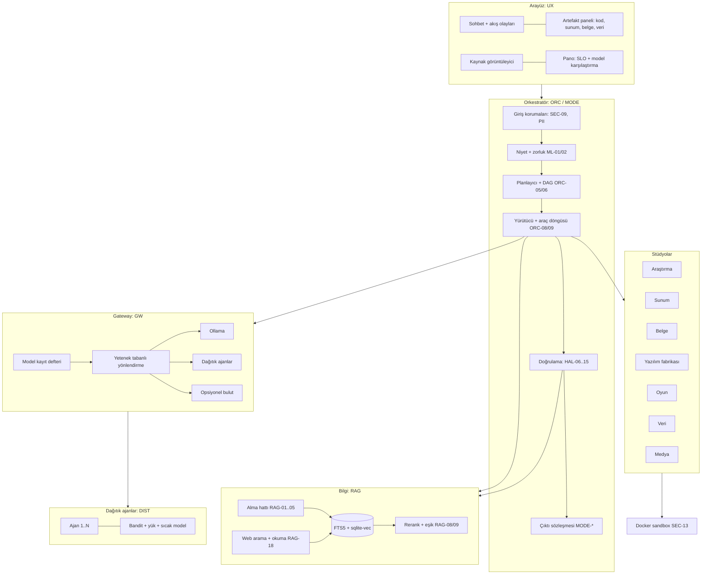

# Master Plan v2 — Güvenilir, Dağıtık, Evrensel Yapay Zekâ Platformu

**Durum:** 23 Kasım 2026 denetimine dayanır · **Giriş noktası bu dosyadır.**

<!-- summary:begin -->
**376 madde** · P0 120 · denetim bulgusuna dayalı 191 · öneri 185 · toplam 1.174,5 kişi-gün (P0: 487,0) · en uzun bağımlılık zinciri 11 madde
<!-- summary:end -->

Yukarıdaki özet satırı `python scripts/plan_tool.py render` ile üretilir; elle değiştirilmez, `check` güncel olmayan bloğu hata sayar.

Bu plan, mevcut projenin (hocanın dağıtık ajan gereksinimlerini karşılayan çekirdek + sonradan eklenen asistan, stüdyo, RAG, CNC ve diğer modüller) üzerine, kullanıcının hedefini gerçekleştirmek için hazırlanmıştır:

> Herhangi bir kullanıcı, herhangi bir alanda ne isterse yapabilsin: araştırma yapıp sunum hazırlasın, belge/tablo üretsin, proje ve oyun yazıp dosyalarıyla IDE gibi göstersin, yalnız kod isteyene yalnız kod, konu anlatımı isteyene anlatım versin. **Halüsinasyonu mimariyle çok düşük tutsun**, bilmediğini söylesin, kaynak göstersin. Hocanın dağıtık ajan mimarisi ürünün ayrılmaz parçası olarak kalsın.

## 1. Önceki plandan farkı: kanıt, beyan değil

Önceki plan (694 satır, `docs/ENTERPRISE_AI_MASTER_IMPLEMENTATION_PLAN.md` ve kopyası) 80 modülü "DONE (Canlı)" ilan ediyor; ilerleme dosyası (`docs/IMPLEMENTATION_PROGRESS.json`) hepsini `completed` işaretliyor. Denetimde bunun kendi beyanından ibaret olduğu görüldü: modüllerin yaklaşık yarısı canlı uygulamaya bağlı değil, "canlı" dediği bazı özellikler hiç çalışmamış. **Bu planda hiçbir madde kendi kendini tamamlanmış ilan edemez.** Plan dosyaları yalnızca `Durum: açık` diyebilir; ilerleme `PROGRESS.json`'da tutulur ve "done" ancak kabul testi + commit kanıtıyla kabul edilir (`plan_tool.py status`).

Plandaki her madde: `[DOĞRULANDI: F#]` (denetimde yeniden üretilebilen bulgu) veya `[ÖNERİ]` (henüz ölçülmemiş tasarım kararı) etiketiyle başlar. Denetim bulgusuna dayalı ve öneri madde sayıları yukarıdaki özet satırındadır.

## 2. Denetim bulguları (yeniden üretilebilir)

Komutlar repo kökünde, `master\venv\Scripts\python.exe` ile çalıştırılır.

| Kod | Bulgu | Yeniden üretme | Durum |
|---|---|---|---|
| F1 | `app.py`'den içe aktarma zinciriyle erişilemeyen 47 modül; 21 modül yalnızca başka modüle yönlendiren ince sarmalayıcı (aralarında `software_factory`, `swarm_coordinator`, `fault_tolerance`, `bandit_router`, `map_reduce_llm`, `citation_guard`, `auth_rbac`, `secure_sandbox`, `voice_engine`) | `python scripts/plan_tool.py wiring --facades` | Açık |
| F2 | Kimliksiz uç noktalar: `POST /api/studio/workspaces/{id}/exec` (serbest komut), `run-code`, `launch-exe`, `start-server`, `GET /api/admin/backup.zip` (tüm DB), kullanıcı verisi dışa aktarma/silme, MCP `call` (sunucudan istek, SSRF); önizleme aynı origin'den; MCP anahtarı düz metin. Master `0.0.0.0`'a bağlı. | `master/studio_api.py` `exec_in_workspace`; `master/tests/test_access_control.py` | **Kısmen düzeltildi** (commit `fd32d3e`: yalnız sunucu makinesi veya `X-Admin-Token`); asıl çözüm SEC-01..SEC-24 |
| F3 | Sohbetteki GraphRAG araması `HybridGraphRAG.hybrid_search` çağırıyordu; metot yok (`search` var), hata `except Exception: pass` ile yutuldu, özellik hiç çalışmadı | `master/tests/test_grounding_fixes.py` | **Düzeltildi** (`fd32d3e`) |
| F4 | "dcf/cfo" anahtar kelimesi `run_cfo_financial_analysis()`'i argümansız çağırıp yerleşik örnek şirket verisini kullanıcının sayılarıymış gibi prompta ekliyordu | aynı test | **Düzeltildi** (`fd32d3e`); motor sözleşmesi DOM-01 |
| F5 | Hukuki risk motoru belge yokken kullanıcının prompt metnini "sözleşme" sayıp tarıyordu | aynı test | **Düzeltildi** (`fd32d3e`) |
| F6 | `numpy` ve `python-pptx` modül düzeyinde içe aktarılıyor ama `requirements.txt`'te yoktu: temiz CI ve master Docker imajı açılışta çökerdi | `master/requirements.txt` | **Düzeltildi** (`fd32d3e`); kilit dosyası DEF-13 |
| F7 | İnternet erişimi **yok**: `deep_research.py` yalnızca yerel Ollama'ya istek atıyor. "Araştır ve sunum yap" modelin parametrik hafızasından yazması demek; kaynak veremez, güncel olamaz | `grep -n "httpx" master/deep_research.py` (tek çağrı Ollama) | Açık |
| F8 | RAG: kullanıcı belgelerini dizine alan kod yok (`add_document` yalnız modül içinde); `company_rag` belgeleri koda gömülü; `search` her sorguda tüm tabloyu tarıyor (O(N)); Ollama gömmesi yoksa sessizce 256 boyutlu n-gram karmasına düşüyor; RRF alaka eşiği olmadan her zaman bir sonuç döndürüyor | `master/hybrid_graph_rag.py` `search`, `_embed` | Kısmen (yalnız F3 düzeltildi); dizin hâlâ boş |
| F9 | Sohbet hattı monolit: `_chat_stream_impl` 575, `_prepare_chat_request` 208 satır; anahtar kelime zinciri; her mesajda sınıflandırıcı LLM çağrısı; ek 16.000 karakterde sessiz kesiliyor; her CSV'ye otomatik tahmin ekleniyor | `master/assistant.py` | Açık |
| F10 | Sabit sıcaklık 0.7; model tercihi sabit isim listesi; ajanların yetenek puanları sohbette kullanılmıyor; görsel ajan yönlendirmesi `pass` ile boş | `assistant.call_ollama_chat`, `_select_grounded_model` | Açık |
| F11 | Doğrulama katmanı yok: `citation_guard` bağlı değil, atıf/güven/kaçınma yok; 62 `except Exception` (25'i doğrudan `pass`/`continue`) | `grep -c "except Exception" master/*.py` | Açık |
| F12 | Dağıtık ajan mimarisi yalnız Scrum proje görev hattında; sohbet, stüdyo, araştırma, sunum master'da tek düğüm; `swarm_coordinator`, `map_reduce_llm`, `fault_tolerance`, `bandit_router` erişilemez | `plan_tool.py wiring` | Açık |
| F13 | Giriş yok; `/api/user/{user_id}/...` kimlik denetimsiz (başkasının sohbeti okunabilir); tek ortak `AGENT_TOKEN`, sonuç gönderiminde çağıranın görevin atanmış ajanı olduğu doğrulanmıyor | `master/user_api.py`, `master/tasks_api.py` `submit_result` | Açık |
| F14 | 4 ayrı SQLite dosyası (`platform`, `user_profile`, `cognitive_memory`, `graph_rag`); WAL yalnız `memory_engine`'de; elle yazılmış `ALTER TABLE` listesi, şema sürümü yok | `master/data/*.db`, `master/db.py` | Açık |
| F15 | ~6.000 satır vanilla JS (`assistant.js` 1952), `package.json` yok: lint/tip/birim/e2e/derleme yok; yeniden üret ve mesaj düzenleme yok; `aria-` yalnız 3 dosyada | `ls master/static/js`, `grep -l aria- ...` | Açık |
| F16 | Önceki ilerleme dosyası kendi beyanına dayalı | `docs/IMPLEMENTATION_PROGRESS.json` | Açık (PROC-09 ile değişir) |
| F17 | Arayüzü olmayan uç noktalar: çakışma çözümü, görev iptal, fix-tasks, CMM ölçüm, olay günlüğü, perf/stats, hafıza, çalışma alanı silme. Frontend'in çağırdığı **hiçbir** endpoint eksik değil (89 route, 0 kopuk çağrı) | OpenAPI ile karşılaştırma (`app.openapi()`) | Açık |
| F18 | Test/ölçüm borcu: 280 test geçiyor ama hepsi sahte LLM; gerçek kaliteyi ölçen 0; 13 doğrudan Ollama çağrı noktası (10 modül, gateway yok); 9 fonksiyon > 150 satır; 9 `subprocess` çağrısı cp1254 ile çözüyor (`UnicodeDecodeError` görüldü) | `pytest`, `grep -n "/api/chat" master/*.py` | Açık |
| F19 | Yazılım üretimi için iki paralel hat: canlı `workspace_builder` ile erişilemez `software_factory`/`self_healing_runner`/`visual_verifier`/`build_pipelines`/`project_archetypes` | `plan_tool.py wiring` | Açık |
| F20 | Yükleme/medya: `extract_zip_text` ve ZIP içe aktarmada toplam boyut/oran/dosya sayısı sınırı yok (ZIP bombası); `/api/assistant/media/{ad}` yetkisiz; saklama süresi ve tam silme yok | `master/extract.py`, `master/assistant.py` | Açık |

> **Eş zamanlı çalışma uyarısı:** Denetim sırasında aynı çalışma ağacında başka bir araç (büyük olasılıkla Antigravity) bu planın SEC maddelerini uygulamaya başladı (`secret_store.py`, `log_sanitizer.py`, `backup_manager.py` ve `config.py` değişiklikleri). İki aracın aynı dosyayı aynı anda düzenlemesi sessiz üzerine yazmaya yol açar; bkz. Bölüm 8, kural 9.

## 3. Tasarım ilkeleri

1. **Önce ölç.** Ölçülmeyen iyileştirme eklenmez; eval düzeneği (HAL-02/03) her şeyden önce kurulur.
2. **Güvenilirlik mimariyle gelir.** Olgusal doğruluk kaynaktan (RAG, web), hesap araçtan, kod çalıştırmadan, kendinden-emin-yanlışlık kalibrasyon ve kaçınmadan gelir. İnce ayar çoğunlukla davranışı (biçim, araç kullanımı, kaçınma) düzeltir; olgu bilgisini güvenilir artırmaz (Parça 3).
3. **Her iddia ya kaynaklı, ya hesaplanmış, ya etiketli** ("doğrulanamadı").
4. **Bilmediğini söylemek bir özelliktir** (HAL-15), hata değildir.
5. **İstenen neyse o:** çıktı sözleşmesi (MODE) hem üretimi hem doğrulamayı yönetir.
6. **Dağıtık mimari ürünün parçasıdır:** sohbet, araştırma, stüdyo dahil işler ajan yeteneklerine göre dağıtılır (ORC-07); tek düğüm yalnız yedektir.
7. **Yerel-önce, bulut isteğe bağlı** (karar D1). Gizli veri kullanıcıdan çıkmaz; bulut kapalıyken dış ağ çağrısı yapılmadığı test edilir.
8. **Güvenli varsayılan:** kimliksiz değiştirici uç nokta yok, ana makinede serbest komut yok, `127.0.0.1` varsayılan.
9. **Kanıtsız "bitti" yok:** kabul testi + commit + bağlantı kapısı (Bölüm 8).
10. **Küçük adımlar:** madde başına bir PR; hiçbir madde XL'den büyük değildir.

## 4. Bekleyen kararlar (kullanıcı onayı gerekir)

Plan her biri için bir **öneri** içerir; karar verilene kadar öneri varsayılandır ve ADR'ye (OPS-14) yazılır.

| Kod | Karar | Seçenekler | Öneri ve gerekçe |
|---|---|---|---|
| D1 | Harici bulut LLM sağlayıcıları | (a) hiç yok (b) gateway destekler, varsayılan kapalı (c) varsayılan açık | **(b).** Hedef "Claude/GPT/Gemini düzeyi" çıktı; 4B–9B yerel modeller genel bilgide ulaşamaz. Zor işleri isteğe bağlı bulut/büyük ajana yükseltebilmek gerekir, ancak ders ve gizlilik için varsayılan kapalı. LiteLLM sunucusu yok; süreç içi gateway. |
| D2 | Web arama sağlayıcısı | SearXNG (self-host) / Brave / Tavily / DuckDuckGo HTML | **SearXNG** (Docker profili `web-search`), anahtarsız; Brave/Tavily isteğe bağlı. |
| D3 | Kimlik | yerel hesap / Tailscale kimliği / ikisi | **Yerel hesap + oturum çerezi**; Tailscale başlık kimliği isteğe bağlı (SEC-02). |
| D4 | Frontend | vanilla'yı koru / Vite+TS (kademeli) / framework'e yeniden yazım | **Vite + TypeScript `checkJs`**, yeniden yazım yok (UX-01/02). |
| D5 | Vektör deposu | `sqlite-vec` / Qdrant / HNSW kütüphanesi | **sqlite-vec** (tek dosya, kurulum yok). |
| D6 | Gömme modeli | `bge-m3` / `nomic-embed` / `multilingual-e5` | **bge-m3** (Türkçe iyi, Ollama'da var); eval ile doğrulanır. |
| D7 | Kod sandbox'ı | Docker köksüz / gVisor / yalnız süreç | **Docker** (Docker Desktop kurulu); Docker yoksa özellik kapalı. |
| D8 | Veritabanı | tek SQLite WAL / çoklu SQLite / Postgres | **Tek SQLite WAL**, Postgres uyumluluğu isteğe bağlı (DAT-01/16). |

## 5. Hedef mimari

## 6. Plan dosyaları ve içerik

<!-- counts:begin -->
| Dosya | Alanlar (madde sayısı) | Toplam |
|---|---|---|
| `01-temel-ve-guvenlik.md` | DEF (24), SEC (24) | 48 |
| `02-gateway-orkestrator.md` | GW (20), ORC (24), MODE (8) | 52 |
| `03-temellendirme-rag-halusinasyon-ml.md` | RAG (30), HAL (30), ML (14) | 74 |
| `04-arastirma-belge-veri-medya.md` | RES (12), PPT (10), DOC (10), DS (10), MM (14) | 56 |
| `05-yazilim-fabrikasi-oyun-alan.md` | IDE (24), GAME (10), DOM (12) | 46 |
| `06-dagitik-ajanlar-ve-arayuz.md` | DIST (22), UX (28) | 50 |
| `07-veri-operasyon-surec.md` | DAT (16), OPS (24), PROC (10) | 50 |
<!-- counts:end -->

Diğer dosyalar: `08-yol-haritasi-riskler.md` (fazlar, kritik yol, MVP, riskler, kapsam dışı) · `phases.json` (her madde tam olarak bir fazda ve ön koşulundan önce değil; ayrıca `mvp` listesi) · `PROGRESS.json` (kanıta dayalı durum; araç üretir) · `wiring_allowlist.txt` (bugünkü bağlanmamış modüller).

**Madde biçimi** (araç bunu doğrular): `#### KOD-NN · Başlık`, ardından `Sorun` (kanıt etiketiyle), `Değişiklik` (dosya/modül düzeyinde), `Kabul` (ölçülebilir), `Meta` (`Öncelik · Efor · Bağ · Durum`).
**Öncelik:** P0 güvenlik/doğruluk blokajı veya diğerlerinin ön koşulu · P1 çekirdek değer · P2 tamamlayıcı · P3 cila. **Efor** (AI destekli geliştirici günü): S 0,5 · M 2 · L 7 · XL 15; tahminler ±%50 belirsizdir. Toplam efor özet satırındadır.

## 7. Başarı ölçütleri

Aşağıdaki hedefler **başlangıç hipotezidir**; ilk eval koşusundan (HAL-03) sonra gerçek taban çizgisine göre yeniden ayarlanır ve değişiklik ADR ile yapılır.

| Ölçüt | Hedef | Ölçüm | Madde |
|---|---|---|---|
| Olgusal doğruluk (cevaplanabilir sorular) | ≥ %85 | altın küme, hakem κ ≥ 0,7 | HAL-02/04 |
| Doğru kaçınma (cevaplanamaz sorular) | ≥ %85; gereksiz kaçınma ≤ %7 | altın küme | HAL-15 |
| Uydurma kaynak/atıf (RAG ve araştırma) | 0 | atıf çözümleme testi | RAG-11, RES-04 |
| Atıflı olgusal cümle (araştırma modu) | ≥ %97 | kural + NLI | HAL-08 |
| Atıfın iddiayı desteklemesi | ≥ %95 | NLI makro-F1 ≥ 0,85 | HAL-07 |
| Sayısal hata (araç gerektiren) | < %2 | sayısal set | HAL-09 |
| Güven kalibrasyonu (ECE) | ≤ 0,08 | eval | HAL-14 |
| Doğrulanmış kod çalışma oranı | ≥ %85 | sandbox | HAL-12 |
| Çalışan proje oranı | ≥ %80 | 20 istem | IDE-24 |
| Sunum / belge / oyun kontrol listesi | ≥ %90 / %90 / %85 | otomatik | PPT-10, DOC-10, GAME-10 |
| Prompt injection saldırı başarısı | < %5 | 100+ örnek | SEC-09 |
| Korumasız değiştirici route | 0 | OpenAPI matrisi | SEC-22 |
| Dağıtık hızlanma (6 ajan) | ≥ 3x | standart iş yükleri | DIST-21 |
| İlk token (sıcak model, basit sohbet) p95 | ≤ 3 sn | yük testi | OPS-16 |
| Değişen satır kapsamı | ≥ %85 | diff-cover | OPS-08 |

## 8. Yürütme protokolü (insan veya yapay zekâ aracı için, zorunlu)

1. **Okuma sırası:** bu dosya → `08-yol-haritasi-riskler.md` → ilgili parça dosyası. Her parça < 20.000 token'dır; tamamı bir seferde okunabilir.
2. **Başlamadan:** `python scripts/plan_tool.py check` 0 hata vermeli. Sıradaki madde: en düşük fazdaki, ön koşulları `done` olan, en yüksek öncelikli madde (`phases.json`, `PROGRESS.json`).
3. **Madde döngüsü:** (a) maddeyi ve ön koşullarını oku (b) **Kabul** satırını önce başarısız bir teste çevir (c) uygula (d) kapıları çalıştır (e) HAL/RAG/ML/PPT/DOC/GAME/IDE maddelerinde ilgili eval'i çalıştır (f) tek madde = tek commit/PR (g) `PROGRESS.json`'a kanıtı yaz: `tests`, `commit`, gerekiyorsa `eval_report`.
4. **Kapılar** (hepsi 0 hata): `ruff check master agent start_agents.py scripts` · `pytest master/tests agent/tests` · `python scripts/plan_tool.py check` · `python scripts/plan_tool.py wiring --fail-on-new`.
5. **Yasaklar:** yer tutucu/`TODO`/`pass` gövde · sessiz `except Exception: pass` · eksik girdide **varsayılan/örnek değerle sonuç üretmek** · gerçek model veya ağ isteyen birim testi · CDN · arayüzde emoji · `.env`, `AGENT_TOKEN`, Tailscale anahtarı veya herhangi bir sırrı repoya/Trello'ya yazmak · güvenlik duvarı/sistem ayarını kullanıcı onayı olmadan değiştirmek.
6. **"Bitti" demek:** yalnızca kanıt `PROGRESS.json`'da ise ve `plan_tool.py status` kabul ediyorsa. Plan dosyalarındaki `Durum: açık` hiçbir zaman değiştirilmez (araç reddeder).
7. **Bir madde plana aykırı çıkarsa:** maddeyi sessizce uyarlamak yerine plan dosyasını (gerekçesiyle) düzeltin; araç tutarlılığı yeniden doğrular.
8. **Yeni bulgu:** bu dosyadaki tabloya `F#` olarak eklenir (yeniden üretme komutuyla), ilgili maddeler ona bağlanır.
9. **Eş zamanlı araçlar:** aynı çalışma ağacında iki araç çalıştırmayın. Her araç kendi `git worktree`/dalında çalışır, `main`'e PR ile birleşir. Başkasının değiştirdiği dosyayı geri almayın; çakışmayı gerekçesiyle raporlayın.
10. **Çalıştırma ortamı:** daima `master\venv\Scripts\python.exe` (sistem Python'unda `pymupdf` yok). Master varsayılan olarak `127.0.0.1`'e bağlanır; takım erişimi için tailnet IP'si ve yalnız `100.64.0.0/10` kaynağına izin veren güvenlik duvarı kuralı (SEC-24).

## 9. Bu plan neyi vaat etmez

Yerel 4B–9B modellerle genel bilgi/akıl yürütmede Claude, GPT veya Gemini'nin seviyesine ulaşmak; sıfır halüsinasyon; bir CAD/CAM çekirdeğinin ticari sürümü. Plan, **ölçülen** ve **şeffaf** biçimde düşük halüsinasyon, kaynaklı çıktı, doğrulanmış kod/belge/proje üretimi ve ders gereksinimlerinin kanıtlı karşılanmasını hedefler. Kapsam dışı maddeler ve riskler `08-yol-haritasi-riskler.md` içindedir.
