# Veri modeli (ERD)

Bu dosya `python master/erd.py` ile şemadan üretilir; elle değiştirilmez.

```mermaid
erDiagram
    accounting_ledger {
        integer id PK
        text user_id  "sahip"
        text model
        integer tokens_in
        integer tokens_out
        integer latency_ms
        real energy_wh
        text day_utc
        text created_at
    }
    agent_scores {
        integer id PK
        text agent_id FK
        integer eval_session_id FK
        text dimension
        real score
        text evaluated_at
        text details
    }
    agents {
        text agent_id PK
        text member_name
        text model
        text mode
        text runtime
        text hostname
        text os
        integer cpu_count
        real ram_gb
        text model_family
        text parameter_size
        text quantization
        integer context_length
        text capabilities
        text agent_version
        text heartbeat_status
        text agent_key_hash
        integer agent_key_revoked
        integer approved
        text registered_at
        text last_seen_at
    }
    blobs {
        text sha256 PK
        integer size
        text created_at
    }
    cnc_cmm_measurements {
        integer id PK
        text lot_id FK
        integer balloon_no
        integer serial_no
        real measured_value
        real deviation
        integer is_ok
        text measured_at
    }
    cnc_inspection_lots {
        text id PK
        text cnc_job_id
        text part_number
        text lot_number
        text machine_id
        text operator_name
        integer sample_count
        real fpy_percent
        real min_cpk
        text status
        text created_at
    }
    conflicts {
        integer id PK
        integer project_id FK
        integer task_id_a FK
        integer task_id_b FK
        text file_path
        text detected_at
        text resolved_at
        text resolution
    }
    conversation_messages {
        integer id PK
        text conversation_id FK
        text role
        text content
        text model_used
        text task_type
        text workspace_id
        text cnc_job_id
        integer feedback_score
        text created_at
    }
    conversations {
        text id PK
        text user_id  "sahip"
        text title
        text summary
        text pinned_context
        text created_at
        text updated_at
    }
    custom_agent_versions {
        integer id PK
        text agent_id
        text user_id  "sahip"
        integer version
        text instructions
        text allowed_tools_json
        text created_at
    }
    custom_agents {
        text agent_id PK
        text user_id  "sahip"
        text name
        integer current_version
        text instructions
        text rag_collections_json
        text allowed_tools_json
        text model_override
        text shared_org_id
        text updated_at
    }
    edu_flashcards {
        text card_id PK
        text user_id  "sahip"
        text topic
        text front
        text back
        integer repetitions
        integer interval_days
        real ease_factor
        text next_review_at
        text created_at
    }
    error_events {
        text fingerprint PK
        text kind
        text message
        text route
        text sample
        integer count
        text first_seen
        text last_seen
        text request_id
    }
    eval_annotations {
        integer id PK
        text dataset_id
        text item_id
        text annotator_id
        text label
        text notes
        text created_at
    }
    eval_datasets {
        text dataset_id PK
        text name
        text language
        integer item_count
        text version
        text created_at
    }
    eval_sessions {
        integer id PK
        text started_at
        text finished_at
        text status
    }
    events {
        integer id PK
        integer project_id FK
        text agent_id FK
        text event_type
        text payload
        text created_at
    }
    feature_flags {
        text name PK
        integer enabled
        text description
        text updated_at
        text updated_by
    }
    feature_overrides {
        text name PK,FK
        text owner_id PK "sahip"
        integer enabled
    }
    files {
        text id PK
        text owner_id  "sahip"
        text name
        text mime
        text sha256 FK
        integer size
        text created_at
        text expires_at
    }
    ha_leases {
        text lease_key PK
        text leader_id
        text expires_at
        integer term
        integer draining
        text updated_at
    }
    idempotent_results {
        text idempotency_key PK
        text task_id
        text agent_id
        text result_hash
        text committed_at
    }
    kg_edges {
        integer id PK
        text source_name
        text source_type
        text relation
        text target_name
        text target_type
        text doc_id
        text evidence
    }
    kg_entities {
        text entity_id PK
        text name
        text entity_type
        text doc_id
    }
    marketplace_packages {
        text package_id PK
        text name
        text version
        text kind
        text permissions_json
        text sha256_digest
        text signature_hmac
        integer installed
        text created_at
    }
    memory_conflicts {
        integer id PK
        text user_id  "sahip"
        text category
        text fact_key
        text existing_value
        text candidate_value
        text status
        text resolution
        text created_at
        text resolved_at
    }
    ml_model_promotions {
        integer id PK
        text model_id
        real eval_score
        real min_threshold
        text stage
        integer canary_pct
        text actor
        text created_at
    }
    notebooks {
        text notebook_id PK
        text user_id  "sahip"
        text title
        text cells_json
        text created_at
        text updated_at
    }
    notification_channels {
        text channel_id PK
        text kind
        text name
        text config_json
        integer quiet_start_hour
        integer quiet_end_hour
        integer rate_limit_per_hour
        integer enabled
        text created_at
    }
    org_invites {
        text token_hash PK
        text org_id FK
        text invited_by
        text role
        text email
        text expires_at
        text used_by
        text used_at
        text created_at
    }
    org_members {
        text org_id PK,FK
        text user_id PK
        text role
        text joined_at
    }
    orgs {
        text id PK
        text slug
        text name
        text owner_id
        text created_at
    }
    procedural_skills {
        text id PK
        text name
        text trigger_pattern
        text solution_template
        integer success_count
        text created_at
    }
    profiles {
        text user_id PK "sahip"
        text display_name
        text role_title
        text bio
        text avatar_color
        text settings_json
        text created_at
        text updated_at
    }
    projects {
        integer id PK
        text name
        text source_filename
        text document
        text status
        text error
        text spec
        text analysis_model
        real analysis_seconds
        integer chunk_count
        text created_at
        text updated_at
    }
    rag_documents {
        text doc_id PK
        text title
        text content
        text metadata_json
        integer token_count
        blob embedding_blob
        text created_at
        text embedding_model
        integer embedding_dim
        integer embedding_version
    }
    retention_policies {
        text owner_id PK "sahip"
        integer chat_days
        integer usage_days
        integer file_days
        text updated_at
    }
    rtbf_erasure_proofs {
        text proof_id PK
        text user_hash
        text erased_at
        text removed_counts_json
        integer residual_hits
        text receipt_hmac
    }
    saved_chats {
        text chat_id PK
        text user_id PK "sahip"
        text title
        integer updated_at
        text messages_json
    }
    schema_migrations {
        integer version PK
        text name
        text checksum
        text applied_at
    }
    schema_version {
        integer version
    }
    semantic_memories {
        integer id PK
        text user_id  "sahip"
        text category
        text fact_key
        text fact_value
        real confidence
        text updated_at
    }
    task_dependencies {
        integer task_id PK,FK
        integer depends_on_task_id PK,FK
    }
    tasks {
        integer id PK
        integer project_id FK
        text key
        integer stage
        text type
        text title
        text description
        text details
        text status
        text performed_by
        text assigned_to FK
        text assigned_at
        text lease_expires_at
        text assignment_reason
        text result
        text result_at
        real tokens_per_second
        text files
        text validation_status
        text validation_message
        integer attempt
        integer perf_ms
    }
    usage_events {
        integer id PK
        text user_id  "sahip"
        text ts
        text conversation_id
        text model
        text task_type
        integer prompt_tokens
        integer completion_tokens
        integer latency_ms
        integer estimated
    }
    user_quotas {
        text user_id PK "sahip"
        integer daily_token_limit
        real daily_energy_wh_limit
        integer hard_enforce
        text updated_at
    }
    vision_drawings {
        text drawing_id PK
        text title
        text metadata_json
        blob fingerprint_blob
        text created_at
    }
    web_archive {
        text url_hash PK
        text url
        text host
        text title
        text content
        text content_hash
        real credibility_score
        text fetched_at
    }
    webhook_deliveries {
        text delivery_id PK
        text event_type
        text target_url
        text signature_hmac
        text status
        integer attempts
        text created_at
    }
    agents ||--o{ agent_scores : "agent_id"
    agents ||--o{ events : "agent_id"
    agents ||--o{ tasks : "assigned_to"
    blobs ||--o{ files : "sha256"
    cnc_inspection_lots ||--o{ cnc_cmm_measurements : "lot_id"
    conversations ||--o{ conversation_messages : "conversation_id"
    eval_sessions ||--o{ agent_scores : "eval_session_id"
    feature_flags ||--o{ feature_overrides : "name"
    orgs ||--o{ org_invites : "org_id"
    orgs ||--o{ org_members : "org_id"
    projects ||--o{ conflicts : "project_id"
    projects ||--o{ events : "project_id"
    projects ||--o{ tasks : "project_id"
    tasks ||--o{ conflicts : "task_id_a"
    tasks ||--o{ conflicts : "task_id_b"
    tasks ||--o{ task_dependencies : "depends_on_task_id"
    tasks ||--o{ task_dependencies : "task_id"
```

| Tablo | Sınıf |
|---|---|
| accounting_ledger | sahip: user_id |
| agent_scores | ortak |
| agents | ortak |
| blobs | ortak |
| cnc_cmm_measurements | ortak |
| cnc_inspection_lots | ortak |
| conflicts | ortak |
| conversation_messages | conversations altında |
| conversations | sahip: user_id |
| custom_agent_versions | sahip: user_id |
| custom_agents | sahip: user_id |
| edu_flashcards | sahip: user_id |
| error_events | ortak |
| eval_annotations | ortak |
| eval_datasets | ortak |
| eval_sessions | ortak |
| events | ortak |
| feature_flags | ortak |
| feature_overrides | sahip: owner_id |
| files | sahip: owner_id |
| ha_leases | ortak |
| idempotent_results | ortak |
| kg_edges | ortak |
| kg_entities | ortak |
| marketplace_packages | ortak |
| memory_conflicts | sahip: user_id |
| ml_model_promotions | ortak |
| notebooks | sahip: user_id |
| notification_channels | ortak |
| org_invites | ortak |
| org_members | ortak |
| orgs | ortak |
| procedural_skills | ortak |
| profiles | sahip: user_id |
| projects | ortak |
| rag_documents | ortak |
| retention_policies | sahip: owner_id |
| rtbf_erasure_proofs | ortak |
| saved_chats | sahip: user_id |
| schema_migrations | ortak |
| schema_version | ortak |
| semantic_memories | sahip: user_id |
| task_dependencies | ortak |
| tasks | ortak |
| usage_events | sahip: user_id |
| user_quotas | sahip: user_id |
| vision_drawings | ortak |
| web_archive | ortak |
| webhook_deliveries | ortak |
