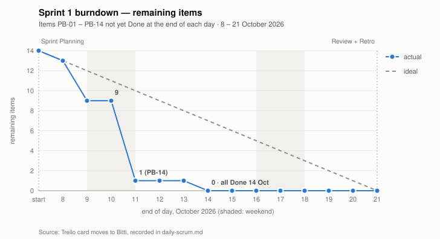

# Sprint 1 — Progress Report

| | |
|---|---|
| Sprint | 1 (8 – 21 October 2026) |
| Team | team6 — CM6453 Software Engineering Process and DevOps |
| Prepared by | Zeynep Duru Küçük (Scrum Master) |
| Date | 15 October 2026 |

## Summary

Sprint 1 laid the platform's foundation, and the Sprint Goal was met. The team now has a Turkish web interface with four tabs, a master-agent prototype that decomposes Turkish requirements documents into dependency-ordered task graphs in under two minutes on a laptop GPU, and six LLM agents, one on each member's own computer, registered with the master over a private Tailscale network. All 13 planned items and PB-14 meet the Definition of Done: 155 h actual against 160 h estimated.

## Course requirements for this sprint

| Requirement (course document) | Items | Status | Evidence |
|---|---|---|---|
| Define system requirements | PB-04 | Done | [SRS.md](../../SRS.md) (v1.1) |
| Design overall architecture | PB-05 | Done | [architecture.md](../../architecture.md) |
| Implement web interface | PB-02, PB-03, PB-06 | Done | `master/static/`, acceptance tests AT-03 – AT-17 |
| Implement master-agent prototype | PB-07 | Done | `master/app.py`, `master/db.py`, `master/projects_api.py`, AT-01 – AT-09 |
| Register available agents/models | PB-08, PB-13, PB-14 | Done | `agent/`, `master/agents_api.py`, `agent-node/`, AT-10 – AT-12; six agents on members' computers |
| Implement basic task decomposition | PB-09 | Done | `master/extract.py`, `master/decompose.py`, [test report](test-report.md) §2 |
| Scrum: planning, backlog, task assignment, review, retrospective | PB-10, PB-12 | Done | This folder; [Trello board](https://trello.com/b/VvJnXmp6) |
| GitHub repository with code and documentation | PB-11 | Done | Protected `main`, 3 required CI checks |

## Scrum events of the sprint

| Event | Date | Record |
|---|---|---|
| Sprint Planning | 8 Oct | [sprint-planning.md](sprint-planning.md) |
| Daily Scrum | every working day, 8 – 21 Oct | [daily-scrum.md](daily-scrum.md) |
| Product Backlog refinement (Sprint 2) | 16 Oct | [daily-scrum.md](daily-scrum.md#friday-16-october--refinement-session) |
| Sprint Review | 21 Oct | [sprint-review.md](sprint-review.md) |
| Sprint Retrospective | 21 Oct | [sprint-retrospective.md](sprint-retrospective.md) |

Sprint Backlog: [sprint-backlog.md](sprint-backlog.md) · Burndown: [burndown.svg](burndown.svg) · Tests: [test-report.md](test-report.md)

## Task assignments and time tracking

| Member | Role | Items | Est. (h) | Actual (h) | Pull requests |
|---|---|---|---|---|---|
| İshak Bostan | Master agent's LLM | PB-09 | 18 | 20 | PR #2, #7 |
| Furkan Kaan Özbeyli | Sub-agent interface | PB-05, PB-08, PB-13 | 32 | 28 | PR #2 |
| Zeynep Duru Küçük | Scrum Master; Trello, backend | PB-07, PB-10, PB-12 | 38 | 37 | PR #2 |
| Berfin Yiğit | Web interface, dashboard | PB-02, PB-03, PB-06 | 34 | 33 | PR #2 |
| Semih Sarıca | LLM model selection | PB-01; tests for PB-07, PB-09 | 20 | 18 | PR #2 |
| Işıl Karademir | GitHub processes | PB-04, PB-10 (process documents), PB-11 | 18 | 19 | PR #1, #3, #4 |
| **Total** | | **13 items** | **160** | **155** | |

In addition, every member installed and registered their own agent (PB-14, 3 h per person), and the Scrum Master prepared and facilitated the Sprint Review and Retrospective (4 h).

### What each member contributed

- **İshak Bostan — master's LLM engine (PB-09).** Integrated Qwen3.5 4B into the master. When a Turkish requirements document is uploaded, the platform analyses it on its own and extracts entities, API endpoints, pages, open questions and a task graph. Tested with three Turkish sample documents (44–117 s); the two findings became issues #5 and #6.
- **Furkan Kaan Özbeyli — agent infrastructure (PB-05, PB-08, PB-13).** Wrote the architecture document ([architecture.md](../../architecture.md)); built the agent service, which reads its model's information from Ollama and registers with the master; wrote the setup scripts (`setup.ps1`, `setup.sh`) that install Ollama, the model, Tailscale and Python with one command.
- **Zeynep Duru Küçük — Scrum Master and backend (PB-07, PB-10, PB-12).** Wrote the master backend: FastAPI REST API, SQLite database and the background analysis pipeline. Created the Scrum documents (Product Backlog, Definition of Done, sprint templates and records), set up the Trello board and ran it during the sprint, and facilitated the Scrum events.
- **Berfin Yiğit — web interface (PB-02, PB-03, PB-06).** Designed and built the four-tab Turkish interface (*Yeni Proje*, *Projeler*, *Ajanlar*, *Asistan*), made it work on phones and tablets, and added table and SVG diagram rendering for the Assistant's answers. Drafted the Sprint 2 Agents tab design.
- **Semih Sarıca — model selection and tests (PB-01, tests).** Built the chat assistant: code questions go to Qwen2.5-Coder and general questions to Qwen3.5 automatically, insulting messages are blocked, and PDF/DOCX files can be uploaded. Wrote the master and agent tests (75 + 13 unit tests, all green in CI) and the spot checks of the six models.
- **Işıl Karademir — GitHub processes and SRS (PB-04, PB-10, PB-11).** Wrote the Software Requirements Specification, with every item of the course document traced to a requirement. Set up GitHub: protected `main`, three required CI checks, five collaborators. Kept the process documents up to date.

## Metrics

| Metric | Value |
|---|---|
| Items planned / done | 13 / 13, plus PB-14 |
| Effort, PB-01 – PB-13 | 160 h estimated, 155 h actual (−3 %) |
| Acceptance tests | 20 / 20 pass |
| Unit tests (master / agent) | 75 / 13, all passing in CI; lint clean |
| Analysis time, three sample documents | 44–117 s per document (RTX 4060 Laptop GPU, Qwen3.5 4B) |
| Decomposition output | 7–13 entities, 11–25 endpoints, 9–10 pages, 15–19 tasks |
| Agents registered | 6, each on its member's own computer; 6 models from 4 vendors |
| Pull requests merged | 6 (#1, #2, #3, #4, #7, and #8 for the revised calendar and time tracking) |

Burndown (remaining items per day):

## Security decisions

- An agent connects to the master; the master never connects to an agent. No member opens a port on their home computer.
- Ollama listens only on localhost, so nobody can reach a member's model from outside.
- `AGENT_TOKEN` and the Tailscale key were shared only privately and have never been in the repository.
- The Assistant's Run button is off by default; when on, code runs as `nobody` without the master's secrets.

## Problems and how they were handled

| Problem | How it was handled |
|---|---|
| The instructor revised the calendar after most of the Sprint 1 implementation was done | Re-planned Sprint 1 on 8 October against the new dates; recorded estimates and target dates; used week 2 for PB-14, Sprint 2 refinement and the Review rehearsal |
| Work was concentrated on one member (instructor's feedback, 1 October) | Every member got a role and owns Sprint 1 items; every member has an item in every sprint; every member presented at the Review. Retrospective action 2: every member opens the pull requests for their own items |
| PRs #2, #3 and #4 were merged without a teammate's review | Retrospective action 1: required approval in the branch protection, no bypass |
| PB-14 had been postponed | Brought back at Sprint Planning; all six agents registered from their members' computers by 14 October |
| A member's 9.6 GB model download stopped halfway | The staging agent kept running until the download finished the next day |
| The decomposition sometimes asks about things the document answers and misses a data item | Prompt improved (fixed the spelling issue); the rest tracked as #5 / PB-60 and #6 / PB-61 |
| Small models make factual mistakes in otherwise good answers | Documented in the test report; checking content is part of Sprint 4 (PB-42, PB-43) |

## Plan for Sprint 2 (22 October – 4 November)

> In Sprint 2 we score every agent 0–100 for coding, reasoning and context capacity. When a task arrives, the master picks the available agent with the highest score for that task type, based on measurement, not at random.

| ID | Item | Responsible | Est. (h) |
|---|---|---|---|
| PB-20 | Agent heartbeat and status monitoring | Furkan Kaan Özbeyli | 12 |
| PB-21 | Capability benchmark sets | Semih Sarıca | 14 |
| PB-22 | Capability evaluation runner | Zeynep Duru Küçük | 20 |
| PB-23 | Task classification weights | Işıl Karademir | 10 |
| PB-24 | Agent selection algorithm with recorded reasons | İshak Bostan | 16 |
| PB-25 | Task distribution queue and pull endpoint | Furkan Kaan Özbeyli | 18 |
| PB-26 | Agents tab: status badges and capability bars | Berfin Yiğit | 14 |

Total: 104 h (first estimates from the 16 October refinement; final at Sprint 2 Planning on 22 October). Sprint 2 Planning also decides on PB-60 and PB-61 and starts the three Retrospective actions.