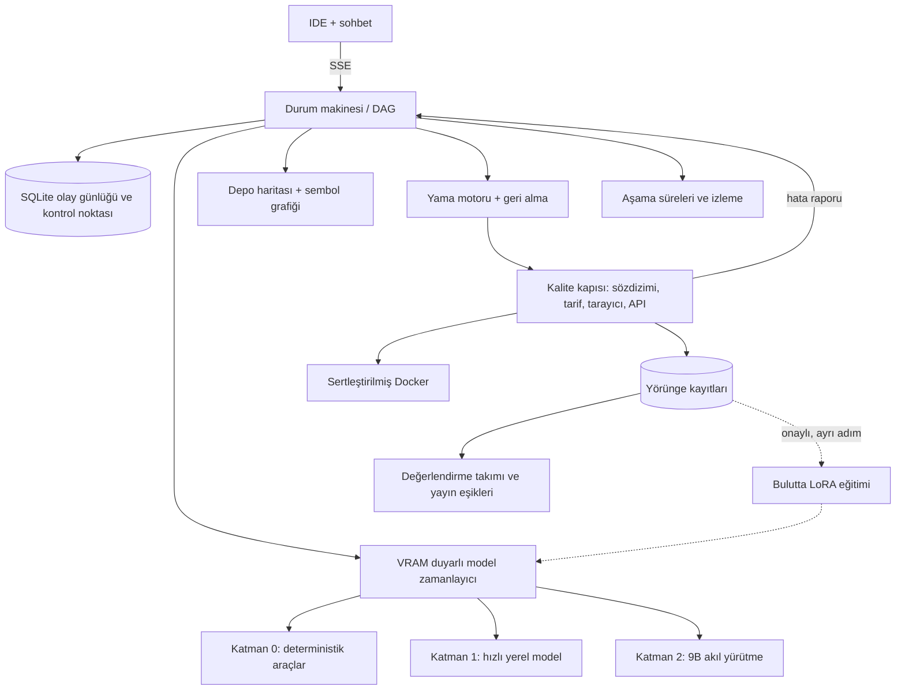

# v2.0 Faz 1: mimari RFC ve darboğaz analizi

Bu belge v2.0 şartnamesinin yalnızca Faz 1'idir. Faz 2-8 yazılmamıştır.

## 0. Şartnamenin varsayımına itiraz

Şartname v1.0'ın eksiksiz çalıştığını varsayıyor. Bu doğru değil: bkz. [ai-platform-spec-status.md](ai-platform-spec-status.md).
v2.0 katmanları bu temelin üstüne kurulacağı için önce v1.0 açıkları kapanmalı ve ölçülmelidir.

| Gerilim | Neden | Çözüm |
|---|---|---|
| 8 GB tek GPU ile paralel DAG | İki 7-9B model aynı anda VRAM'e sığmaz; paralel çağrılar sıraya girer | Paralellik yalnız aynı modelde; görevleri modele göre grupla |
| 14B-70B "ağır katman" | 14B bu kartta belirgin yavaş, 70B çalışmaz | Ağır katman = `qwen3.5:9b`; 14B yalnız elle seçilir |
| Yerel QLoRA / DPO / GRPO | 9B eğitimi 8 GB'da sınırda; GRPO pratik değil. Doğrulanmış veri de henüz yok | Önce yörünge toplama ve veri kümesi; eğitim bulutta, ayrı ve onaylı adım |
| GraphRAG + LSP + Tree-sitter | Üretilen projeler çoğunlukla 1-10 dosya | Faz 3'ü büyük proje ihtiyacı doğunca yap |
| "%50-75 hızlanma" | Aşama bazında ölçüm yok, hedefin tabanı belirsiz | Önce ölçüm, sonra hedef |
| gVisor / Firecracker | Windows ev sahibinde yok | Mevcut sertleştirilmiş Docker (ağsız, yetkisiz, kotalı) |

## 1. Ölçülen süreler (2026-11-26, bu makine)

| İş | Süre |
|---|---|
| Tek sayfa web, 7B yazar | 190-300 sn |
| Tek sayfa web, 9B yazar (ayrıntılı tarif) | 175-490 sn |
| Sohbetten revizyon (dosya baştan yazılırken) | 24-285 sn |
| Tam birim test takımı | ~4 dk |

Bunlar duvar saati toplamlarıdır. Model yükleme, üretim, tarayıcı testi ve onarım turlarının payı **ayrı ölçülmedi**;
Faz 2'nin ilk işi bu ölçümdür.

Kod okumasından görülen olası maliyetler: araştırma, plan, yazım, kapsam denetimi, senaryo testi ve onarım ayrı model
çağrılarıdır; yazar (7B/9B) ile denetçi (9B) arasında model değişimi VRAM'den boşaltma yaratır.

## 2. Büyük ölçekte beklenen hata türleri

1. Bağlam taşması: revizyon istemi dosya içeriğini 24.000 karakterde keser.
2. Dosyalar arası uyumsuzluk: bir dosyadaki ad değişikliğinin etkisi izlenmiyor.
3. Kesilen onarım: büyük dosya yeniden yazımı token sınırına takılır (yama ve kesik-dosya koruması azaltır).
4. Çökmede kayıp: üretim hattı kontrol noktasından devam etmiyor.
5. Güvenilmeyen içerik: yüklenen belge metni ile talimat arasında yapısal ayrım her yolda yok.

## 3. Hedef mimari

## 4. Yığın kararı

FastAPI, SQLite (WAL), Ollama, düz JavaScript ve Docker korunur: çalışan testler ve özellikler hazır, ek servis
(Postgres, Temporal, ayrı vektör veritabanı) 8 GB'lık tek makinede bakım yükünü artırır. OpenTelemetry yerine önce
SQLite'a aşama süresi kaydı; dışa aktarım gerekirse sonra.

## 5. Faz 2 kontrol listesi

- [ ] Aşama süresi kaydı (model yükleme, token, test, onarım) ve özet uç noktası
- [ ] Sabit-önek istem düzeni ve görev boyuna göre `num_ctx`
- [ ] Modele göre görev gruplayan zamanlayıcı, `keep_alive` yönetimi
- [ ] Katman 0 deterministik işlemler (renk/etiket değişikliği model çağırmadan)
- [ ] Karmaşıklık puanıyla model basamaklama ve kapıdan geçemeyince yükseltme
- [ ] Üretim hattında kontrol noktası ve kaldığı yerden devam
- [ ] Ölçüm: aynı senaryolarda önce/sonra süre ve ilk seferde geçme oranı
